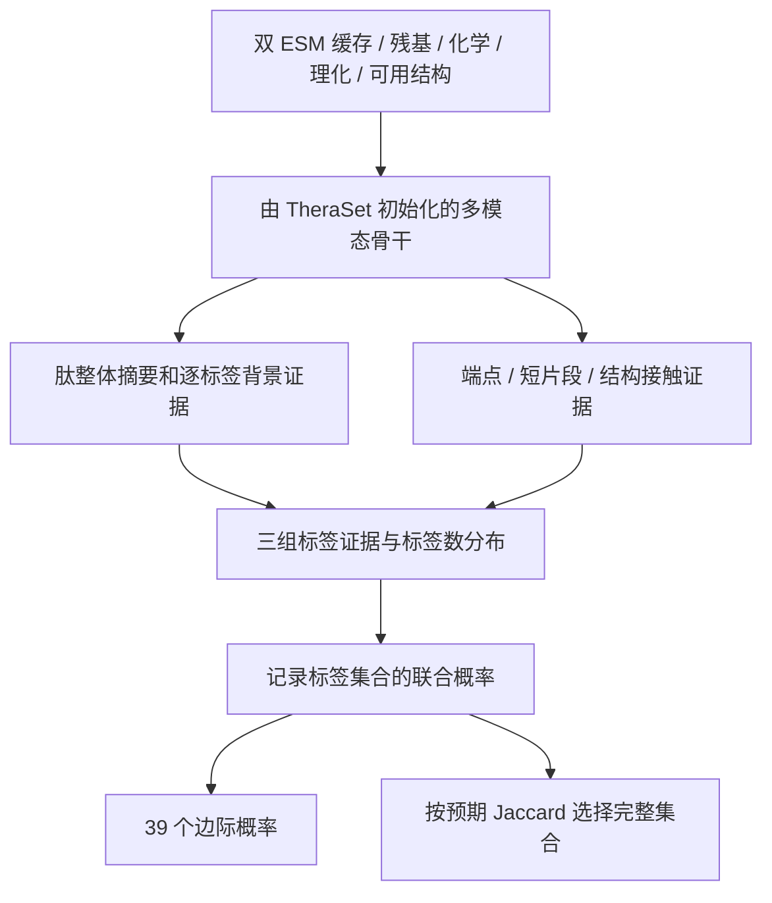

# HH-SetReread V1.6 架构设计书

**任务是原始 Fine39 的整体 Sample Jaccard，目标为 70%。** V1.6 复用多模态 TheraSet 的特征编码能力，在训练中联合更新证据编码与标签集合分布。它为每条肽直接生成整套新预测。首轮仅使用项目现有的原始训练样本、长度 80 的双 ESM 缓存、化学与结构字段。V1.5 的设计及实验入口可在 Git 提交 `4681fdc` 中查阅。

## 1. V1.0 至 V1.5 的实验结论

以下 ACC 都指 Sample Jaccard。底座固定为 Fine39 `no_label_context_single_prototype/micro_f1`、seed 42、阈值 0.50 的 TheraSet，原始 Validation 为 **61.0463%**，Macro AP 为 **57.1128%**，Micro F1 为 **65.5723%**。V1.0 的设计与其前驱 SetReread 分别列出。后续各版本的 seed、选择协议和修改范围不同，表内数值用于解释对应实验。

| 版本 | 正式结果及对照 | 吸取的教训 |
|---|---|---|
| V1.0 | HH-SetReread V1.0 是设计稿，无独立正式训练。前驱 SetReread 的五 seed、300 epoch 上限批次，V100 为 **48.333 ± 0.554%**，RTX 5070 为 **47.479 ± 0.465%**，两机早停设置不同。 | 多路径读出和编辑复杂度无法弥补初始标签身份识别不足。前驱结果不能算作 V1.0 成绩。 |
| V1.1 | E0 继续训练得 **61.288%**，E0-L 关系关闭 **61.545%**，E1 共享关系 **61.524%**，E2 双线性 **61.507%**。同一 E2 权重开启关系只贡献 **+0.0052 pp**。 | 要用同一权重的开关比较关系本身。强底座续训产生的变化不能归给标签关系，关系层也无法给大部分漏报创造新的肽证据。 |
| V1.2 | 条件、无条件、原始无条件三组最终选回 **61.046% 的 epoch 0**。条件读出训练后最佳 **56.511%**，原始无条件训练后最佳 **60.922%**，仿射对照 **61.064%**。 | 数值压缩会伤害已学排序。即使用保留原始分数的对照，冻结证据读出也几乎停在原点。 |
| V1.3 | 条件单补 **61.704%**，纯分数单补 **61.734%**。条件组约 **96.9%** 的收益来自空集。单独给空集补 Top-1 已有 **61.751%**。这轮留下 39,455 条真实 Train 折外底座分数。 | 空集要单列。单补会保留原有错类，尤其会把一次可能的完整纠正变成部分命中。折外分数是训练资产。 |
| V1.4 | seed 157 最好 **61.047%**，seed 483 的三组为 **61.058–61.060%**。seed 483 的残基读出严格恢复 **26 条**第二功能，整体增幅约 **+0.012 pp**。 | 多功能专项可以改善，整体损失仍可能被其他样本的退化抵消。需要同时学习主标签身份和全套标签。 |
| V1.5 独立排序器 | 双 ESM 弱监督 **45.320%**，折外难例 **41.008%**。难例组更容易拟合训练竞争对，验证退化。弱监督组 39 个标签的 AP 全部低于 TheraSet。 | 另起小型序列模型时丢掉了强底座的多模态证据。固定地压低高分未记录标签也会伤害排序。 |
| V1.5 全集合选择 | 仅前缀 **61.855%**，开放替换 **61.834%**。86.511% 的候选 Oracle 下，只完整纠正 **9 条**单标签错类并改坏 **84 条**原本完全正确的预测。 | 真值能选择的上限反映候选覆盖，预测时能否选择要独立验证。冻结分数留下的身份误差依旧。 |
| V1.5 近邻与成对替换 | 在成对实验共用的同源簇分折上，近邻组 **62.138%**，成对组 **61.987%**。固定 50 条误改预算，完整纠正 **7→41 条**，整体 **62.128→61.806%**。 | 更愿意替换可以提高专项纠正数，也会挤掉有效增删并加重错换损失。首要任务是改善原始证据和校准，而非再叠一个动作评分器。 |

除原始 TheraSet 外，必须比较补空集的 **61.751%**、V1.5 近邻整体对照，以及三份历史 TheraSet 概率平均约 **62.92%** 的开发对照。最后一项在同源簇分组的 Validation 上选择阈值，三个权重之前也已按 Validation 选过 epoch。它适合衡量新模型的增量，不能当作独立 Test 结果。

## 2. TheraSet 识别正确和漏判的样本

数据版本 `2026-10-14`。按 `row_id`、`ID`、Fine39 标签顺序及目标数组对齐保存的 TheraSet 连续预测。Train 有 **39,455 条、25,244 簇**，Validation 有 **8,529 条、5,010 簇**，两者无同源簇重叠。下文的正确、漏报和全错均按项目已记录 Fine39 标签计算。0 表示未标注，额外预测需要测定才可认作生物学阴性。`__unknown` 表示具体亚类未知。

### 2.1 四个互斥样本组

| 组别 | 样本数 | 组内 Jaccard | 平均记录标签数 | 平均预测标签数 | 最高分中位数 | 已记录标签均无 16 邻居支持 |
|---|---:|---:|---:|---:|---:|---:|
| 完全匹配 | 4,184 | 100.00% | 1.38 | 1.38 | 0.99997 | 2.37% |
| 部分命中 | 2,079 | 49.19% | 2.10 | 2.42 | 0.99884 | 2.50% |
| 非空全错 | 1,988 | 0.00% | 1.33 | 1.53 | 0.99481 | 19.22% |
| 空预测 | 278 | 0.00% | 1.27 | 0.00 | 0.31276 | 17.63% |

- **完全匹配组承担了整体成绩的大部分。** 4,184 条占 Validation 的 49.06%。模型要在保持这批样本的同时改变难例表示。在新模型失去 100 个样本 Jaccard 单位时，需要在其他地方补回约 1.17 个百分点。
- **部分命中组同时有 1,296 位漏报和 1,959 位额外预测。** 平均真值数 2.10、预测数 2.42，增加预测数量会同时累积已存在的问题。1,177 条有三个及以上记录标签的肽里，638 条部分命中，整体完全匹配率只有 **30.76%**。
- **非空全错组包含大量高分错类。** 其中 **1,583 条**最高分至少 0.90，**1,126 条**至少 0.99，**1,202 条**的前五名有至少一个正确记录。剩余 **786 条**的前五名全错。仅用底座置信度、预设近邻阈值和前五名内部编辑会受到这些样本限制。
- **空预测只有 278 条。** 即使全改对也最多贡献约 **3.26 pp**。已有 Top-1 补空集贡献 **0.704 pp**，它应作为便宜对照持续报告。

### 2.2 标签身份、长度和信息来源

| 观察 | 实测差异 | 对设计的影响 |
|---|---|---|
| 单标签身份错类 | 846 条原预测与记录均为单标签且完全错类，共 208 种有方向的混淆。功能投影下 88 条同轴、758 条跨轴，其中包含泛抗微生物与细类别的标注差异。635 条最高分至少 0.90。 | 不预设少数标签对的专用层。模型需共享并比较所有 39 类的肽证据。 |
| 数量与身份 | 底座预测数量与记录数量相同的行占 62.19%。给底座真实标签数、再用原排序取相应长度，只有 **66.170%**。 | 数量应与标签身份一起学习，新 head 要能改变排序。 |
| 短肽 | ≤8 残基 1,349 条，ACC **55.62%**。9–16 残基 3,734 条，ACC **62.31%**，但仍有 **911 条**非空全错。 | 增加端点和短片段刻画。不能把所有改进集中在最短组。 |
| 近邻相似度 | peptide150M 最近原 Train 代表余弦 <0.90 的 573 条，ACC **47.79%**。≥0.97 的 2,094 条，ACC **68.64%**，其中仍有 **370 条**非空全错。 | 序列相似能提供参考。需要用局部化学及接触证据区分相似序列的不同记录标签。 |
| 结构与组成 | 有结构 7,489 条，ACC **61.52%**；无结构 1,040 条，**57.62%**。非空全错与完全正确两组的结构覆盖率仍接近，分别为 **87.27%** 和 **88.60%**。 | 缺失结构需要掩码。单独添加几何不能解释现有大量错类。 |
| 化学与立体标注 | 有非空非甘氨酸 D 标注 174 条，ACC **55.61%**。基于记录字段定义的修饰或连接组 779 条，ACC **66.90%**，完全匹配率只有 **43.90%**。同一 canonical 序列在 Val 有 40 个重复组，其中 **28 组**的 Fine39 记录不同，且各组至少有两个不同原始字符串。 | 保留 HELM、立体和端点信息。分组差异包含标签数量及来源构成，不能作为化学修饰的因果效应。 |
| 常见标签与长尾 | 17 个标签各有 ≥300 个训练阳性簇，却占 **3,871 / 4,287** 个漏报位。`antifungal__unknown` 漏报 544 个，召回 **49.54%**；`cell_communication__unknown` 召回 **34.72%**。`anti_gram_`、`anti_gram+` 额外预测分别为 **1,092**、**943**。 | 长尾应单报。整体性能也依赖高频类别身份和相邻类别判断，单纯提高稀有类权重无法提供所需量级。 |

典型的高分错类包括记录 ID `140663`（9 残基，记录为 `antibacterial__unknown`，底座仅报 `antimicrobial__unknown`，记录标签第 5）、`111330`（9 残基，方向相反，记录标签第 3），以及 `153588`（11 残基，记录为 `antimicrobial__unknown`，底座仅报 `anti_gram_`，记录标签第 7）。三个样本都有结构记录。它们展示的是数据库标注粒度与模型输出的冲突，需与真实活性差异分开。

### 2.3 70% 需要的净收益

从 61.0463% 到 70% 需要增加约 **763.66 个样本 Jaccard 单位**。按底座原来的四组计数，一种达到目标的量级是让原先完全匹配组的平均 Jaccard 保持在 0.98，将部分命中组从 0.4919 提到 0.59，将非空全错组从 0 提到 0.31，将空集从 0 提到 0.20。加权总成绩为 **70.334%**。这些数字仅用来说明每类误差的大致贡献需求。正式成绩由新模型在独立预测上的表现决定。

## 3. V1.6 模型总览

**结构为多模态肽证据编码器、三个输入条件分量，以及一个生成完整标签集合的概率头。**

### 3.1 保留强编码器，新增标签条件的片段辨别

1. **已有模态。** 使用原 TheraSet 的双 ESM 残基视图、AA34 与立体编码、HELM 化学及端点、理化向量、原结构接触与掩码。冻结 ESM 缓存，复用多模态 stem 权重。复用现有残基接口，扩展接口导出肽摘要和阈值前逐标签证据状态 `[B,C,256]`。训练时更新过往骨干的证据层和新头。底座的二分类阈值预测不进入模型前向。
2. **片段与接触 token。** 对 `[B,L,256]` 残基表示，生成有效连续片段的池化 token。首轮使用宽度 3 和 7，结合 N/C 两端的短窗及真实长度归一化位置。短于对应窗口时使用整条肽一次，重复片段去重。可用结构通过已有稀疏接触边取非相邻残基对 $i<j$，编码两端向量、序列间距、距离和可用质量掩码。接触每条肽最多 32 个，按距离优先取边，是计算预算。所有 token 投影到 128 维。
3. **每个类别显式读证据。** 每个分量 $r$ 和标签 $c$ 的查询分别在局部片段、结构接触上做带掩码注意力。融合短片段向量、接触向量、原来的逐标签背景证据和肽整体摘要，再生成该分量的标签分数 $z_{r,c}$. 空结构路径返回零向量与缺失位。片段分支的 39 维辅助输出用已有弱监督损失共同训练，要求片段能够区别记录标签。
4. **证据辨别实验。** 首轮固定局部宽度和边预算，比较同一概率头有无片段分支。按 ≤8、9–16、17–32、≥33、无结构、带 D 标注和 canonical 冲突分组。对高置信跨轴错例，另作长短等预算的端点、内部窗口和遮蔽诊断。只有真实标签排序、完整集合或给定亚组改善时，才把效果归给新增片段。

宽度 3 和 7 是两种不同的感受野起点。3 残基窗口保留短局部差异，7 残基窗口在短肽上可覆盖大部分骨架，在 9–16 残基肽上仍保留多个不同位置。选择依据是本地长度分布和计算成本。若完整分支改善结果，再在相同参数及窗口预算下比较宽度选择。

实现中，查询参数为 `[R,C,128]`。片段与接触各自输出 `[B,R,C,128]`，分别用共享线性层与投影后的原逐标签状态、肽整体摘要相加后做 LayerNorm。每个标签的投影向量和分量偏置给出标量 $z_{r,c}$。数量 logits `[B,R,C]` 和混合 logits `[B,R]` 由肽整体摘要读出。这样不同标签在同一次编码里读取不同部位，能对全肽近邻混淆作细粒度比较。片段注意力记录的是模型证据，H6 的保留与遮蔽诊断用于检查它。

### 3.2 生成记录标签集合的概率模型

设 $Y$ 为记录集合，$C=39$，$M=|Y|$。混合系数 $\alpha_r(X)$ 由肽摘要的 softmax 得到。每个分量另输出条件数量分布 $\pi_{r,m}(X)$，以及 $C$ 个标签权重 $w_{r,c}=\exp z_{r,c}$。首轮 $R=3$，数量分布覆盖 $m=1,\ldots,C$。当前训练任务的记录集合非空，这与观测数据契约一致。

对一个候选真实集合 $Y$，记 $e_m(w)$ 为所有 $m$ 元子集权重乘积之和，则

$$
P_\theta(Y\mid X)=
\sum_{r=1}^{R}
\alpha_r \pi_{r,|Y|}
\frac{\prod_{c\in Y} w_{r,c}}{e_{|Y|}(w_r)}.
$$

每个分量给定 $m$ 时，对大小恰为 $m$ 的集合归一化。对所有标签子集求和后，条件层得 1，数量层和分量层也各自归一化，因此 $P_\theta$ 是合法分布。给定分量时共享标签权重，通过不同分量的标签顺序和数量分布共同表达不同的共现模式。相比分别预测每个标签，再在末尾估计个数，这里的标签身份与数量来自同一分布。

$e_m$ 使用对数域动态规划。$D_{0,0}=0$，其余不可达状态为 $-\infty$。第 $j$ 个标签递推为

$$
D_{j,m}=\operatorname{logaddexp}
\left(D_{j-1,m}, z_j+D_{j-1,m-1}\right).
$$

记录标签的排名分数用真实边际 $q_c=P_\theta(c\in Y\mid X)$，可由排除 $c$ 的归一化获得：

$$
q_c=\sum_{r,m\ge1}\alpha_r\pi_{r,m}
\frac{w_{r,c}\,e_{m-1}(w_{r,\neg c})}{e_m(w_r)}.
$$

因此 $\sum_c q_c=\mathbb E_\theta |Y|$。应同时验证推理边际、标签数分布、集合似然的稳定性。$R=1$ 是重要的容量对照。多个分量的利用率与每分量的数量分布均需记录，避免把退化到单分量的训练称为联合证据改善。

### 3.3 按期望 Jaccard 生成完整集合

给定待输出的集合 $S$，$s=|S|$。设 $t=|S\cap Y|$，$u=|Y\setminus S|$，则 $|S\cup Y|=s+u$。在某一分量内，若记录数为 $t+u$，交集与集合外的组合权重可分解为 $e_t(w_{r,S}) e_u(w_{r,\bar S})$。将其代入得到

$$
\mathcal U_\theta(S\mid X)=
\sum_r\sum_{t=1}^{s}\sum_{u=0}^{C-s}
\frac{t}{s+u}\,
\alpha_r\pi_{r,t+u}\,
\frac{e_t(w_{r,S})\,e_u(w_{r,\bar S})}{e_{t+u}(w_r)}.
$$

因此候选使用连续、共用尺度的 Jaccard 效用。分子和分母来自同一个记录集合模型。比如三类中若 $\{A\}$、$\{B,C\}$、$\{A,B\}$ 的概率为 0.40、0.35、0.25，最可能的真实集合是 $\{A\}$，其预测效用为 0.525。输出 $\{A,B\}$ 的期望 Jaccard 约 0.567。这是直接优化目标指标的具体差异。

- **搜索范围。** 对全 39 类分别按三个分量的 logits 和混合边际排名。对每个顺序生成大小 $1,\ldots,14$ 的完整前缀并去重，最多 56 个候选。14 是当前原 Train 正常样本的最大记录数。Val 最大为 10，初始预算内覆盖其所有实际数量。输出长度上限与概率分布的数量范围分别记录，分析训练分布外任务时可评估全范围。候选可以与 TheraSet 的原预测完全不重叠。
- **解码计算。** 为每个排序及分量建立前缀与后缀 DP，每个候选直接读取对应两侧的 $e_t,e_u$。按预测效用选出首项，平分时先较短再按项目固定标签顺序。此实现精确计算所枚举集合的效用，有限候选搜索没有全 $2^{39}$ 集合的全局最优保证。
- **独立对照。** 同一权重同时评估逐标签阈值、边际排名与预测数量的组合、上述效用解码。联合模型学习改善了哪些排序，可由同权重下的 $q_c$ 分层 AP 和标签覆盖验证。解码改善则由同权重的集合结果配对验证。训练阶段无需对每批每条肽执行候选搜索。

数值检查已经在 6 标签、3 分量、25 组随机参数上穷举完成。联合概率归一化、边际之和与期望数量、每个非空候选的效用都一致，效用最大误差为 $6.66\times10^{-16}$。这个检查验证公式，正式实现仍需检查 FP32/AMP 的数值与梯度。

## 4. 训练目标与训练方法

实现入口为 `train --model hh_setreread_v16 --task fine39`。通过 `--hh-v16-mode single|mixture|full` 选择单分量、三分量和完整片段版，将原 TheraSet 权重传给 `--initialize-from`，使用 `--hh-oof-files` 指定原三份折外分数。训练入口从原 Train 频数初始化标签偏置，并用加 0.5 平滑的训练标签数频率初始化数量头。后续均可学习。验证选择使用联合解码的集合，保存的边际分数用于 AP、0.50 阈值对照和数量对照。

### 4.1 数据与目标

- 使用原始 Fine39 Train 行与标签顺序，不加入增强样本。长度继续取 80。Val 选最佳 epoch 与解码配置，Test 在方案确定后用于最终评价。Major15 与 Rich48 用各自原任务输出维度和划分，首轮结论只来自 Fine39。
- $Y$ 是数据库记录集合。联合负对数似然 $-\log P_\theta(Y\mid X)$ 是针对可观测的项目评测目标。缺失标签不能被解释成生物阴性。新模型不拟合未经审计的观测概率、不使用结构来源 ID 作为预测特征。将来有可靠的确证结果时，可以另报生物学表现。
- 复用 V1.3 的三折底座分数。设 $b_i$ 为基线在该肽的折外集合，$r_i=J(b_i,Y_i)$。高损失样本的主要标签集合监督权重从 $1$ 增至最多 $1.5$，取 $a_i=1+0.5(1-r_i)$ 并在批次归一化。在 $r_i=1$ 的样本上，可用折外教师的软分数保留已学线索。在故障样本上由实际记录集合推动改判，避免 V1.5 将每个高分未记录标签都当作竞争性的负例。

### 4.2 首轮损失

$$
L =
\frac{\sum_i a_i[-\log P_\theta(Y_i\mid X_i)]}{\sum_i a_i}
+0.20 L_{\mathrm{weak}}
+0.10 L_{\mathrm{frag}}
+0.05 L_{\mathrm{retain}}.
$$

$L_{\mathrm{weak}}$ 用整体证据的直接 39 类输出复用当前弱 ASL。$L_{\mathrm{frag}}$ 对片段分支的 39 类辅助输出用同一规则。当前未记录位权重 0.3，保留已知的泛标签歧义降权。$L_{\mathrm{retain}}$ 在 $r_i=1$ 的原 Train 行用温度 2 的 Bernoulli KL 约束整体直接输出，教师是折外 TheraSet。辅助项用有效位归一化，折外教师无可用子集时取零。

首轮权重是实验起点。记录各项损失和相对梯度量级。前 3 个 epoch 训练新头并保持骨干权重，之后骨干和新头联合学习。新头学习率 `2e-4`，骨干 `1e-5`。用无辅助项的同架构比较，查明优势来自概率模型、肽证据还是权重分配。V1.6 首轮使用可精确计算的记录集合似然训练，在推理时按其分布最大化预期 Jaccard。集合损失与解码各自的效果通过同权重比较测定。

### 4.3 计算预算

- 继续使用冻结的特征缓存。每条肽的基本特征编码只运行一次，三个分量共享骨干。近邻库、V1.5 的 HGB 选择器以及三份历史教师无需在推理时运行。
- 训练 NLL 的 DP 可运行到当批真实标签数最大值，$\pi$ 仍在全数量范围归一化。两个弱监督头使用直接 logits，避免每一步计算完整边际和 56 个候选的效用。验证选择、预测导出分别记录读数据、头部训练和联合解码耗时。
- 首轮以 FP32 在 V100 试 batch 16/32/64，先实测显存与吞吐。DP 和集合效用使用 FP32。不同设备采用相同有效 batch 与协议。首轮上限 40 个 epoch，按 Validation Jaccard 选择权重，patience 8。所有具体训练时间以实机记录为准。

## 5. 归因和验收

| 对照 | 改变的内容 | 要回答的问题 |
|---|---|---|
| T0 原 TheraSet、继续训练 TheraSet、三模型集合 | 继续训练使用同样初始化和预算。三模型集合沿用已有结果。 | 是否超越当前单模型及带互补性、成本可知的历史对照。 |
| V1.6 单分量 | 相同 TheraSet 证据，$R=1$，学习条件标签集合，用同一解码。 | 单靠学习数量与评测对齐能产生多大变化。 |
| V1.6 三分量 | 同一证据与偏置权重，$R=3$。 | 多种候选联合分布是否缓解类别不确定和多功能部分命中。 |
| V1.6 完整模型 | 三分量加入局部片段和接触辨别。 | 新证据能否提高高置信错类的实际识别、标签 AP 和总体。 |

先用 seed 157 比较三组 V1.6 与历史对照。重复 seed 483、1093 来检验入选架构的结果区间。每项与原 TheraSet 的逐样本对比使用相同标签和样本。对 Validation 的 5,010 个簇按簇配对做重采样，报告随机种子间波动。全部性能判断都应写明选择的 epoch、评测阈值或集合解码协议。

验收报告集中于实际影响：

1. 整体 Sample Jaccard、Macro AP、Micro F1、完全匹配率、多功能检测 F1。记录预测标签数和数量混淆矩阵，独立功能数继续按项目功能轴计算。
2. 原四组的净 Jaccard、非空全错恢复数量、846 条单标签错类的完整纠正数、4,184 条原完全正确的受损样本数及损失幅度。每组集合的 Top-1、Top-5 覆盖和高置信错类单报。
3. 将 V1.6 前缀候选的覆盖、预期效用校准与真正选出的集合分开。提供 50 条误改预算诊断作为历史衔接，同时记录损失幅度。后者在 V1.5 已证明同预算下也可能相差很大。
4. 完整版本若主要改善了解码，但标签边际排名或原高置信错类仍不改善，则瓶颈仍是输入证据。若标签排序改善而集合效用无收益，则检查联合分布校准、数量学习和搜索覆盖。任何 70% 声称须经确定后的原 Test 评价。

## 6. 研究出处与本项目边界

- 数量条件集合延续 H3，H4 的排序与决策诊断用同一联合分布分别导出。H5 的标签竞争在全类别分量内发生，允许双记录。H7 的折外教师仅用于保留已有充分证据的样本，H8 提醒区分观测集合与真实功能。片段保留和遮蔽诊断沿用 H6 的思路。项目材料见《H1–H8 序列多标签模型架构设计书》。
- 条件 Bernoulli 混合与风险最小化属于已有方法。本设计将其具体化为“多模态肽证据、条件数量混合、解析的集合 Jaccard 效用”联动。Jaccard 的预测排序和约束必须由当前联合分布的性质推导，F1 的 GFM 结论不能移用到本混合模型。 [Li 等，Conditional Bernoulli Mixtures](https://proceedings.mlr.press/v48/lij16.html) · [Natarajan 等，Optimal Classification with Multivariate Losses](https://proceedings.mlr.press/v48/natarajan16.html) · [Waegeman 等，F-Measure Maximizers](https://www.jmlr.org/papers/v15/waegeman14a.html)
- AMCL 已研究多标签监督对比与难例挖掘。Protein-Vec 已展示通过学习的蛋白表示做功能相关检索。V1.6 的贡献主张限于上述模型结构、项目数据上的定量定位和相应消融，效果需由本项目原始划分验证。 [AMCL 原论文](https://doi.org/10.1186/s12915-025-02273-0) · [Protein-Vec 原论文](https://pmc.ncbi.nlm.nih.gov/articles/PMC10690258/)
- 本地证据来自 `SetReread_V100_RTX5070_5Seed_Results.md`、V1.1 验证及关系诊断归档、V1.2–V1.5 正式验证归档、TheraSet 历史三模型归档和 V1.5 选择器、近邻及成对替换的 `results.json` / `val_predictions.npz`。
