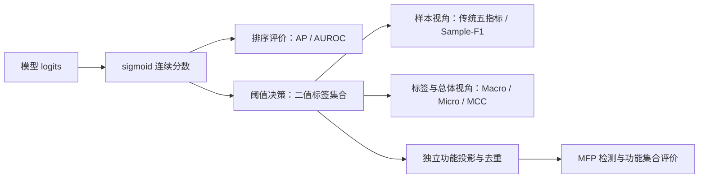

# MFP-Nova 指标说明书

适用范围：TriRelay、GeoFactor、ProtoRoute、HelixSet 的 major15 / fine39 多标签实验。2026-10-22 更新四模型与评价模式说明。本文以 `metrics.py`、`metric_protocol.py`、`research.py`、`multimodal.py` 的实际实现为准，说明定义、计算、范围、用途及指标之间的联系。公式中的“真值”均指**已有观测标注**，不代表完整的实验生物学真值。同名 PDF 尚未同步此次文字更新，当前以 Markdown 为准。

## 阅读导航

1. [任务语义与统一符号](#1-任务语义与统一符号)
2. [指标总览](#2-指标总览)
3. [传统五指标](#3-传统五指标)
4. [Sample、Macro、Micro 的区别](#4-samplemacromicro-的区别)
5. [F1、Sensitivity、Specificity 与 MCC](#5-f1sensitivityspecificity-与-mcc)
6. [AP 与 AUROC](#6-ap-与-auroc)
7. [Head / Medium / Tail 与分组评价](#7-head--medium--tail-与分组评价)
8. [MFP 专项评价](#8-mfp-专项评价)
9. [指标之间的数学联系](#9-指标之间的数学联系)
10. [Loss 与训练状态](#10-loss-与训练状态)
11. [阈值、选模与数据集职责](#11-阈值选模与数据集职责)
12. [手算示例](#12-手算示例)
13. [结合当前真实曲线解读](#13-结合当前真实曲线解读)
14. [不可计算、多 Seed 与字段查询](#14-不可计算多-seed-与字段查询)
15. [实现位置与参考资料](#15-实现位置与参考资料)

## 1. 任务语义与统一符号

### 1.1 多标签预测是什么

一条肽可以同时具有多种功能。模型对每个标签分别输出分数，不要求各标签概率之和为 1，不能按互斥多分类的方式解释。

设一次评价有 $N$ 条样本、$K$ 个标签：major15 的 $K=15$，fine39 的 $K=39$。

| 符号 | 含义 |
|---|---|
| $y_{ij}\in\{0,1\}$ | 第 $i$ 条样本、第 $j$ 个标签的观测标注 |
| $z_{ij}\in\mathbb R$ | 模型输出的 logit |
| $p_{ij}=\sigma(z_{ij})\in[0,1]$ | sigmoid 分数；数值上可为 0 或 1，但不保证已校准 |
| $\tau_j$ | 标签决策阈值；主协议使用全局统一阈值 $\tau$ |
| $\hat y_{ij}=\mathbf1[p_{ij}\ge\tau_j]$ | 二值预测；代码使用 **大于等于** |
| $Y_i=\{j:y_{ij}=1\}$ | 样本的观测功能标签集合 |
| $P_i=\{j:\hat y_{ij}=1\}$ | 样本的预测标签集合；这里的 $P_i$ 不是 Precision |
| $S_j=\sum_i y_{ij}$ | 当前评价集合中标签 $j$ 的正例 Support |

### 1.2 “0 是未标注”对指标有什么影响

项目中 1 表示已观察到的功能，0 表示未标注，不等于实验确认阴性。当前评价器对选定样本的完整二值标签矩阵计算指标：0 在混淆矩阵中作为参考负类，预测为 1 会产生相对标注的 FP。

因此，高 FP 可能同时包含真正的错误预测和数据库尚未收录的潜在功能；仅凭分类指标不能区分两者。Sensitivity、Specificity、AP、MCC 等都受这个标注语义约束，不能被直接解释为经过前瞻性实验验证的诊断性能。

必须区分三种 mask：

- **样本监督范围 / 划分 mask**：确定哪些行进入 Train、Validation、Test。
- **残基 / 模态 mask**：处理 padding、缺失结构、缺失描述符，不改变标签评价定义。
- **逐标签观测 mask**：如果将来有实验确认的阳性、阴性、未知三态信息，可用它建立另一套评价；**当前 `evaluate_metrics` 没有接收这种二维 mask，也没有把所有 0 从评价中排除**。

训练中的弱未标注权重属于 Loss 处理，并不意味着评价指标已经变成 PU 校正指标。

### 1.3 混淆矩阵是多数指标的共同底座

对一个标签跨所有样本计算：

| | 预测 1 | 预测 0 |
|---|---:|---:|
| 标注 1 | $TP$：检出已标注正例 | $FN$：漏掉已标注正例 |
| 标注 0 | $FP$：预测了未标注项 | $TN$：标注和预测均为 0 |

样本级计算时，把一条样本的 $K$ 个标签当成这组二值判断：

$$
TP_i=|Y_i\cap P_i|,\quad FP_i=|P_i\setminus Y_i|,\quad FN_i=|Y_i\setminus P_i|.
$$

标签级计算得到 $TP_j,FP_j,FN_j,TN_j$。两者是在同一矩阵上沿不同方向计数，不能混淆。

## 2. 指标总览

| 指标 | 范围 / 方向 | 是否依赖所选阈值 | 主要回答的问题 |
|---|---|---|---|
| Acc / 样本 Jaccard | $[0,1]$，高好 | 是 | 每条肽预测与标注的功能集合重叠多少？ |
| Prec / 样本 Precision | $[0,1]$，高好 | 是 | 每条肽预测出的功能有多少被标注支持？ |
| Cov / 样本 Recall | $[0,1]$，高好 | 是 | 每条肽已标注的功能找回了多少？ |
| AT / Exact Match | $[0,1]$，高好 | 是 | 有多少样本的整套标签完全正确？ |
| AF / Hamming Loss | $[0,1]$，低好 | 是 | 全部样本—标签位中错了多少？ |
| Sample / Macro / Micro-F1 | $[0,1]$，高好 | 是 | 在指定聚合层面如何平衡 Precision 与 Recall？ |
| Sensitivity | $[0,1]$，高好 | 是 | 正例检出率；与同口径 Recall 相同 |
| Specificity | $[0,1]$，高好 | 是 | 对参考负类的排除率 |
| MCC | $[-1,1]$，高好 | 是 | 综合四类计数后，预测和标注有多强相关性？ |
| AP / Macro-AP / Micro-AP | $[0,1]$，高好 | 否 | 正例能否在评分排序中靠前？ |
| AUROC / Macro / Micro-AUROC | $[0,1]$，高好 | 否 | 正例分数是否高于负例分数？ |
| Head / Medium / Tail AP | $[0,1]$，高好 | 否 | 不同训练支持度的标签学得怎样？ |
| MFP Detection P/R/F1 | $[0,1]$，高好 | 是 | 能否判断一条肽具有至少两种独立功能？ |
| MFP Function P/R/F1 | $[0,1]$，高好 | 是 | 在真正多功能样本上，具体功能集合预测怎样？ |
| Support / 样本数 / TP 等 | 非负整数 | Support 否；预测计数是 | 这些分数基于多少证据？ |

区间说明针对有定义的数值。项目遇到部分不可计算情况返回 `null`；部分零分母比例按既定 `zero_division=0` 返回 0，见第 14 节。0.55 与 55% 是同一个值，相差 0.01 是 **1 个百分点**。

## 3. 传统五指标

### 3.1 Accuracy：Acc，样本平均 Jaccard

$$
J_i=\frac{|Y_i\cap P_i|}{|Y_i\cup P_i|}
=\frac{TP_i}{TP_i+FP_i+FN_i},\qquad
\mathrm{Acc}=\frac1N\sum_i J_i.
$$

**字段**：`accuracy` 与 `sample_jaccard` 完全同义。**范围**：$[0,1]$，越高越好。

**目的与作用**：直接衡量一条肽的整套功能集合重叠程度，同时惩罚多报和漏报，允许部分得分。它不使用 TN，不会仅因标签矩阵稀疏而获得大量“全零正确”的奖励。

**解释**：Acc=0.55 表示样本平均集合交并比为 0.55，**不是 55% 的样本整套预测正确，也不是 55% 的标签位正确**。当 $Y_i$ 和 $P_i$ 都为空时，项目按零分母规则令 $J_i=0$。

### 3.2 Precision：Prec，样本平均精确率

$$
\mathrm{Prec}_i=\frac{|Y_i\cap P_i|}{|P_i|}
=\frac{TP_i}{TP_i+FP_i},\qquad
\mathrm{Prec}=\frac1N\sum_i\mathrm{Prec}_i.
$$

**字段**：`precision` / `sample_precision`。**范围**：$[0,1]$，越高越好；没有预测正标签的样本计 0。

**目的与作用**：反映每条肽预测出的功能是否可靠，关注多报成本。例如后续实验资源有限，过宽的候选功能集合会增加验证工作量，应关注 Precision。

**局限**：只预测最容易的一个功能可能得到较高 Precision，却漏掉其他功能，所以必须配合 Cov。样本平均 Precision 不能直接解释为全部预测标签中正例的比例；后者是 Micro-Precision。

### 3.3 Coverage：Cov，样本平均 Recall

$$
\mathrm{Cov}_i=\frac{|Y_i\cap P_i|}{|Y_i|}
=\frac{TP_i}{TP_i+FN_i},\qquad
\mathrm{Cov}=\frac1N\sum_i\mathrm{Cov}_i.
$$

**字段**：`coverage` / `sample_recall`。**范围**：$[0,1]$，越高越好；没有正例标注的样本计 0。

**目的与作用**：反映已标注功能找回得是否完整，关注漏报成本。多功能肽若只找到一个功能，Cov 会惩罚这种遗漏。

**局限**：把全部标签都预测为 1，可使有正例样本的 Cov 达到 1，但 Precision、Jaccard、AF 通常很差。

本项目 Cov 既不是 Micro-Recall，也不是 sklearn 的 `coverage_error`。后者是排序指标，衡量查看排名前多少个标签才能覆盖全部真实标签，当前项目没有计算它。

### 3.4 Absolute True：AT，Exact Match / Subset Accuracy

$$
\mathrm{AT}=\frac1N\sum_i\mathbf1[Y_i=P_i].
$$

**字段**：`absolute_true` / `exact_match`。**范围**：$[0,1]$，越高越好。

**目的与作用**：衡量能否完整、精确地给出每条肽的功能清单。只有所有标签位都正确，样本才得 1；多一个或少一个标签都得 0。

**解释**：AT=0.30 才表示 30% 的样本整套标签完全匹配。真实和预测集合都为空时 AT=1，与本项目对空集合 Jaccard 计 0 的约定不同。

**局限**：对单个标签错误和大量标签错误都计 0，不能单独说明错误程度；标签空间扩大、样本功能增多或标注不完整都会影响它。

### 3.5 Absolute False：AF，Hamming Loss

$$
\mathrm{AF}=\frac1{NK}\sum_{i,j}\mathbf1[y_{ij}\ne\hat y_{ij}]
=\frac1{NK}\sum_i(FP_i+FN_i).
$$

**字段**：`absolute_false` / `hamming_loss`。**范围**：$[0,1]$，越低越好。

**目的与作用**：统计逐标签位错误率，保留错误数量信息。与 AT 相比，它能区分“只错一个”和“错了很多”。

**直接换算**：$K\times\mathrm{AF}$ 等于每条样本平均错的标签位数量。例如 major15 的 AF=0.10，意味着平均每条肽错 1.5 个标签位。

**局限**：分母含大量未标注位置，稀疏任务中全预测 0 也可能 AF 很低。$1-\mathrm{AF}$ 是标签位准确率，**不是本项目 Acc，也不是 AT**。本项目 AF 不是“非完全正确样本比例”；后者应为 $1-\mathrm{AT}$。

## 4. Sample、Macro、Micro 的区别

三者不是同一指标的三个写法，而是把评价重点放在不同对象上。P/R/F1 的标准聚合方式可参考 [scikit-learn 官方说明](https://scikit-learn.org/stable/modules/generated/sklearn.metrics.precision_recall_fscore_support.html)。本项目的零分母与有效标签规则仍以代码为准。

### 4.1 Sample：每条肽平等

先沿标签维计算每条肽的指标，再对样本取平均。传统 Acc、Prec、Cov 和 `sample_f1` 属于此类。

一个有 1 个正标签的样本和一个有 5 个正标签的样本，最终平均权重相同。适合回答“一条典型肽的预测清单怎样”。

### 4.2 Macro：每个标签平等

先沿样本维计算每个标签的指标，再平均。例如：

$$
\mathrm{Macro\text{-}Precision}=\frac1K\sum_j\frac{TP_j}{TP_j+FP_j},\quad
\mathrm{Macro\text{-}Recall}=\frac1K\sum_j\frac{TP_j}{TP_j+FN_j}.
$$

**作用**：防止高频标签仅凭数量主导评价，更容易暴露冷门功能的弱点。Macro 赋予标签相同权重，不表示已经解决长尾学习问题，也不意味着每个尾类估计都足够稳定。

**项目边界**：Macro-P/R/F1 对全部 $K$ 个标签平均，零分母按 0；Macro-AP 仅平均有评价正例的标签，Macro-AUROC 仅平均同时有正负例的标签。这些 Macro 指标的有效分母不总是相同。

### 4.3 Micro：每个样本—标签判断统一汇总

令 $T=\sum_jTP_j$、$F=\sum_jFP_j$、$M=\sum_jFN_j$：

$$
\mathrm{Micro\text{-}Precision}=\frac{T}{T+F},\qquad
\mathrm{Micro\text{-}Recall}=\frac{T}{T+M},\qquad
\mathrm{Micro\text{-}F1}=\frac{2T}{2T+F+M}.
$$

**作用**：描述总体标签判断的效果。高频功能和多标签样本贡献更多计数，因此 Micro 通常更受它们影响，但实际仍取决于预测产生的 FP/FN。

**为什么不能简单说 Micro 是“按 Support 加权的 Macro”**：

- Micro-Recall 的标签权重确实为 $TP_j+FN_j=S_j$。
- Micro-Precision 的标签权重为 $TP_j+FP_j$，即预测正例数，不是 Support。
- Micro-F1 的标签权重为 $2TP_j+FP_j+FN_j$，也不是 Support。

因此，只拿标签 Support 对各标签 F1 加权，一般得不到 Micro-F1。当前项目也没有把 sklearn 的 `weighted` 平均作为 Micro 的替代。

## 5. F1、Sensitivity、Specificity 与 MCC

### 5.1 F1：Precision 与 Recall 的调和平均

在同一组计数上：

$$
F1=\frac{2PR}{P+R}=\frac{2TP}{2TP+FP+FN}.
$$

**范围**：$[0,1]$，越高越好。调和平均会受到较小的那个分量限制，不能用很高的 Recall 抵消极低的 Precision。

| 字段 | 计算方式 | 主要用途 |
|---|---|---|
| `label_f1[j]` | 一个标签的 F1 | 看具体功能的检出与误报平衡 |
| `macro_f1` | $K$ 个标签 F1 的算术平均 | 看各类功能总体是否均衡 |
| `micro_f1` | 汇总全部 TP/FP/FN 后计算 | 看整体标签判断效果 |
| `sample_f1` | 每条样本 F1 的算术平均 | 看每条肽的功能集合恢复情况 |

**不能先平均 P/R，再当成对应的平均 F1**：

$$
\mathrm{Macro\text{-}F1}\ne
\frac{2\,\mathrm{Macro\text{-}P}\,\mathrm{Macro\text{-}R}}{\mathrm{Macro\text{-}P}+\mathrm{Macro\text{-}R}}
$$

一般不相等，Sample 也一样。只有 Micro-P/R 与 Micro-F1 共用同一套汇总计数，调和平均恒等式成立。

### 5.2 Sensitivity：敏感度 / 真正率 / TPR

$$
\mathrm{Sensitivity}_j=\frac{TP_j}{TP_j+FN_j}=\mathrm{Recall}_j.
$$

**范围**：有定义时 $[0,1]$，越高越好。字段为 `label_sensitivity`、`macro_sensitivity`、`micro_sensitivity`。

**作用**：从“已标注正例被检出多少”的角度解释 Recall，便于与传统论文对照。它不是额外的一种独立能力。

**实现差异**：没有正例时，`label_recall` 按零分母约定为 0，而 `label_sensitivity` 为 `null`；宏平均敏感度只平均有效值。所以存在无正例标签时，Macro-Sensitivity 可能不同于 Macro-Recall。Micro 也存在零分母时 0 与 `null` 的区别。

### 5.3 Specificity：特异度 / 真负率 / TNR

$$
\mathrm{Specificity}_j=\frac{TN_j}{TN_j+FP_j},\qquad
\mathrm{FPR}_j=1-\mathrm{Specificity}_j.
$$

**范围**：有定义时 $[0,1]$，越高越好。字段为 `label_specificity`、`macro_specificity`、`micro_specificity`；FPR 这里只用于解释，当前没有单独输出该字段。

**作用**：发现是否过多预测参考负类为正类。**局限**：负类很多时，高 Specificity 仍可能伴随不高的 Precision；全预测 0 的 Specificity 可达 1，但正例 Recall 为 0。没有参考负例时该指标为 `null`。

### 5.4 MCC：Matthews 相关系数

$$
\mathrm{MCC}_j=
\frac{TP_jTN_j-FP_jFN_j}
{\sqrt{(TP_j+FP_j)(TP_j+FN_j)(TN_j+FP_j)(TN_j+FN_j)}}.
$$

**范围**：有定义时 $[-1,1]$。1 表示完全一致，接近 0 表示二值预测与标注的相关性弱，-1 表示完全反向。它综合 TP、TN、FP、FN，可补充不考虑 TN 的 F1。[MCC 官方说明](https://scikit-learn.org/stable/modules/generated/sklearn.metrics.matthews_corrcoef.html)

**字段**：`label_mcc`、`macro_mcc`、`micro_mcc`。宏平均只平均有效标签；Micro 使用全矩阵汇总的四类计数。

**项目特有边界**：分母为 0 时返回 `null`，不能套用某些库或论文直接记 0 的约定。MCC 对不平衡有价值，但仍依赖阈值、参考标注质量和有效样本量，不能独立证明模型没有长尾问题。

## 6. AP 与 AUROC

它们使用连续分数 $p$，不是二值预测 $\hat y$。在同一组分数上只修改最终阈值，不会改变 AP 或 AUROC。

### 6.1 AP：Average Precision

对一个标签，将样本按分数从高到低排列，在不同分数阈值处得到 Precision 和 Recall：

$$
\mathrm{AP}_j=\sum_t(R_t-R_{t-1})P_t.
$$

**范围**：项目有效值在 $[0,1]$，越高越好；有正例的有限排序通常 AP 大于 0。正例全部排在负例之前可达 1；无评价正例时本项目返回 `null`，不把它记成一个有效的 0。

**目的与作用**：关心正例是否排在前面，更贴近“优先挑选高分候选”的使用方式。AP 是一系列排序截点的概括，**不是阈值 0.5 时的 Precision**，也不是准确率。

无并列分数时，令排序第 $r$ 位的标注为 $y_{(r)j}$，还可写成：

$$
\mathrm{AP}_j=\frac1{S_j}\sum_{r:y_{(r)j}=1}
\frac{\sum_{u\le r}y_{(u)j}}r.
$$

有并列分数时应按 sklearn 的同分组阈值处理，不能任意打破并列再套上式。

**AP 不等于梯形积分 PR-AUC**：当前调用 `average_precision_score`，采用非插值的 Recall 增量加权。梯形法在线性连接的 PR 点间积分，数值可能不同，论文比较时必须确认口径。[AP 官方定义](https://scikit-learn.org/stable/modules/generated/sklearn.metrics.average_precision_score.html)

**基线与局限**：若所有样本分数完全相同，AP 等于该标签的正例比例；随机排序的大样本基线大致受正例比例控制，有限样本的随机期望不应机械等同于该比例。只有正例、没有负例时 AP 可为 1，但没有负例区分证据，应结合 Support 和 AUROC 是否有效解释。

### 6.2 Macro-AP 与 Micro-AP

$$
\mathcal V_{AP}=\{j:S_j>0\},\qquad
\mathrm{Macro\text{-}AP}=\frac1{|\mathcal V_{AP}|}\sum_{j\in\mathcal V_{AP}}\mathrm{AP}_j.
$$

**目的**：让每个有评价正例的功能标签平等参与选模。字段为 `macro_ap`、`label_ap`、`ap_labels_with_positives`。没有任何有效标签时整体为 `null`。

**Micro-AP**：把 $N\times K$ 个标注和分数分别展平，做一次 AP 计算，字段为 `micro_ap`。它是全部样本—标签位的联合排序，**不是逐标签 AP 的简单平均或固定 Support 加权平均**。

**重要差异**：Macro-AP 只需要每个标签内部的排序；Micro-AP 还受不同标签之间分数尺度的影响。二者分别揭示“每种功能会不会排”和“不同功能的分数能否合在一起排序”。

### 6.3 AUROC：ROC 曲线下面积

对一个同时含正负例的标签，ROC 横轴是 FPR、纵轴是 TPR：

$$
\mathrm{AUROC}_j=\int_0^1\mathrm{TPR}_j(u)\,du
=\Pr(p^+>p^-)+\tfrac12\Pr(p^+=p^-).
$$

**范围**：$[0,1]$；1 为完美排序，随机分数的期望约 0.5，低于 0.5 表示反向排序倾向。它回答“随机抽一个正例和负例，正例分数更高的概率有多大”。[AUROC 官方接口](https://scikit-learn.org/stable/modules/generated/sklearn.metrics.roc_auc_score.html)

字段 `label_auroc` 为逐标签值，`macro_auroc` 仅平均同时有正负例的标签，`micro_auroc` 对全矩阵展平后计算。缺少正例或负例时对应 AUROC 为 `null`。

### 6.4 AP 和 AUROC 为什么会得出不同印象

令正例比例为 $\pi$，某个阈值下有：

$$
\mathrm{Precision}=\frac{\pi\,\mathrm{TPR}}
{\pi\,\mathrm{TPR}+(1-\pi)\,\mathrm{FPR}}.
$$

假设 TPR=0.8、FPR=0.01：正例比例为 0.5 时 Precision 约 0.988；比例为 0.01 时却约为 0.447。**很低的 FPR，在海量负类中仍可能产生不少 FP。**

ROC 直接看 TPR/FPR，PR 还反映正例比例对候选精确性的影响。因此，稀有标签上 AUROC 较高不保证 Precision 或 AP 足够好。反过来，不同数据集 AP 不能脱离正例比例直接比较。

## 7. Head / Medium / Tail 与分组评价

### 7.1 固定 Train 标签分层

令 $S_j^{train}$ 为原始 Train 中的观测正例数：

| 分层 | 当前代码阈值 |
|---|---|
| Head | $S_j^{train}\ge1000$ |
| Medium | $200\le S_j^{train}<1000$ |
| Tail | $S_j^{train}<200$ |

对某层，平均该层中当前评价集合有正例的标签 AP，得到 `head_macro_ap`、`medium_macro_ap`、`tail_macro_ap`，范围 $[0,1]$。`head_ap_labels` 等记录**实际参与平均的标签数**，不是样本数。

**目的**：判断增益来自高频功能还是覆盖了稀有功能。分层仅用 Train 拟合，不能按不同模型或 Val/Test 支持度重新划分。

若 $m_H,m_M,m_T$ 是当前评价中三层有效标签数，则：

$$
\mathrm{Macro\text{-}AP}=
\frac{m_H AP_H+m_M AP_M+m_T AP_T}{m_H+m_M+m_T}.
$$

所以 Macro-AP 一般不是三层 AP 的简单三分之一平均。当前既有统计中，major15 的 Tail 只有 1 个标签，fine39 的 Tail 为 18 个；两者的 Tail AP 证据广度不同。

### 7.2 样本分组与标签分层不同

`validation_groups` 在**同一批 Val 预测**上选出不同样本子集重新计算指标，不增加模型前向。各组保存 `rows` 和 `metrics`。

| 分组字段 | 实际定义与解释边界 |
|---|---|
| `structure_present` / `structure_missing` | 数据中的 `structure_available` 标记；不等价于几何完整、来源可信或构象可靠 |
| `D_annotation` / `L_only` | 是否存在非甘氨酸 D 标记；`L_only` 实际表示没有这种 D 标记，不是另一次实验确认 |
| `length_2_8` | 代码实际为骨架长度 ≤8，组名中的 2 不是额外执行的下界判断 |
| `length_9_16` / `length_17_32` / `length_33_plus` | 9–16、17–32、>32 |
| `single_function` / `multifunction` | 独立功能映射后的观测功能数为 1 / ≥2；不是原始标签数 |
| `confidence_unknown` | 没有有限的已验证来源置信度值 |
| `confidence_known_lt70` / `confidence_known_ge70` | 存在置信度时，样本有限值均值 <70 / ≥70 |
| `source_*` | 当前已解析的来源字符串类别；不能自动称为实验结构组 |

质量未知不等于低质量；置信度阈值分组也不代表不同来源之间已完成可靠性校准。不同维度分组可重叠，同一肽可同时属于 D、长肽、有结构、多功能等组，不能直接把所有组平均。

组内没有正例的标签 AP 被排除，因此不同组的 Macro-AP 可能对应不同有效标签集合；比较组间分数时应同时查看样本量和有效标签情况，不能把差异直接归因于某一模态。

## 8. MFP 专项评价

### 8.1 先从标签映射到独立功能

项目使用固定的 15 个功能轴：抗细菌、抗真菌、抗寄生虫、抗病毒、泛抗微生物、免疫活性、抗癌、抗高血压、溶栓、神经肽、抗氧化、代谢调节、生长再生、细胞通讯、药物递送。

fine39 的亚类投影到这些轴，再做去重。例如：

- `anti_gram+` 与 `anti_gram_` 都归为抗细菌，两个标签仍只算一个功能轴。
- `antihiv` 与 `antihsv` 都归为抗病毒。
- `cell_penetrating`、`blood_brain_barrier_penetrating`、`tumor_homing` 都归为药物递送。
- `__unknown` 保留所属父功能证据，表示具体亚类未知，不新增一个“未知功能轴”。

如果已出现抗细菌 / 抗真菌 / 抗寄生虫 / 抗病毒证据，泛 `antimicrobial` 不再另计一轴，避免上位词与具体功能重复计数。这个“独立功能”是**项目操作性分类规则**，不表示这些生物学机制在统计上彼此独立。

令投影、去重后的集合为 $F_i$ 与 $\hat F_i$：

$$
m_i=\mathbf1[|F_i|\ge2],\qquad \hat m_i=\mathbf1[|\hat F_i|\ge2].
$$

所以原始预测标签数 ≥2，并不自动构成 MFP 检出。

### 8.2 MFP Detection：是否识别为多功能肽

在 $m_i$ 和 $\hat m_i$ 之间建立二分类混淆矩阵：

$$
P_{MFP}=\frac{TP_{MFP}}{TP_{MFP}+FP_{MFP}},\quad
R_{MFP}=\frac{TP_{MFP}}{TP_{MFP}+FN_{MFP}},\quad
F1_{MFP}=\frac{2TP_{MFP}}{2TP_{MFP}+FP_{MFP}+FN_{MFP}}.
$$

**范围**：$[0,1]$，越高越好。字段在 `mfp_detection` 下：

| 子字段 | 含义 / 范围 |
|---|---|
| `precision` / `recall` / `f1` | 上述三项 |
| `support` | 观测多功能样本数，0–N |
| `predicted` | 预测多功能样本数，0–N |
| `true_positive` | 正确检出的多功能样本数 |
| `false_positive` | 参考非多功能、预测为多功能的样本数 |
| `false_negative` | 参考多功能、预测为非多功能的样本数 |

满足 `support=TP+FN`、`predicted=TP+FP`。日志中的 `MFP-F1` 指这里的检测 F1。

### 8.3 MFP Function Prediction：多功能样本的功能集合是否正确

只取 $\mathcal I=\{i:|F_i|\ge2\}$，对 $F_i$ 与 $\hat F_i$ 计算样本 Precision / Recall / F1 后平均。字段为 `mfp_function_prediction.precision/recall/f1`，范围 $[0,1]$。

**关键区别**：它的分母包含所有观测多功能样本，包括漏检为单功能或零功能的样本，不是只在“成功检出的 MFP”上评价。没有观测多功能样本时整体为 `null`。

举例：真实功能是“抗细菌+抗癌”，预测为“抗病毒+药物递送”。MFP Detection 仍是 TP，因为都判为至少两个功能；但功能集合没有交集。因此，**检测到多功能与预测对具体功能是两件事**，必须同时报告。

## 9. 指标之间的数学联系

### 9.1 单样本的 Jaccard 与 F1 是单调变换

在同一组非零计数上：

$$
F1_i=\frac{2J_i}{1+J_i},\qquad
J_i=\frac{F1_i}{2-F1_i}.
$$

该变换严格递增，所以单条样本的 Jaccard 与 F1 排序一致，且 $F1_i\ge J_i$。本项目空—空集合两者都记 0，也满足此关系。

**平均后不能直接变换**：

$$
\mathrm{Sample\text{-}F1}\ne\frac{2\,\mathrm{Acc}}{1+\mathrm{Acc}}\quad\text{一般成立。}
$$

因为先做非线性变换再平均，与先平均再变换不同。由函数 $f(x)=2x/(1+x)$ 的凹性，可得：

$$
\mathrm{Acc}\le\mathrm{Sample\text{-}F1}
\le\frac{2\,\mathrm{Acc}}{1+\mathrm{Acc}}.
$$

同理，若另外定义汇总计数的 Micro-Jaccard，则它与 Micro-F1 存在上述直接变换；**当前项目的 Acc 是 Sample-Jaccard，不是 Micro-Jaccard**。

### 9.2 Precision、Recall 与 Jaccard 的联系

同一个样本、$TP>0$ 时：

$$
J=\frac1{1/P+1/R-1},\qquad J\le\min(P,R).
$$

因此，只提高 Recall 而产生大量 FP，Jaccard 仍会受限制；反过来也一样。按本项目零分母约定，平均后仍有 $\mathrm{Acc}\le\min(\mathrm{Prec},\mathrm{Cov})$，但不能把平均 Prec/Cov 代入分式恢复 Acc。

### 9.3 Exact Match 与 Hamming Loss 的误差界

令 $e_i=FP_i+FN_i$。当样本不完全正确时，$1\le e_i\le K$。因此：

$$
\frac{1-\mathrm{AT}}K\le\mathrm{AF}\le1-\mathrm{AT},
$$

即：

$$
\max(0,1-K\,\mathrm{AF})\le\mathrm{AT}\le1-\mathrm{AF}.
$$

**解释**：同样的 AF，可以是很多样本各错一项，也可以是少数样本错很多项，AT 会不同。这就是逐标签位正确率很高但整套功能清单正确率不高的原因。

若额外假设每个标签位独立、错误率相同为 $h$，才有近似 $\mathrm{AT}\approx(1-h)^K$。这只是解释标签数累积效应的思想实验，**多标签功能本身相关，不能将这个独立假设当作项目估计公式**。

### 9.4 “高 Specificity、低 Precision”由基率效应连接

第 6.4 节公式说明：Precision 同时受敏感度、特异度和正例比例控制。一个稀有标签即使特异度 99%，仍可能有不少 FP；仅报告高特异度不能说明候选列表精确。F1 不考虑 TN，MCC 考虑 TN，二者也不能互相替代。

### 9.5 排序、阈值、概率校准是三个层面

| 层面 | 要求 | 主要指标 / 当前状态 |
|---|---|---|
| 排序 | 正例分数应高于负例 | AP、AUROC |
| 决策 | 在阈值处选出的功能集合应合理 | P/R/F1、Jaccard、AT、AF、MFP |
| 校准 | 例如报 0.8 的事件长期约 80% 成立 | 可用校准曲线、Brier 等研究；当前没有报告校准指标 |

假设同一标签两条样本标注为 `[1,0]`：分数 `[0.8,0.7]` 和 `[0.4,0.3]` 的排序完全相同，AP 和 AUROC 均为 1；阈值 0.5 下，前者预测两条为正，后者两条都预测负，F1 却不同。

进一步，对所有分数施加同一个严格递增函数，所有排名不变，Macro/Micro-AP 与 AUROC 不变；但固定阈值预测和概率损失可以改变。若每个标签分别施加不同的严格递增函数，逐标签及 Macro 排名指标仍不变，**Micro 排名指标可能因跨标签顺序改变而变化**。

加权、非对称、弱未标注 Loss 并不保证 sigmoid 输出是校准后的真实概率，0.5 也不是自动最优的功能决策点。

### 9.6 提高阈值不会保证所有指标提高

对固定分数提高全局阈值：预测正标签集合缩小，TP/FP 均不会增加，FN 不会减少。因此 Recall 不会上升，Specificity 不会下降。

Precision **没有严格单调保证**：如果某个被删掉的低分预测实际是 TP，Precision 反而可能下降。F1、Jaccard、AT、AF 通常存在折中，可能先改善再恶化。阈值拟合应基于明确目标，不能凭“提高阈值一定更准”调参。

### 9.7 高 Macro、不高 Micro，或反过来，说明评价侧重点不同

- Macro 改善、Micro 不改善：可能是少见功能受益，而高频功能未改善；也可能是跨标签分数尺度不同，需看逐标签 AP 和分层结果确认。
- Micro 改善、Macro 不改善：可能主要改善高频功能，不能据此声称尾类也变好。
- MFP Detection 改善而标签 F1 不改善：可能更会判断“是不是多功能”，但具体功能类型仍不准确。

这些都是诊断线索，不是不用逐标签数据就能确定的因果结论。

### 9.8 分组分数与整体分数不一定能简单平均

若样本分组**互斥且穷尽**，Sample 指标、AT、AF 可按组样本数加权恢复整体。Micro-P/R/F1 应先合并组的计数再算，不能一般性地平均组 F1。

AP/AUROC 还涉及跨组正负样本的相对排序，整体通常不能由组 AP/AUROC 加权恢复。不同组 Macro-AP 的有效标签集合也可能不同。重叠分组更不能当作样本分区直接求平均。

## 10. Loss 与训练状态

### 10.1 Loss 是优化目标，不是百分比成绩

四模型的主分类 Loss 使用长尾正例权重和弱未标注项。记 $q_{ij}=\min(1,1-p_{ij}+0.03)$，其核心形式为：

$$
\ell_{ij}=-y_{ij}w_j\log p_{ij}
-(1-y_{ij})u_{ij}\,\operatorname{stopgrad}[(1-q_{ij})^2]\log\max(q_{ij},\epsilon).
$$

其中 $w_j$ 来自 Train 正例支持度，$u_{ij}$ 为未标注项权重，默认 0.3；fine39 的某父功能存在 `__unknown` 标注时，相应具体亚类的弱未标注惩罚进一步降低。公式用于解释当前实现，不等同于已获得实验确认负类的标准二元似然。

`classification` / `direct` / `branch` 分别评价最终、直接及分支分类输出；通常非负、无固定上界，越低表示相应优化目标拟合更好，不代表 AP/F1 一定更高。

### 10.2 四模型总 Loss 的组成

| 模型 | 总 Loss 的组成 |
|---|---|
| TriRelay | classification + 加权 direct + branch + reconstruction |
| GeoFactor | classification + 加权 direct + reconstruction + factor |
| ProtoRoute | classification + 加权 direct + branch + prototype + diversity + balance + reconstruction |
| HelixSet | classification + 0.1 × direct（几何/关系修正之前的主证据分类）；重构后 branch 恒为0，无中间解码监督 |

`reconstruction` 监督遮蔽特征恢复；`factor` 约束关系因子幅度；`prototype` 促进正例与原型匹配；`diversity` 减少原型过度相似；`balance` 约束可用专家的使用分布。这些数值尺度和目标不同，不能直接按大小判断模块重要性。

实际贡献应看“分项 Loss × 当轮权重”，权重保存在 `loss_settings`。当前辅助项默认在前 5 轮逐步升权，学习率也 warmup，所以早期总 Loss 上升同时 Val 分类 Loss 下降，并不自动表示发散。

### 10.3 Train 与 Validation Loss 为什么不能直接比较

- Train 总 Loss 包含随机遮蔽、模态 dropout、Dropout、辅助项及不断更新的参数。
- Val Loss 在 eval 模式下，用完整干净输入只计算主分类项，不含随机辅助重建。
- 不同模型总 Loss 组成也不同。

因此，不能因 Train Loss 高于 Val Loss 就认定“没有过拟合”，也不能按总 Loss 最低来跨模型选冠军。排名不变时，过于自信的错误也可能使概率损失恶化而 AP 不变。

### 10.4 训练状态字段

| 日志 / 字段 | 定义、范围和用途 |
|---|---|
| `epoch` | 当前完整或诊断轮次，正整数；不是性能指标 |
| `lr` / LR | 当前轮优化使用的学习率，非负；不能仅由其大小判断训练质量 |
| `seconds` / Time | 当前轮计时秒数，含训练、验证、CPU 指标统计和保存等工作 |
| `elapsed_seconds` / Elapsed | 训练器累计计时；恢复保留既有累计值，不含离线等待，初始化等阶段可能不计 |
| `peak_cuda_memory_bytes` / Peak | CUDA 已分配张量内存的峰值；终端 GiB=$bytes/2^{30}$，不是显卡总占用或 reserved |
| `best_epoch` / Best | 按既定规则选中的最佳轮；不是最后轮，也不一定是最低 Loss 或最高 F1 轮 |
| `early_stopping_count` / Patience | 连续未改善计数；达配置上限后停止，是正常终止条件 |
| `skipped_amp_updates` | 当轮 FP16 缩放器跳过更新的计数；FP32 下为 0 是预期现象 |
| `global_step` | optimizer 尝试步累计，含 AMP 跳过的尝试；不能一概等同于有效参数更新次数 |
| `trainable_parameters` | 实际参与训练的参数数目，不含冻结 ESM；不能单独代表性能或显存 |

显存、速度是实现成本，不是识别质量。设备、精度、batch、序列长度、CPU 和存储都会影响速度；总训练时间还受早停轮数影响。比较吞吐应统一计时口径。

## 11. 阈值、选模与数据集职责

### 11.1 每轮监控与最终结果的区别

每轮 `history.jsonl` 的 Train / Val 监控指标使用固定 0.5，连续分数的 AP/AUROC 不受这个阈值影响。`traditional5` 模式另存当轮 Val 拟合阈值后的 `selection_metrics` 与 `selection_threshold` 用于选模，不能与固定阈值监控列混用。

Train 指标复用当轮训练产生的预测：含增强和 Dropout，参数随 batch 更新，表示在线训练过程，**不是某个固定 checkpoint 的完整 Train 评估**。Val 每轮完整 eval 前向一次，所有全局与分组指标共用结果。训练结束还会对选中的最佳模型评价 Val，以拟合最终阈值。

### 11.2 Checkpoint 选择

`task_specific` 模式（原三模型默认）按以下顺序比较：

1. Validation Macro-AP 最大。
2. Macro-AP 完全相同时，Micro-AP 最大。
3. 两者完全相同时，保留更早 epoch。

`traditional5` 模式（HelixSet 默认）按每轮 Val 拟合阈值后的 Acc 最大选模，同分依次比较 AT 与更早 epoch。四模型均可显式选择任一模式；不同模式的结果不混成同一组均值。打印四位小数相同不一定意味着内部完整精度相同。

### 11.3 最终全局阈值

加载最佳模型，在 Val 上搜索 $0.05,0.06,\ldots,0.95$，最大化样本 Jaccard；同分优先离 0.5 最近，再优先更小阈值。最终结果在 `results.json.validation`，阈值在 `threshold`，拟合集合记录为 `threshold_fit_split=val`。

可选 `per_label` 实验使用 Val 逐标签 F1 拟合阈值，同分优先靠近全局阈值，再选更小值；无正例的标签使用全局阈值。它是独立实验条件，不能与 global 混合汇总。

**最终 Val 阈值化指标是 Val 内拟合结果，有选择乐观性；不能当作独立 Test 泛化成绩。** 最佳 epoch 与最后一轮、固定阈值与拟合阈值都必须分清。改阈值不会改变该最佳模型的 AP/AUROC。

### 11.4 Train / Val / Test 的职责

| 数据集 | 可以做什么 | 本项目边界 |
|---|---|---|
| Train | 学模型、标准化统计、标签先验、长尾分层、原型容量 | 增强只在 Train |
| Validation | 监控、选 checkpoint、早停、拟合阈值 | 同一协议跨模型 / Seed 一致 |
| Test | 用最终模型和已定阈值报告独立结果 | 不用于调参、选模型、改 Seed 或重新拟合阈值 |

不能根据新 Seed 的某个次指标更好就事后替换选模目标，也不能把各指标各自最高轮的值拼成一个“模型成绩”。

## 12. 手算示例

以下是**教学构造，不是真实实验性能**。设 $K=4$，标签为 A/B/C/D：

| 样本 | 标注集合 $Y_i$ | 预测集合 $P_i$ | TP / FP / FN | Jaccard | Precision | Recall | F1 | Exact | AF |
|---|---|---|---|---|---|---|---|---|---|
| 1 | A,B | A,C | 1 / 1 / 1 | 1/3 | 1/2 | 1/2 | 1/2 | 0 | 2/4 |
| 2 | A | A | 1 / 0 / 0 | 1 | 1 | 1 | 1 | 1 | 0 |
| 3 | B,C,D | B | 1 / 0 / 2 | 1/3 | 1 | 1/3 | 1/2 | 0 | 2/4 |

传统五指标：Acc=$5/9\approx0.5556$，Prec=$5/6\approx0.8333$，Cov=$11/18\approx0.6111$，AT=$1/3$，AF=$1/3$。Sample-F1=$2/3$。

汇总 $TP=3,FP=1,FN=3,TN=5$，得到 Micro-P=0.75，Micro-R=0.50，Micro-F1=0.60。逐标签 F1 分别为 $1,2/3,0,0$，所以 Macro-F1=$5/12\approx0.4167$。

**同一批预测的 Sample-F1=0.6667、Micro-F1=0.6000、Macro-F1=0.4167 都正确**：它们分别平等对待样本、汇总判断、标签。

再看独立排序例子：某标签按高分到低分的标注是 `[1,0,1]`，且分数无并列。AP=$(1+2/3)/2=5/6$，AUROC=0.5。前者重视正例出现的排名位置，后者比较两对正负样本；指标不同，不构成计算矛盾。

## 13. 结合当前真实曲线解读

以下仅来自用户回传的 RTX 5070 TriRelay 日志，均为 Val 固定阈值 0.5 的监控值，不是最终阈值下的 Test 成绩。

### 13.1 major15 seed101：传统指标改善与 AP 回落可以并存

| 指标 | 最佳 epoch11 | 最后 epoch26 |
|---|---:|---:|
| Acc | 0.5151 | 0.5884 |
| Prec | 0.5319 | 0.6262 |
| Cov | 0.8306 | 0.7381 |
| AT | 0.2622 | 0.4190 |
| AF | 0.1076 | 0.0762 |
| Val Macro-AP | 0.5470 | 0.5120 |
| Train Macro-AP | 0.7965 | 0.9711 |
| Val 主分类 Loss | 0.0469 | 0.0631 |

后期集合决策更偏向高 Precision、低 Recall 的取舍，部分传统指标改善，但验证排序能力回落、训练与验证差距扩大，符合过拟合的表现。不能仅凭后期 AT 更高，就认为主选模 checkpoint 错了。

### 13.2 fine39 seed101：Macro 与 Micro 的取舍

| epoch | Val Macro-AP | Val Micro-AP |
|---|---:|---:|
| **19，主协议选中** | **0.5139** | 0.5967 |
| 25 | 0.5089 | **0.6414** |

模型在不同标签和分数尺度上的收益存在取舍。具体来自哪些标签需要逐标签数据，不能仅凭总分归因。epoch19 更符合既定 Macro-AP 主目标，不能事后把 epoch25 的 Micro-AP 拼到 epoch19 的成绩上。

### 13.3 不能用 AF 直接比较 major15 与 fine39 难度

四个新增 major15 Seed 的最佳 epoch 平均 AF 约 0.10265，对应平均错 $15\times0.10265\approx1.54$ 个标签位。fine39 seed101 最佳 epoch 的 AF=0.0483，对应 $39\times0.0483\approx1.88$ 个标签位。

fine39 的 AF 数字更低，不等于功能清单更精确；两任务标签含义、数量和稀疏度也不同，连平均错误位数都只能作为辅助理解，不是完全同难度的横向评价。

## 14. 不可计算、多 Seed 与字段查询

### 14.1 `null`、0 与缺失字段不是同一件事

| 情况 | 当前实现 |
|---|---|
| 标签没有评价正例 | `label_ap=null`，Macro-AP 排除该标签 |
| 标签缺正例或负例 | `label_auroc=null`，Macro-AUROC 排除 |
| MCC 分母为 0 | `label_mcc=null`，Macro-MCC 排除 |
| Sensitivity 无正例 / Specificity 无负例 | 对应标签为 `null`，相关宏平均排除 |
| Precision 无预测正例、Recall 无正例、F1 分母为 0 | 相关 P/R/F1 按 `zero_division=0` 记 0，参与其既定平均 |
| 真实 / 预测集合均为空 | Sample Jaccard / P / R / F1 为 0，Exact Match 为 1 |
| 某层无有效 AP 标签 | 分层 AP 为 `null`，有效标签数为 0 |
| 某样本组无样本 | `rows=0, metrics=null, reason=no_samples` |
| 没有真实多功能样本 | 功能集合评价为 `null`；MFP 检测 P/R/F1 保持零分母规则 |
| 旧日志从未记录某指标 | 字段缺失，不能补成 0，也不能把最终分数填回历史 epoch |

`undefined_metrics` 保存原因，字典中的标签索引对应固定 `labels` 顺序。0 可能是真实很差的成绩，也可能是明确的零分母约定，需要一起读取。只有一个有效类别的子集尤其要注意有效统计量数量。

### 14.2 多 Seed 的 mean ± std

对同一模型、任务、数据划分、ESM、Loss、阈值策略、精度和有效 batch 等协议下的 $n$ 个独立 Seed 分数 $a_s$：

$$
\bar a=\frac1n\sum_s a_s,\qquad
s=\sqrt{\frac1{n-1}\sum_s(a_s-\bar a)^2}.
$$

当前固定 Seed 为 42、101、202、303、404；标准差使用样本标准差 `ddof=1`。$n=1$ 时 std 为 `null` / NA，不能写成“稳定性标准差为 0”。某指标缺失或不可计算时记录该指标实际 `available_seeds`，不让未完成实验进入均值。

mean ± std 不是 95% 置信区间，也不是不同数据划分的泛化误差估计。五 Seed 共用同一划分，主要衡量初始化、随机训练过程带来的波动。两台机器同一 Seed 的复跑不能计为两个独立 Seed；跨设备结果保留环境记录，不把数值差异直接当成模型差异。

不能选择表现最好的 Seed 代替均值，也不能因排名改变固定 Seed 清单。阶段性 $n<5$ 应明确注明，不冒充完整五 Seed 结论。

### 14.3 字段位置速查

| 文件 / 路径 | 内容 |
|---|---|
| `history.jsonl` 每行 `train` / `validation` | 当轮在线 Train / 完整 Val 全局与逐标签指标，阈值 0.5 |
| `history.jsonl` 每行 `validation_groups` | 同一批 Val 预测的分组指标 |
| `history.jsonl` 每行 `losses` / `loss_settings` | Train 总 / 分项 Loss 与当轮权重 |
| `history.jsonl` 每行 `validation_loss` | 干净 eval 输入的 Val 主分类 Loss |
| `results.json.validation` | 最佳模型、Val 拟合阈值后的最终 Val 指标 |
| `results.json.validation_groups` | 最佳模型、同一最终阈值下的分组指标；旧结果可能没有 |
| `results.json.threshold` | 最终全局阈值或可选逐标签阈值列表 |
| `metadata.json.labels` / 新结果 `labels` | 逐标签数组的固定顺序 |
| `label_ap` / `label_auroc` | 逐标签排序指标 |
| `label_precision` / `label_recall` / `label_f1` | 逐标签阈值化指标 |
| `label_sensitivity` / `label_specificity` / `label_mcc` | 逐标签补充指标 |
| `label_positive_support` | 当前被评价集合的观测正例数，不是 Train 分层计数 |

### 14.4 实际阅读顺序

1. 确认模型、任务、Seed、数据范围、阈值和是否 diagnostic，不先比较裸分数。
2. 看 Macro-AP / Micro-AP 与 Head/Medium/Tail，了解排序能力分布。
3. 看 Acc、Prec、Cov、AT、AF 和各类 F1，了解该阈值下的功能集合决策。
4. 看 MFP 检测与功能集合指标，避免只会判断功能数量。
5. 看逐标签 Support、AP、F1、MCC 和有效性原因，定位薄弱功能。
6. 看 Train/Val 曲线、Loss 分项与早停，判断学习、过拟合和辅助目标是否合理。
7. 在统一协议下看多 Seed 均值、样本标准差和资源成本，最后使用独立 Test 验证。

“多少分算好”没有跨任务通用门槛；应与相同标签语义、划分、标注覆盖、阈值和统计口径下的对照比较。单个较漂亮的数字不能代替整套证据。

## 15. 实现位置与参考资料

本文的项目特定规则由以下源码决定；外部通用定义不能覆盖本项目明确记录的零分母、标签映射或选模约定。

- [指标计算、阈值拟合与日志格式](../src/mfp_nova/metrics.py)
- [训练、checkpoint、历史和独立评价](../src/mfp_nova/research.py)
- [独立功能映射、Train 标签统计与样本分组](../src/mfp_nova/multimodal.py)
- [原始标签、样本范围与划分读取](../src/mfp_nova/data.py)
- [弱未标注主分类 Loss 与共享研究层](../src/mfp_nova/research_layers.py)
- [固定五 Seed 进度与汇总](../src/mfp_nova/experiments.py)

官方定义已于 2026-10-16 查阅；本机和服务器依赖版本可能不同，复现实验应以各 run 的实际版本与本项目口径为准：

- [scikit-learn：P/R/F-score、Support 与平均方式](https://scikit-learn.org/stable/modules/generated/sklearn.metrics.precision_recall_fscore_support.html)
- [scikit-learn：非插值 Average Precision](https://scikit-learn.org/stable/modules/generated/sklearn.metrics.average_precision_score.html)
- [scikit-learn：AUROC](https://scikit-learn.org/stable/modules/generated/sklearn.metrics.roc_auc_score.html)
- [scikit-learn：MCC](https://scikit-learn.org/stable/modules/generated/sklearn.metrics.matthews_corrcoef.html)

本文中的数学恒等式、误差界、加权关系和构造示例用于解释这些指标之间的联系；它们不是额外新增的项目评价字段，也不表示已修改当前训练协议。
