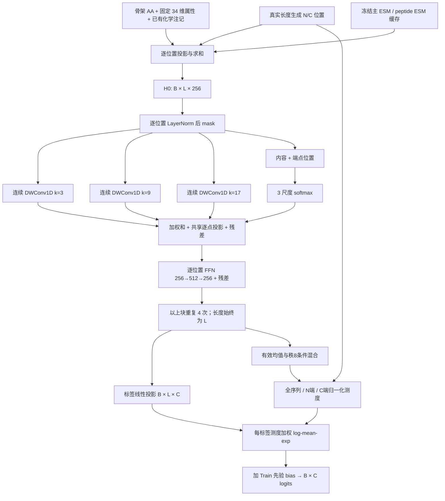

# TermiScale：保留序列端点的动态多尺度卷积模型设计

> **实现更新（2026-11-08）：**核心主配置已实现，见[模型源码](../src/mfp_nova/models/termiscale.py)和[配置](../configs/termiscale.yaml)。已做CPU模型及训练链路验证，正式GPU实验待执行；本页较早段落保留原设计历史，当前运行方式见[README](../README.md#新三模型实现状态与运行)。


> 设计稿，检索与代码阅读日期：2026-10-30。本文只提出架构、实现位置和实验方案；尚未实现、训练或取得性能结果。覆盖 `major15` / `fine39` / `therapep49` 三任务。前两者沿用修复簇划分，后者保留作者CSV；编码器选择参见[总览第2.4节](MFP-Architecture-Design-Study.md)。

## 1. 要回答的科学问题

**跨领域研究补充（2026-11-07）：**[总览第8节](MFP-Architecture-Design-Study.md#8-从深度学习前沿提炼本项目的原创方法2026-11-07)更新创新定位。动态尺度、位置测度和差分注意力均有近邻；第8.3节给出混合测度与端点相对证据的等价式，不能把同一读出重新命名为全新机制。本文继续作为高可行性的性能候选，不将直接采用前沿组件等同于独立原创。

**在已有冻结蛋白语言模型表示之上，是否可以用一条保持全部残基位置的紧凑卷积路径，替代多阶段标签推理和稠密残基对建模，并同时保留局部基序、较长连续片段及其距离序列两端的位置？**

这不是“卷积必然优于 Transformer”的判断。项目已经有五个不同侧重的模型，尚需通过统一实验判断复杂融合是否提供了超出序列表征的收益。TermiScale 对应一个有明确失败条件的假说：若多数功能所需的增量信息可由连续残基上下文及其所在位置表达，保持完整分辨率的浅层动态卷积可能形成更好的精度与成本折中。

当前数据摘要记录 canonical 长度为 2–74，四分位数约为 9/15/24，95% 分位数为 42。它支持研究 3、9、17 个残基的不同连续上下文，但不能证明这些窗口就是生物学功能单元。数值来自项目已有 [data_summary.json](data_summary.json)，不把设计窗口称为已验证基序长度。

本文中的“端点”首先指**输入骨架序列的 N→C 顺序和两端位置**，不是对游离 N/C 端化学状态的断言。现有化学/末端注释可能缺失或冲突，环肽也不能仅凭字符串确定闭环键。因此主干使用真实相邻残基顺序与零填充，不臆造首尾共价边；对明确环化样本，序列端点可能是书写切点，需单独考察这一局限。

### 1.1 基础机制对照

| 项目 | 明确默认 |
|---|---|
| 核心输入 | 冻结单ESM650M＋AA34；单150M-F/双路是后续竞争条件 |
| 下游主干 | d192、4块、连续DWConv3/9/17、FFN扩展2、dropout0.2 |
| 尺度选择 | 内容＋4维R，选择器零初始化；不输入覆盖率c |
| 标签输出 | 每标签残基分数＋G/N/C归一化测度混合LME，一次读出 |
| 主任务损失 | 仅现有observed_label_loss；R-Drop/EMA首轮关闭 |
| D/修饰输入 | 首轮与匹配对照统一关闭，后续在major15/fine39成对开启；通用公式保留接口 |
| 三任务 | 独立输出15/39/49；therapep49保留两Train队列设计 |

这张表定义基础机制对照。2026-11-07起实施主配置采用第1.3节，后文d192参数表用于说明基础容量。输入扩展与编码器比较均使用同一套主干接口。

### 1.2 性能与创新优先的调整（2026-11-05）

第1.1节是隔离机制的起点，不是最终性能模型的容量上限。当前方案实现复杂度低、创新强度中等；主要新意是端点位置与上下文尺度的联合偏置，而动态核、位置编码、LME各自都已有先例。若只有速度优势而没有同输入下稳定的预测收益，它更适合作为强对照，不能为了凑齐三项主贡献而夸大。

**允许先扩大必要表达容量，再判断机制是否有效。** 在相同单650M、C=39、无D/化学输入条件下，现有公式给出以下head参数：

| 容量配置 | 参数推算 | 要回答的问题 |
|---|---:|---|
| d192、4块 | 1,029,951 | 基础机制是否可训练、是否有增量 |
| d256、4块 | 1,700,863 | 通道宽度是否限制多功能表征 |
| d192、6块 | 1,413,981 | 更深的连续上下文组合是否有用 |

只按Train/Val观察选择一次有理由的宽度或深度扩展，不先穷举。相应静态尺度/普通池化对照同步扩容，避免把容量增益当作端点机制增益。训练拟合不足只提供扩容线索，不保证扩容有效；训练已很好而Val差时，优先检查泛化和监督，而非继续加层。这些数字是设计公式的计算，不是实测。

标签LME仍是一个明显的表达约束：它在最终分数图上主要汇聚强证据，不能独立提供两个远端片段的显式组合运算。上游CNN/ESM可能已经编码这些依赖，因此不能据此断言整个模型无法处理组合；但若性能短板确实集中于此，应优先推进MotifSpan，而不是给TermiScale同时堆原型、图、蒸馏和多轮解码，使两条路线失去区别。

单150M-F、650M与双路应在有希望的架构上直接竞争；650M只是共同归因参照。最终采用哪个编码器、是否保留现有R-Drop/EMA，应由Validation性能与完整成本决定，不用“小head”掩盖PLM开销。共同决策见[架构总览](MFP-Architecture-Design-Study.md)第6.5节。

### 1.3 实施主配置与创新边界（2026-11-07）

为减少性能研究中反复扩宽、加路由的返工，主配置选 d256、4块DWConv3/9/17、FFN扩展2、dropout0.2，单650M＋AA34。采用第5.6节的秩8样本条件π，保留初始全局/N/C质量0.8/0.1/0.1，温度固定τ=1。τ与残基分数幅度存在耦合，先用标签投影学习分数幅度，省去一个可解释性较弱的自由度。C39、关闭D/化学嵌入时按现有公式估算1,703,808个下游参数，待实现统计确认。d192和可学习温度保留为已有对照。

主损失采用现有 observed_label_loss；系统比较使用与匹配 HelixSet/TheraSet 相同的 R-Drop0.1、EMA0.999及第6轮开始的现有日程。第1.1节关闭二者的条件只用于隔离机制。单650M是本轮可复现起点，其最优性尚待编码器比较。major15/fine39的D与修饰通过已定义入口成对比较，therapep48/49按作者可得输入运行。

主要科学主张限定为“残基内容驱动的上下文尺度与样本/标签条件端点测度能否改善短肽功能预测”。LSKNet已实现空间自适应核选择，因此动态核自身的创新依据有限。本文的位置LME等价于受约束位置偏置下的LME，需用同宽的等权核、仅位置路由、均匀LME和相近参数量位置偏置比较。只有在同输入和同训练配方下的功能指标增量成立，才支持该任务适配方法。[LSKNet 作者稿](https://arxiv.org/abs/2403.11735)

此方案直接针对宽大下游主干的拟合负担、局部信号稀释与功能位置异质性。冻结表征、缺失标签、同骨架不同修饰和少阳性簇的问题仍取决于输入与监督。按same-input强基线判断收益，避免把小参数量当作性能证明。明确环化记录上的输入两端表示书写切点，应按现有可靠注记分组；在没有可靠连接信息的队列上保持统一序列表示，由均匀读取对照检验端点偏置是否得当。

## 2. 从本项目五个模型中学到了什么

以下判断以实际模型文件及当前 YAML 为准，指架构能力和代价，**不构成实测性能排名**。总体比较可结合 [公共设计研究](MFP-Architecture-Design-Study.md) 阅读。

| 当前模型 | 已实现的主要计算路径 | 可借鉴内容 | 本方案刻意检验的区别 |
|---|---|---|---|
| [TriRelay](../src/mfp_nova/models/trirelay.py) | 序列、几何、属性编码；多轮模态交互；标签读取与关系推理；标签反馈至特征 | 用实际可用性与质量控制模态证据；保留直接预测路径 | 不使用多轮跨模态中继、反馈或标签关系修正，只检验连续序列路径的表达能力 |
| [GeoFactor](../src/mfp_nova/models/geofactor.py) | 残基、结构片段、属性、标签异构交互；一元输出与迭代成对/高阶因子推断 | 区分局部证据与结构化预测 | 不构造异构图或迭代标签因子，避免把标签共现变成主要增益来源 |
| [ProtoRoute](../src/mfp_nova/models/protoroute.py) | 序列/几何/属性/联合四专家；标签条件路由；共享和自适应多原型 | 同一功能可对应多种证据来源 | 尺度选择发生在残基位置，标签只在末端读出；不设置专家、原型容量和原型多样性损失 |
| [HelixSet](../src/mfp_nova/models/helixset.py) | 双 ESM、残基及 pair 更新、基序金字塔、潜变量融合、标签集合解码；默认含三角更新 | 重视基序尺度、结构质量与残基对 | 全程保持 `B×L×D` 特征；不建立 `L×L` pair 状态、不下采样为片段 token、不使用潜变量池 |
| [TheraSet](../src/mfp_nova/models/theraset.py) | 两级并行 3/5/7/9 CNN 与 max-pool 直接分类；双 ESM 等来源；标签多原型读取、尺度/来源选择、pair 及标签因子修正 | 明确而强的 CNN 直接路径，固定残基属性编码，缺失模态 mask | 将多尺度选择移到编码器的每个残基，直接产生标签残基分数；取消“CNN logits + 原型证据修正”的双路径结构 |

必须注意三点已有实现：

1. 项目共享 `SequenceEncoder` 已包含位置嵌入与多核局部卷积，HelixSet 已有 depthwise 卷积。因此“加入卷积”“加入位置”本身不具有新意。
2. TheraSet 已采用普通零填充、逐位置 LayerNorm、有效残基 max pooling，也已有标签条件尺度选择。本方案的区别是**完整分辨率下的内容/边界条件尺度编码 + 单次标签池化**，不能把“修复 TheraSet 环形卷积”写成贡献。
3. 当前 TriRelay/GeoFactor/ProtoRoute 默认仅使用主 ESM；HelixSet/TheraSet 默认使用主 ESM 与 peptide ESM。不同默认输入、训练配置和参数量下的指标差异不能直接归因为新模块。

## 3. 对 TheraPep-AI 源码的重点参考

核对了作者 `model.py`、`data.py`、`train.py`、`cli/train.py`，并将类默认参数与发布模型命令分开理解。

| 核对项 | 实际事实 | 对本方案的启发 |
|---|---|---|
| 发布配置 | README 的 `finetuned_v10` 使用 enhanced 编码、3/5/7/9 卷积、1024/512 全连接、dropout 0.1、5 个成员、periodic 与 random-position | 先尊重强 CNN 基线，再检验端点保留和动态尺度是否有增益；不直接照搬发布训练协议 |
| CNN | 两级并行卷积，第二级读取第一级拼接；BN/ReLU/dropout 后池化与 MLP。`PeptideCNN` 类默认 kernel=3/5/7、dropout=0.3、circular=False，与上述发布配置不同 | 连续残基卷积值得作为独立主干；此设计改为 depthwise 空间滤波与共享通道混合 |
| 编码及位置 | enhanced 是 20 维 one-hot + 14 维固定属性；periodic 是在固定窗口内循环放置，仍截断至窗口长度；随机位置仅在 Train | 保留固定属性思想；完整使用当前最长 74 的骨架，不采用固定 50 截断或随机循环移位 |
| 集成 | 独立初始化成员的损失在代码中取均值；无专门成员多样性损失。`forward` 平均 logits，`predict_proba` 平均 sigmoid 概率 | 联合执行不等于成员信息交互；本文先比较单模型，不将 5 成员预算当单模型成本 |
| 验证与损失 | `validate` 走 `sigmoid(model(x)) > 0.5`，故 ensemble 验证是平均 logits 后 sigmoid；CLI 用 `BCEWithLogitsLoss`，`very_low` 的正类权重为 `clip(sqrt(neg/pos),1,2)` | 不能将平均概率与平均 logits 混称一个算法；本项目 0 的语义要求继续使用现有降权未标注损失 |

来源分别为 [发布模型配置](https://github.com/terra-quantum-public/tq-therapep-ai/blob/main/README.md#reproducing-finetuned_v10)、[CNN 与集成实现](https://github.com/terra-quantum-public/tq-therapep-ai/blob/main/src/therapep_ai/model.py)、[编码和数据加载](https://github.com/terra-quantum-public/tq-therapep-ai/blob/main/src/therapep_ai/data.py)、[训练/验证](https://github.com/terra-quantum-public/tq-therapep-ai/blob/main/src/therapep_ai/train.py)、[CLI 损失配置](https://github.com/terra-quantum-public/tq-therapep-ai/blob/main/src/therapep_ai/cli/train.py)。

作者发布资源还包含合成背景及 49 维任务。本文不将其负样本、标签传播或随机划分迁入 `major15/fine39`，也不使用作者成绩推断本方案效果。仓库列出的 2D CNN、Transformer 等备选类并不代表 `finetuned_v10` 使用了这些组件。

**baseline定位按用户复现包明确：TheraPep-AI是同原始数据来源的主要比较模型。** 包内CSV与当前therapep49逐行一致；F1复现在正肽Test前48列的Jaccard为64.760%、Micro-F1为76.250%，是可直接列入同任务表格的已有参考。positive_only只是该含背景模型的子集评价，无背景Train仍需另训。TermiScale-PLM相对无ESM的五成员CNN，系统差异包含表征、损失与集成，不能全归给动态尺度；TermiScale-CNN的共同输入/损失对照更接近架构问题。完整依据见[复现baseline说明](TheraPep-AI-Metric-Alignment.md#11-用户复现包作为主要baseline的依据)。

## 4. 近期视觉研究如何转化为本方案

这里只采用两个足以支撑主干方向的研究线索，不为了增加“前沿模块”而堆叠结构。

| 原始研究与可查证结论 | 本方案迁移 | 不能推出的结论 |
|---|---|---|
| UniRepLKNet，CVPR 2024；扩展论文 *Scaling Up Your Kernels*，TPAMI 2025：研究少量大核、depthwise 空间滤波、通道混合及结构重参数化；覆盖图像及若干其他模态 | 采用 3/9/17 连续 1D depthwise 核和浅层残差块，把全连接通道混合与空间范围选择分开 | 视觉结果不能证明肽上应选 17、不能证明一定更快、更准；本方案不用其图像权重 |
| LSKNet，IJCV 2024 在线 / 2025 卷期：通过空间位置相关的核选择适配不同上下文需求 | 把“不同空间位置需要不同上下文”转为“不同残基及其距序列边界的位置需要不同连续范围”；用位置级 softmax 选择 | 不照搬遥感旋转不变性、二维分层下采样或膨胀核；残基的排列方向和单个位置都可能重要 |

可直接阅读 [TPAMI 扩展稿正文，III-A/III-B](https://arxiv.org/html/2410.08049v1)、[UniRepLKNet 作者仓库的发表信息](https://github.com/AILab-CVC/UniRepLKNet)、[IJCV 出版页](https://link.springer.com/article/10.1007/s11263-024-02247-9)、[LSKNet 作者全文，3.2–3.3](https://arxiv.org/html/2403.11735v2)。上述迁移是本项目待验证的假说，不是原论文对治疗肽作出的结论。

**候选贡献的边界：**位置编码、动态卷积、depthwise卷积和log-mean-exp都有既有研究。创新假说收敛为用内容/端点位置调节连续上下文，再以**标签相关的全序列/N端/C端归一化测度**读出，解决固定端点证据随长度增加被机械稀释的问题。第5.3节给出数学动机；它是问题驱动的组合创新，不是新通用卷积算子。覆盖率和化学扩展不作为核心贡献。若单独模块无效、收益仅来自参数或配方，应收缩主张；尚不能声称文献首次。

## 5. 完整架构与张量约定

主模型称为 **TermiScale-PLM**：冻结所选ESM，只训练下游网络。统一架构归因对照用单650M，另直接竞争单150M-F及双路；下文d=256；输入宽度D_in为1280、640或1920。另设 **TermiScale-CNN** 成本对照，移除所有ESM；它是不同资源预算轨道。

三个任务均独立训练，`C=15/39/49`。major15/fine39可使用已有序列化学注记；therapep49统一只用AA、固定残基属性和所选ESM，不给真实正肽单独补修饰、结构或515维性质。其第49列是全局标志，评价前48列只是功能切片；另按作者therapep48协议运行时使用正肽成员和48输出，不能将切片评价等同于48输出训练。

therapep49先设计“含全部合成背景”和“仅真实/恢复正肽”两种Train队列，均保留49输出；共用正肽Val前48功能列Micro-F1@0.5选模，在同一Test上拆开功能和背景诊断。第49列在无背景Train中恒阳性，不能将其视为学会治疗性区分；正肽未标功能仍保留弱负向损失。具体行数、预算及作者原协议区别见[总览第2.5节](MFP-Architecture-Design-Study.md)。这两条件先固定同一个编码器，随后再研究表征选择；本轮没有实现开关或启动训练。

三种编码器只改变投影输入：650M为`1280→256`、150M-F为`640→256`、双路为`1920→256`；单路也做同样的无仿射LN。所有后续块、标签读出和训练设置保持一致。150M-F是官方短肽MLM继续预训练权重，并非本项目功能监督微调；其≤50训练分布不要求截断本项目的较长输入。先在相同架构上比较三路，双路收益须超过两个单路，不能只和650M比较。[官方训练来源](https://github.com/ZGCI-AI4S-Pep/peptide-esm)

| 符号 | 含义 / 默认形状 |
|---|---|
| `B,L,n_b` | batch、当前 batch 补齐长度、样本真实长度；不另作 50 残基截断 |
| `M` | 残基有效 mask，`B×L` |
| `C` | 输出标签数，15、39或49；三任务独立训练 |
| `A` | 20 one-hot + 14 固定残基属性，`B×L×34`；查表对应项目 AA 顺序 |
| `E,E_pep` | 当前缓存的主 ESM `B×L×1280`、peptide ESM `B×L×640` |
| `R` | 4 维端点位置特征，`B×L×4` |
| `H` | 主干表示，`B×L×256` |
| `alpha` | 每块每位置的 3 个尺度权重，`B×L×3` |
| `S,mu` | 每标签残基分数与归一化位置测度，均为 `B×L×C` |
| `z` | 最终 logits，`B×C` |



### 5.1 输入和端点位置

以下位置下标为 `i=0,…,n_b−1`：

\[
R_{bi}=\left[\frac{i}{\max(n_b-1,1)},\frac{n_b-1-i}{\max(n_b-1,1)},
e^{-i/4},e^{-(n_b-1-i)/4}\right].
\]

前两维保留全序列方向，后两维描述距两端的近距离位置，衰减尺度 4 是固定设计值而非生物学常数。`n_b` 由有效残基数决定，不能用 batch 的 `L`，否则同一肽在不同 batch 中会获得不同位置。长度为 1 时定义相对位置两维均为 0，两端接近项均为 1；当前数据最短为 2，此定义只用于接口数学完整性。

\[
H^0=M\odot\operatorname{LN}\left(
W_E[\operatorname{LN}_0(E);\operatorname{LN}_0(E_{pep})]
+W_A A+W_RR+e_D+e_{chem,res}+\bar e_{chem,global}\right).
\]

`LN_0` 为各自特征维上的无仿射 LayerNorm；`W_E:D_in→256`，`W_A:34→256`，`W_R:4→256`。D/残基化学/全局化学仅使用现有 `d`、`residue_chem`、`chemical`；化学词表由 Train 构建，padding=0 不提供证据，全局化学只平均非零 token。缺失注记不用猜测补齐；D 注记保持当前数据加载器的处理。

本方案不使用 `coords`、DSSP、结构质量和 515 维整体属性；这使其回答的是“仅序列及已有化学输入可以做到什么”。在与完整多模态模型比较时须明确输入差异。固定残基理化表是由 AA 决定的编码，不等于额外实测模态。

### 5.2 内容与可用上下文共同决定尺度

每个块含 3、9、17 三个**普通连续、stride=1、dilation=1、zero-padding 的 depthwise Conv1d**，保留每个残基；不做池化下采样。令 `U=M⊙LN(H)`：

\[
V^{(s)}=M\odot\operatorname{GELU}(\operatorname{DWConv}_{k_s}(U)),
\qquad k_s\in\{3,9,17\}.
\]

默认选择器只读取内容与端点位置；覆盖率留作后续显式特征化对照，不进入首轮结构。其定义为用固定全1窗口从M计算：

\[
c_{bis}=\frac{1}{k_s}\sum_{j=i-\lfloor k_s/2\rfloor}^{i+\lfloor k_s/2\rfloor}M_{bj},
\qquad M_{bj}=0\ \text{if }j\notin[0,L-1].
\]

\[
\alpha_{bi,:}=\operatorname{softmax}\left(W_g[U_{bi};R_{bi}]+b_g\right),
\quad W_g:(256+4)\rightarrow3.
\]

\[
\tilde H=M\odot\left(H+\operatorname{Dropout}\left(W_o\sum_s\alpha_sV^{(s)}\right)\right),
\]
\[
H_{next}=M\odot\left(\tilde H+\operatorname{Dropout}\left(W_2\operatorname{GELU}(W_1\operatorname{LN}(\tilde H))\right)\right).
\]

`W_o:256→256`，`W_1:256→512`，`W_2:512→256`；4个块独立参数，dropout初值0.2。每位置仅生成3个权重，所有通道共享。卷积不按覆盖率除法归一化，避免把边界大幅放大；默认由R与已mask的局部内容表达边界条件。

尺度选择器 `W_g,b_g` 零初始化，使初始三路权重均为 `1/3`；卷积、`W_o` 和 FFN 使用正常非零初始化。这样初始模型是静态多尺度主干，分类梯度可以通过三路不同输出训练选择器；不能把三个卷积也同时零初始化，否则首次更新难以区分尺度。零初始化只是起点，不冻结选择器，也不添加尺度均衡损失。

**默认删除重复覆盖率输入。** 对无内部空洞的序列mask，令 `h=(k−1)/2`，覆盖率恰为 `[min(i,h)+min(n−1−i,h)+1]/k`。它完全由长度和两端距离决定；R的指数距离理论上也编码了这些距离。c只可能替线性选择器显式给出分段非线性函数，并非新信息。仅在默认主干成立后比较“加c”即可，不为保留它额外引入正则或新的模块。

4 个最大核路径的理论覆盖为 `1+4×(17−1)=65`。这仅说明路径长度；并不代表每个位置有效利用 65 个残基。双 ESM 模式在进入主干前已包含全序列上下文，CNN-only 模式则可能遗漏跨度超过 65 的条件交互，这属于要报告的能力边界。

### 5.3 一次标签读出，控制长度稀释与证据集中程度

普通 `logsumexp−log n` 对均匀证据有效，但存在明确的端点证据稀释。设只有 N 端 q 个残基有高分 `a>0`、其余位置分数为 0；固定温度 τ 下，普通归一化池化为：

\[
z_{uniform}-b=\frac1\tau\log\left[1+\frac qn(e^{\tau a}-1)\right].
\]

保持这个局部片段不变、增加远端低分残基，`q/n` 会下降。不能断言肽延长一定不改变真实功能，但模型应能表示“端点局部证据不必总被全序列平均稀释”，而不是先验排除它。因此定义三个**各自和为 1**的位置测度：

\[
\rho^G_{bi}=M_{bi}/n_b,\quad
\rho^N_{bi}=\frac{M_{bi}e^{-i/4}}{\sum_{j:M_{bj}=1}e^{-j/4}},\quad
\rho^C_{bi}=\frac{M_{bi}e^{-(n_b-1-i)/4}}{\sum_{j:M_{bj}=1}e^{-(n_b-1-j)/4}}.
\]

主配置使用样本条件混合。令g为最后一层H的有效残基均值：

\[
h_b=\tanh(W_h\operatorname{LN}_0(g_b))\in\mathbb R^8,\quad
\pi_{bc}=\operatorname{softmax}(v_c+A_ch_b),\quad A_c\in\mathbb R^{3\times8},
\]
\[
\mu_{bic}=\sum_{a\in\{G,N,C\}}\pi_{bca}\rho^a_{bi},\qquad
\sum_{i:M_{bi}=1}\mu_{bic}=1.
\]

W_h无bias、正常初始化；A_c零初始化，v_c初始化为log(0.8,0.1,0.1)。固定π是消融，不是另一套默认定义。三种测度共享同一张分数图，不是三个独立分类器。

\[
S_{bic}=w_c^\top\operatorname{LN}(H^4_{bi}),\qquad
z_{bc}=b_c+\operatorname{LSE}_{i:M_{bi}=1}(\log\mu_{bic}+S_{bic}).
\]

主配置τ恒为1，不创建可训练温度。标签投影无bias，最终b_c使用当前Train的观察阳性频率初始化；该频率不是真实生物发生率。测度、LSE与损失采用FP32，padding用负无穷屏蔽，w_c正常小随机初始化。后文含τ的性质用于分析，代入τ=1即为主模型。

若 `pi=(1,0,0)`，恰好恢复普通归一化 LME。对 N 端分支，上述 q 个残基的测度为 `(1−exp(−q/4))/(1−exp(−n/4))`，随 n 增长趋向正值 `1−exp(−q/4)`，不会像 `q/n` 趋零。这是一个可推导的建模性质，**不是延长肽后活性保持的生物学结论**。三个测度各自归一化也保证常数分数场 `S_i=a` 总输出 `b+a`，不因长度或端点分支数多而凭空加分。

这个读出也可写成对 `S_i + log(mu_i)/tau` 做普通 logsumexp，因此不是新的通用聚合算子。研究差异是位置偏置由三个归一化测度进行低参数约束，并由此获得明确的常数场与端点质量性质；需要与相近参数量的位置偏置对照，不能只更换公式写法就声称创新。

温度控制读取集中程度，不解释成标签所需残基数；混合系数表示模型学到的位置偏好，不解释成真实末端依赖概率。本模型也不具有任意复制/拼接序列的不变性：实际序列变化会改变位置、局部上下文和 ESM。可输出 `softmax_i(log mu_ic+τ_cS_ic)` 检查池化敏感度，但不将其视为已验证功能位点或因果解释。

### 5.4 读出的表达边界与可学习性

令 `a_i=softmax_i(log μ_i+τS_i)`，则 `∂z/∂S_i=a_i`，且有效残基梯度之和为 1。与 max 只给最大位置梯度相比，此读出可向多个位置传递梯度；与 mean 相比又允许集中。但它仍是单个分数场的平滑极值：`min S≤z−b≤max S`。它不能自动执行“两个分离片段都出现才阳性”的逻辑；这种交互必须先在 CNN/ESM 中形成。因此 TermiScale 的定位是连续上下文与读取偏置，显式片段组合由 MotifSpan 检验。

对同一个分数场，因 `μ_i≥π_G/n`，有 `z_mix≥z_uniform+log(π_G)/τ`。这说明端点偏好也有代价：`π_G` 很小时，内部高分证据可能相对均匀读出被明显压低。主配置保留(0.8,0.1,0.1)初始化和秩8条件项，不强制配额；若全局质量接近零且内部证据组退步，比较均匀LME或固定混合。混合系数不具有跨样本因果解释。

实现直接在 log 空间计算 `log μ=logsumexp(log π+log ρ)`：均匀分支为 `−log n`，N/C 分支用对应距离 logits 减各自 `logsumexp`。这样同时保持归一化与尾部数值精度，无需给每个位置人为加平滑质量。标签 `w_c` 使用小的非零初始化；若所有 `S_i` 严格相同，混合参数的梯度为零是正确数学结果（学习温度对照中的温度梯度也为零），不能因此误判计算图断开。温度与 `w_c` 尺度存在耦合，二者都不用于生物学解释；主配置固定τ=1，学习温度仅为后置对照。

核心机制用一个小型二因素实验即可辨别：静态尺度/动态尺度 × 均匀 LME/端点混合 LME，其他输入、宽度、配方一致。只有完整组合的提升超出两个单独变化的贡献，才讨论“联合建模”的额外价值；否则如实归因于各自模块，不强称两者存在协同。差中差只作描述，并报告 seed 波动。

### 5.5 重参数化只作可选小实验

若主干已成立，可在 `DWConv17` 训练时并联一条**线性** `DWConv3`，先求和再 GELU；推理时把小核居中零扩展后与大核相加，偏置同步相加。两路必须作用于同一个已 mask 输入，且中间没有独立归一化、激活或动态权重，才具有代数等价性。

该小实验借鉴 UniRepLKNet 的训练参数化思想，但不属于默认方案。默认直接使用普通 depthwise 核，不复制其复杂空洞分支，也不引入额外 BN。动态尺度间的 softmax 混合**不能**被融合成一个固定卷积；不能将主干宣称为“部署时只有单核”。若无验证收益，删除并联小核。

### 5.6 条件混合的必要性与解释边界

第5.3节的秩8条件混合是唯一主定义。固定π对照移除A_c、W_h，其余主干不变。新增参数8d+24C，在d256/C39时为2,984。W_h因A_c零初始化而在首步无梯度、A_c可更新，是正常的学习起点。

这是条件混合，不是新的通用门控方法。它针对固定端点偏好的表达限制；必须与固定π及同参数普通位置偏置比较，不能把更自由的拟合一律视为生物学机制。g也含长度/位置相关信息，因此同长度Val表现和端点注释可用性仍需检查。明确环化的记录不应被解释为自由末端依赖；缺少准确连接关系时不做循环移位不变性增强。

条件π依赖H之后，第5.4节的归一化导数仍是固定μ、τ时对分数场S的偏导，但对H的完整梯度还含π路径，不能再把那张敏感度图解释为全部输入归因。另一个限制是尺度权重α不等于实际尺度贡献：各卷积分支输出的范数和方向都可变化，小α也可能对应大的特征贡献。只把α称为内部路由权重；机制证据仍来自重新训练的静态尺度对照，不据热图判断“某功能需要17残基”。这一修正不要求额外归一化或均衡损失。

## 6. mask、标签语义与损失

### 6.1 各类 mask 的职责

- 样本级监督成员由现有任务、split 和监督行选择决定，不改变 `row_id`、ID 或标签顺序。
- `M` 表示残基 padding；每次卷积输入、残差输出以及最终池化都正确应用。LayerNorm 仅在单个位置的通道轴计算，避免补齐长度影响统计。
- 当前数据没有可以随意假设的“逐标签真负 mask”。major15/fine39的0表示未标注；therapep49的合成背景零为作者指定负目标、全局标志有明确监督，但不代表实验确认无活性。不能把结构mask当标签监督mask。
- 对 `fine39` 的 `__unknown` 采用当前语义：其表示父类已知而具体亚类未知。已知 unknown 父类下面的具体亚类 0 项进一步降权，而不是给这些子类制造真负。

### 6.2 首版复用当前分类损失

直接复用 [research_layers.py](../src/mfp_nova/research_layers.py) 的 `observed_label_loss`，不新增 PU 风险估计器或第二套标签语义。用 `y∈{0,1}`、`p=σ(z)`、`q=min(1,1−p+0.03)` 表示当前实现：

\[
\ell_{bc}=-a_c y_{bc}\log\sigma(z_{bc})
-u_{bc}(1-y_{bc})\operatorname{stopgrad}[(1-q_{bc})^2]\log q_{bc}.
\]

`a_c`来自Train `positive_weights`；主数据普通零项`u=0.3`，fine unknown对应具体子类零项为`0.3×0.25=0.075`。therapep49直接复用`unlabeled_weights`：正肽未标功能仍弱降权，合成背景的零项及全局标志零项权重为1。最终沿用现有均值；该目标不是已证明无偏的PU风险，也不把指定背景等同于实验阴性。

主配置沿用匹配系统的R-Drop/EMA，网络内部dropout0.2保留。成对的机制隔离实验才关闭二者。具体为：同输入两次dropout前向、平均分类损失，最大R-Drop权重0.1，沿用第6epoch开始及5epoch渐增；EMA为0.999、第6epoch开始。其收益单列训练配方，不能归给动态尺度或端点测度。

不增加重构、原型、路由均衡、对比或跨任务辅助损失。本文“比较学习五模型”指研究和比较五种架构，不把样本增强或 contrastive loss 设为默认必要组件。

## 7. 可直接转化为实现的伪代码

下列为算法规格，不是已接入项目的 Python API，也不是训练命令。

```text
forward(batch):
    M = batch.mask
    n = count_valid_residues(M)
    R = terminal_position_features(n, M)
    H = input_projection(
        normalized_primary_ESM, normalized_peptide_ESM,
        fixed_AA34, R, existing_D_and_chemical_tokens
    )
    H = layer_norm(H) * M

    for block in four_independent_blocks:
        U = layer_norm(H) * M
        V = [gelu(depthwise_conv1d(U, k)) * M for k in (3,9,17)]
        alpha = softmax(scale_linear(concat(U, R)), axis=scale)
        H = (H + dropout(pointwise(sum(alpha[s] * V[s])))) * M
        H = (H + dropout(ffn(layer_norm(H)))) * M

    score = label_linear(layer_norm(H))          # B,L,C; no linear bias
    tau = 1.0  # fixed, no temperature parameter
    rho = normalized_measures(uniform, N_distance, C_distance, mask=M)
    g = masked_mean(H, M)
    h = tanh(condition_projection(layer_norm_without_affine(g)))  # B,8
    pi = softmax(v + einsum("caq,bq->bca", label_condition_weights, h), axis=three_measures)
    mu = combine(rho, pi)                        # B,L,C; sum over valid L is 1
    score = log_mu_on_valid_positions(mu) + score.float() * tau
    score = score.masked_fill(not M, -infinity)
    logits = prior_initialized_bias + logsumexp(score, L) / tau
    return logits, optional(scale_weights, pooling_sensitivities)

compute_loss(batch, settings):
    logits1 = forward(batch)                    # dropout active only in Train
    if training and configured_RDrop_weight > 0:
        logits2 = forward(the_same_batch)
        loss = mean(existing_observed_label_loss(logits1, y),
                    existing_observed_label_loss(logits2, y))
        loss += weight * existing_Bernoulli_RDrop(logits1, logits2)
    else:
        loss = existing_observed_label_loss(logits1, y)
    return loss
```

逻辑上可以在未来 `src/mfp_nova/models/termiscale.py` 中写一个主模型和一个卷积块，接入既有模型构建入口与配置。复用已有数据读取、Train 统计、缓存、损失、指标和 checkpoint；不要复制训练器、数据包或创建新实验平台。编码表可复用现有定义；若需要调整共享位置，届时只做小范围提取。本次没有创建该代码或配置。

## 8. 参数、计算与设备可行性估算

主配置d=256、四块、固定τ=1、秩8条件π、关闭D/修饰。DWConv无bias，位置/标签/条件投影无bias，其余线性层按第5节有bias。参数公式：

\[
N=20d^2+(D_{in}+212)d+(d+28)C+60.
\]

| 输入，C=39 | 下游参数设计计算 |
|---|---:|
| 单650M，D_in=1280 | 1,703,808 |
| 单150M-F，D_in=640 | 1,539,968 |
| 双路，D_in=1920 | 1,867,648 |

单650M下C15/C49分别为1,696,992/1,706,648，C48为1,706,364。每增加一个标签增加284参数。D/化学嵌入另计。d192是容量消融，其开销不再作为主配置开销。

忽略bias、归一化、激活与softmax，单样本主要前向MACs约为：

\[
L[(D_{in}+38)d+4(29d+3(d+4)+5d^2)+dC]+8d+24C.
\]

单650M、d256、C39、L=74约125.1M MACs；不含ESM、反向和第二次R-Drop前向。主要激活为B×L×d及B×L×C，无稠密残基对。B16/L74时单个FP32残基图约1.16MiB，这不是训练峰值。小head不意味着含650M编码器的整体模型很小。

只需普通Conv1d、Linear、LayerNorm及归约，适配当前V100与RTX5070各自环境。短序列depthwise可能受算子调度影响，实际GPU吞吐需测；不要求自定义CUDA或升级环境。

## 9. 统一比较、消融与可证伪标准

### 9.1 不同比较口径分开报告

| 比较 | 输入与训练控制 | 能回答什么 |
|---|---|---|
| 同编码器架构比较 | TermiScale、HelixSet、TheraSet使用同一选定编码器缓存、同row_id，先统一单650M；再独立比较150M-F与双路，后两者额外结构/属性收益另列 | 同表征预算下，紧凑序列主干是否形成有竞争力的折中；结构/属性收益另行判断 |
| 五架构因果归因 | 拟定共同主 ESM650-only、共同序列/化学输入，关闭额外模态；其他四模型的具体关闭方式在未来实现时确认 | 区分架构差异；这是拟定实验，不表示现有配置已自动实现统一输入 |
| 原配置系统参考 | 五模型保留当前合理配置，记录输入、参数、R-Drop/EMA、有效 batch、训练时长 | 选择实际系统；不能把全部差异归因到尺度块 |
| 低成本轨道 | TermiScale-CNN 对当前适配 CNN/TheraSet 关闭证据解码的路径；统一 AA 属性、化学开关与损失 | 无 PLM 预算的性能与速度；不与双 ESM 结果混称公平胜负 |

上表的“因果归因”指受控的模型实验，不意味着预测出的生物学因果机制。TheraPep-AI复现可直接用于同therapep49任务的系统baseline，保留原BCE与五成员。进一步归因架构时，使用相同输入/损失/选模的适配对照，并分别列出单成员与集成成本。major15/fine39使用本项目修复簇划分训练适配CNN，窗口覆盖完整序列；不将现成49输出成绩当作这两个任务的结果。含/不含背景配对还需为原CNN增加同协议训练设计，不能拿positive_only子集评价代替无背景训练。

具体协议：

- 原样本 Train/Validation/Test 与当前修复簇成员不变，增强默认关闭；Train 学参数和拟合统计，Validation 选 epoch 与阈值，Test 只用于最终确定方案的独立评价。
- `major15`、`fine39`、`therapep49`独立训练，采用各自既定成员；开发seed42，正式固定`42/101/202/303/404`。不采用PepBenchmark的折次重新划分本项目数据。
- major15/fine39统一`traditional5/global`：accuracy=样本Jaccard、absolute_true=完全匹配率、absolute_false=Hamming loss，另报F1/AP。therapep49作者口径用all49 Val Micro-F1@0.5，有/无背景受控比较则共同用正肽Val前48功能列Micro-F1@0.5；均固定0.5最终评价，并拆出正肽功能、全局标志和背景误报，不生成major15功能投影。
- 各模型使用同样的最大 100 epoch、patience15、warmup5、有效 batch64 及公平的验证调参预算。可用 AdamW 初值 lr2e-4、weight_decay0.01、clip5；这些是起始设置，不声称适合所有模型且无需调优。
- 原配置参考保留架构原有损失；模块消融固定相同分类损失、R-Drop/EMA。若更改训练配方，作为单独训练配方实验，不把收益记给网络结构。
- 缓存版速度与从原序列开始的端到端成本分开列；同一 GPU、精度、物理 batch 下比较每步耗时和峰值。V100 与 RTX 5070 不直接用单次 wall-clock 排序模型。
- 150M-F的短肽MLM来源已核实，与当前队列是否重叠尚未核查；650M也不能自动视为无曝光。统一650M归因对照与三路竞争都需标明编码器来源，不能将其当作无重叠证明。

### 9.2 最少但能区分机制的消融

| 消融 | 其余不变时的变化 | 判断目标 |
|---|---|---|
| 等权尺度 | 每个位置统一 `alpha=1/3` | 三个卷积核等权混合的起点 |
| 仅位置路由 | 保留相同主干、核、输入 R 和读出，只将选择器改为 `softmax(BR+b)` | 动态模型若优于等权，进一步区分端点/长度规律与同一位置随肽内容改变的路由。两者仍都使用 ESM 内容计算卷积分支 |
| 去编码端点特征 | 输入与选择器去掉 R，池化不变 | 显式端点距离是否超出零填充边界和 ESM 所含位置 |
| 加覆盖率（后置） | 默认无c；选择器增加3维c，保留R | 显式分段非线性特征化是否值得额外保留 |
| 同宽小核 | 3/9/17 改 3/5/7；再补一个相近参数量宽度控制 | 连续较长上下文是否必要，还是容量变化 |
| 固定 max / 固定 mean 池化 | 相同残基主干，替换标签 LME | 标签相关集中程度是否优于简单全局读出 |
| 普通归一化 LME | 固定 `pi=(1,0,0)`，保留相同温度 | 端点测度是否解决有实际价值的长度稀释问题；这是核心消融 |
| 同预算条件位置偏置 | 使用相同秩8上下文投影和每标签3×8系数，控制三个位置基的加性偏置 | 区分归一化测度与普通条件位置偏置；自由无限制偏置可重现logμ，不作为独立机制 |
| 可学习温度（后置） | 从主配置τ=1改为有界可学习τ | 额外自由度是否有实际收益 |
| 三种ESM及无ESM | 单650M、单150M-F、双路直接比较；CNN-only另列 | 双路须对两个单路有增量；要归因短肽继续预训练，再补原始150M对照 |
| 可选线性小核并联 | 仅在主干有效后比较重参数化训练 | 训练参数化是否值得保留 |

重点查看长度 `2–8/9–16/17–32/33+` 及Train支持数定义的head/medium/tail。当前三个任务Val/Test均不含>50序列，major15/fine39的有效Train也各只有1条>50；不能声称现有划分验证了>50泛化，33+组实际主要评价33–50范围。模型仍完整接收最长74的Train序列，不为匹配基线窗口截断。末端相关、环化分析只用可信现有注记，冲突/未知单列。

有意义的反例包括：静态混合与动态模型稳定相当；去 R 不降甚至改善；端点测度相对普通 LME 无效或放大注释偏差；温度在多数标签持续触及同一边界；较大卷积核仅增加延迟。出现这些结果应删去相应模块或缩小主张。只有在受控输入、配方和 seed 条件下观察到稳定收益，才支持“端点感知动态连续上下文与测度读出”的解释。端点测度的代数性质可用分数数组验证，但这样的检查不能作为真实模型性能。

## 10. 实现后只需做的必要检查与真实风险

本次只有设计文档，不运行训练或伪造测试通过记录。若后续实现，先检查15/39/49维输出与有限loss/梯度；同一序列不同补齐长度预测一致；尺度/标签池化不读取padding；极短序列和缺失化学注记可前后向；所选ESM保持row_id/残基对齐；做必要真实Train短训练与Val前向。若启用线性重参数化，再做一次合并前后等价检查。

| 风险 | 会出现什么表现 | 最简单的处理/判断 |
|---|---|---|
| 端点是注释来源偏差 | R 有利但跨簇/注释冲突组显著失效 | 报告分组与去 R 消融，必要时移除 R，不增加来源分类支路 |
| 环化肽的书写切点 | 对同一闭环不同表示可能敏感 | 明确主干不具备环化拓扑不变性；目前不自行生成循环增强或伪造闭环 |
| 内容选择塌缩 | 所有位置总选同一核 | 若静态核等效，直接简化，不默认加均衡正则强迫多样性 |
| 未标注误压制 | tail 标签召回不足或过拟合已知注释 | 使用同一现有弱标签损失与支持数分层；损失改进另立研究问题 |
| 纯 CNN 丢失全局条件交互 | 长序列组或复杂功能组合显著下降 | CNN-only 只作成本轨道；不追加 pair 模块把方案重新变成 TheraSet |
| 缺少实测结构 | 构象主导的功能可能落后于完整多模态模型 | 明确适用范围，通过同输入消融区分架构与模态贡献 |
| 标签池化温度过拟合 | tail 温度不稳定，验证收益不稳定 | 固定 tau=1；不为保留组件添加更多辅助损失 |
| 短序列 GPU 吞吐不理想 | 理论 MAC 少但实际慢 | 保持普通成熟算子并实测；必要时减少块数或固定尺度 |

本方案的实践价值应由“与强序列/CNN基线相比是否有稳定增益，以及同设备下是否更节省资源”共同决定。即使未超过最强多模态模型，只要明确定位到一个可靠、低成本的适用场景，也可能是有效结果；若这两点都不成立，就不应继续扩大架构。

## 参考文献与代码来源

1. TheraPep-AI 作者：[仓库与发布配置](https://github.com/terra-quantum-public/tq-therapep-ai)；[CNN/MultiModel 源码](https://github.com/terra-quantum-public/tq-therapep-ai/blob/main/src/therapep_ai/model.py)；[固定属性与编码](https://github.com/terra-quantum-public/tq-therapep-ai/blob/main/src/therapep_ai/data.py)；[训练/验证](https://github.com/terra-quantum-public/tq-therapep-ai/blob/main/src/therapep_ai/train.py)；[训练 CLI](https://github.com/terra-quantum-public/tq-therapep-ai/blob/main/src/therapep_ai/cli/train.py)。阅读日期 2026-10-30；`main` 为可变分支，正式复现应记录当时 Git commit，不复制作者源码或权重到项目。
2. Ding et al. **UniRepLKNet: A Universal Perception Large-Kernel ConvNet for Audio, Video, Point Cloud, Time-Series and Image Recognition.** CVPR 2024。[作者预印本](https://arxiv.org/abs/2311.15599)，[作者实现](https://github.com/AILab-CVC/UniRepLKNet)。
3. Zhang, Ding, Yue. **Scaling Up Your Kernels: Large Kernel Design in ConvNets Toward Universal Representations.** IEEE TPAMI, 2025，DOI: [10.1109/TPAMI.2025.3600702](https://doi.org/10.1109/TPAMI.2025.3600702)。本次方法阅读使用[作者公开全文](https://arxiv.org/html/2410.08049v1)，发表状态与官方仓库交叉核对；它是第 2 项研究线的扩展，不当作两条独立性能证据。
4. Li et al. **LSKNet: A Foundation Lightweight Backbone for Remote Sensing.** IJCV，2024-10-07 在线，133:1410–1431 (2025)，DOI: [10.1007/s11263-024-02247-9](https://link.springer.com/article/10.1007/s11263-024-02247-9)。[作者方法全文](https://arxiv.org/html/2403.11735v2)，[作者实现](https://github.com/zcablii/LSKNet)。只迁移位置相关上下文选择思想，不把遥感结果外推到肽。
5. 项目内部：[五模型源码目录](../src/mfp_nova/models/)、[共享层和弱标签损失](../src/mfp_nova/research_layers.py)、[数据和 mask 约定](../src/mfp_nova/multimodal.py)、[TheraSet 技术说明](TheraSet-Architecture.md)、[HelixSet 学习说明](HelixSet-Architecture-Learning-Guide.md)、[指标说明](MFP-Metrics-Guide.md)。
