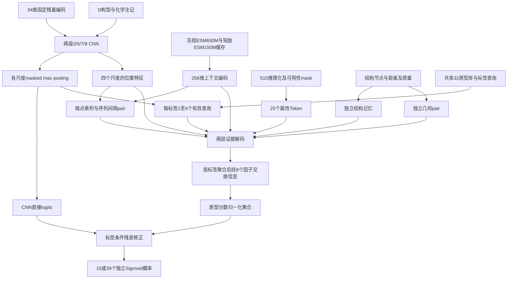

# 第五个模型 TheraSet：以 TheraPep-AI 为基线的标签条件多原型证据修正网络

日期：2026-10-28。实现：[theraset.py](../src/mfp_nova/models/theraset.py)，配置：[theraset.yaml](../configs/theraset.yaml)。

**设计结论：保留 TheraPep-AI 的两级多尺度 CNN 和直接分类路径；把 HelixSet 的细粒度证据读取改造成围绕 CNN 的轻量残差解码器。每个功能标签通过若干共享原型查询选择不同尺度、不同来源及不同残基对证据，最后对 CNN 的预测作可学习修正。**

TheraSet 是第五个独立研究模型，不替换 HelixSet。当前已实现架构、训练、恢复、评价、推理和消融入口，完成必要的正确性检查及真实输入小批量训练检查。2026-10-28已完成两任务seed42完整Train/Val，复算结果与训练记录一致，详见[实验记录](experiment-history.md#2026-10-28theraset-两任务-seed42-正式-trainval-结果)；独立Test、多Seed、TheraPep适配CNN对照及消融仍待开展。本文的“提升”“缓解”等均指设计目标，不能解释为已全面超过基线。

## 1. 基线定义与设计依据

### 1.1 从 TheraPep-AI 继承什么

作者的核心分类器是固定残基编码、两级并行多尺度卷积、全局最大池化和 MLP。它提供了适合短肽的局部模式归纳偏置，也提示我们：增加更多深层交互并不自动提高性能。这里保留以下基础：

- 20 维 one-hot 与 14 维固定残基属性，总计 34 维，投影到 64 维。
- 两级并行卷积，每级使用 3/5/7/9 四个核，默认每分支 128 通道。
- 第二级特征全局最大池化后拼接为 512 维，直接分类 MLP 为 512→1024→512→C。
- C 为本项目 major15 的 15 或 fine39 的 39；两个任务分别训练。

14 项属性为电荷、疏水性、极性、芳香性、氢键供体/受体、体积、G/P/C 标志、大小类别及螺旋/折叠/转角倾向。数值表与归一化口径参照作者公开数据定义，按本项目 `ACDEFGHIKLMNPQRSTVWY` 顺序排列；padding 行为全零。它们是残基查表信息，不是该肽的实测结构。

### 1.2 必须区分的三个比较对象

| 对象 | 内容 | 能回答的问题 |
|---|---|---|
| 原论文 TheraPep-AI | 作者 49 维目标、固定长度处理、合成背景、五成员集成及其训练策略 | 作者设定下的文献结果；不能与本项目数字直接排序 |
| 本地适配 CNN 对照 | 本实现关闭 `evidence_decoder` 和 `chemical_evidence`；保留 34 维编码与两级 CNN，使用本项目划分、目标和损失 | 在相同数据协议下，新增证据模块是否有效 |
| TheraSet | CNN 直接预测＋标签条件多原型证据修正 | 新架构整体效果以及各新增机制的贡献 |

本地 CNN 对照**不是原论文严格复现**。适配差异包括：逐位置 LayerNorm 替代 BatchNorm、GELU 替代 ReLU、按真实长度 mask、零填充卷积、不截为 50 位、不随机循环放置、采用项目弱负项 ASL 和可选 R-Drop/EMA。保留全部有效残基，避免把普通线性肽的两端人为视为相邻。原论文严格复现应另用作者代码，在统一队列上明确映射标签和训练条件；本次不把它冒充成已经完成的结果。

本地 CNN 对照与完整模型均可使用相同训练正则以比较架构。若还要比较原论文加权 BCE、五模型集成或合成负样本，必须分别作为独立实验因素。

### 1.3 从四个现有模型中有选择地学习

| 来源 | 保留的优点 | 在 TheraSet 中的具体落实 | 不照搬的部分及原因 |
|---|---|---|---|
| TriRelay | 各模态保留自己的证据路径，标签决定读取内容 | CNN、PLM、理化、结构、pair 分别读取，再按标签和原型分配权重 | 不复制双向多轮反馈和重建目标，减少混合前证据被覆盖及辅助任务竞争 |
| GeoFactor | 单标签证据与标签集合关系分开建模 | 先读证据，再经 8 个样本条件的共享因子传递标签上下文 | 不直接注入固定训练共现图，不复制高阶标签组合枚举；降低频繁组合支配稀有组合的风险 |
| ProtoRoute | 同一功能可能有多种模式，尾类需要共享统计力量 | 每标签 1–4 个有效查询，从共享原型库组合得到；容量仅由 Train 正例簇数决定 | 不复制四套完整专家网络，也不为每个尾类拟合大量独立原型向量 |
| HelixSet | 双冻结表征、标签回读细粒度证据、显式 pair、质量与缺失处理 | 保留双 ESM 上下文、标签条件残基对读取、结构质量在归一化后缩放及 R-Drop | 不保留 6 层潜变量融合及 4 层三角传播，缩短 CNN→标签的证据路径 |

GeoFactor 的启发在于“单标签与集合关系的分工”，这里不是对它原有概率因子推断的复现。TriRelay 的启发是保留独立路径，也不宣称这里获得了统计意义上的模态解耦。

## 2. 总体架构



图中为两层相同解码结构的概括，每一层均包含证据读取和因子交换。CNN 的直接头始终存在；结构与理化可缺失。没有额外全局“治疗/非治疗”分类头，因为当前真实队列不提供可支撑该目标的可信阴性标签。

## 3. 输入、尺度与直接路径

设 batch 为 B，批内最大长度为 L，标签数为 C，解码宽度 d=256，pair 宽度 r=32，原型上限 K=4。

| 模块 | 张量或配置 | 作用 |
|---|---|---|
| 固定编码 | B×L×34 → B×L×64 | 将已知残基属性显式送入 CNN |
| 化学注记 | D 嵌入、残基注记、全局化学注记均为 64 维 | 与 CNN 输入相加，保留骨架字母外的信息 |
| CNN 一级 | 4 个 B×L×128，拼接 B×L×512 | 检测不同长度局部模式 |
| CNN 二级 | 4 个 B×L×128 | 在一级混合特征上组合局部模式 |
| 直接头 | B×512 → B×C | 保留短路径预测，提供独立辅助监督 |
| 尺度记忆 | 二级四路各投影为 B×L×256 | 保留位置，不把全部证据提前压缩为一个向量 |
| 上下文记忆 | 双 ESM 1280＋640 → 256，1 层 Transformer | 补充进化与短肽上下文信息；另含全局化学 Token |
| 理化记忆 | 515 维分为既有 25 组，1 层 Transformer | 对属性数值及缺失 mask 分组编码 |
| 结构记忆 | 16 维节点特征＋DSSP；另含 25 项全局结构值及 mask | 保存独立结构证据，不直接改写干净的 CNN 路径 |
| 原型库 | 32×256，标签系数 C×4×32 | 共享查询基底，尾类也能使用共享模式 |
| pair 状态 | 学习 pair 与几何 pair 各 B×L×L×32 | 保留关系内容供标签读取 |
| 解码 | 2 层，8 头注意力，8 个关系因子 | 按功能读取证据，并建模样本条件的标签上下文 |

第二级核为 k 的分支已经接收一级所有核，其最大理论感受野为 `9+k−1`，即 11/13/15/17；不能将它们误称为只看到 3/5/7/9 个原始残基。L 更短时只使用有效残基。卷积之间清除 padding 位置，最大池化排除 padding，LayerNorm 仅沿通道归一化，因此预测不依赖同批其他肽的补齐长度。

上下文支路复用项目 `SequenceEncoder(depth=0)` 的输入投影、位置和化学编码，再加入一层 Transformer；没有在它内部再堆三层多尺度卷积。双 ESM 冻结，正式训练读取现有缓存。

## 4. 三项核心研究设计

### 4.1 原型条件的多尺度证据读取

每标签的有效查询数由训练集中独立正例簇数决定，沿用现有统计：

\[
K_c=\min(4,\max(1,\lfloor n_c^{cluster}/100\rfloor)).
\]

阈值 100 是当前项目的容量启发式，不代表经过证明的生物学分组；可以在 Validation 上检验固定单原型与自适应容量的差别。

共享库为 \(P\in\mathbb{R}^{32\times d}\)，标签原型系数为 \(a_{ck}\)：

\[
q_{ck}^{0}=e_c+\operatorname{softmax}(a_{ck})P+W_g h_{CNN}.
\]

查询先分别读取四个尺度的 CNN 位置记忆，再从查询与各尺度证据计算 softmax 权重：

\[
m_{cks}=\operatorname{Attn}(q_{ck},H_s),\quad
\alpha_{cks}=\operatorname{softmax}_s f_s([q_{ck},m_{cks}]),\quad
m_{ck}=\sum_s\alpha_{cks}m_{cks}.
\]

这使同一个标签的不同模式可以选择不同的局部尺度；每个尺度先单独读取，避免把尺度差异仅交给一次全局最大池化。32 个库向量是可学习的共享查询基底，**不是从真实阳性样本聚类得到的肽原型**，不能将某个向量直接解释为已确认的功能基序。

### 4.2 由端点、学习关系和可靠几何共同支持的 pair 读取

先从四尺度平均与 PLM 上下文生成残基表示 \(R_i\)。学习关系采用端点乘积与有符号间隔：

\[
Z_{ij}=\operatorname{LN}[(W_lR_i)\odot(W_rR_j)+W_\delta(\delta_{ij},|\delta_{ij}|)].
\]

几何关系 \(G_{ij}\) 单独编码 16 个距离 RBF、3 类边类型、可用性、置信度已知标记和置信度乘积，共 22 维输入。距离中心覆盖 0–30 Å，超过该范围的分辨率会下降；这比 HelixSet 的多范围距离编码更简洁，也可能损失长肽远距离信息，需看长度分组结果后决定是否扩展。

对有效非自身残基对，复用 HelixSet 的标签条件读取形式：

\[
s_{ckij}=\frac{(W_q^lq_{ck})^TW_k^lR_i+(W_q^rq_{ck})^TW_k^rR_j
 +(W_q^pq_{ck})^T\widetilde Z_{ij}}{\sqrt{3r}},
\]

\[
\widetilde Z_{ij}=\operatorname{LN}(Z_{ij})+
 \rho_i\rho_j\tanh(\operatorname{LN}(G_{ij})).
\]

权重在有效 \(i\ne j\) 对上归一化。通过边际权重读取左右端点，并读取窄 pair 状态，再投影回 d 维；不展开 B×C×K×L×L×d 的宽值张量。

这里的因子化指端点低维乘积构造，不表示整个 pair 张量在 LayerNorm 后严格满足某个矩阵秩约束。它保留显式 pair 的可读性，省去三角传播的立方长度成本；也放弃了 HelixSet 经第三残基更新关系的能力。是否足够，必须与 HelixSet 和关闭 pair 的消融比较。

### 4.3 保留 CNN 决策的证据残差与标签因子上下文

每个查询独立读取五路：CNN 尺度证据、PLM 上下文、理化、结构、pair。各路无仿射 LayerNorm 后按查询与证据评分，在可用来源间归一化；缺失来源权重严格为零。结构质量在归一化后再次绝对缩放。

已知质量使用预处理后的置信度 \(\rho_i\in[0,1]\)，未知置信度在结构存在时取中性值 1，缺失结构为 0。未知不是“证实可靠”，只是当前不额外降权。已知质量全零时，结构读取和几何 pair 均不贡献预测；与 HelixSet 的 0.3 质量下限不同，这是明确可检验的取舍。

每层读完证据后，先按标签平均有效原型状态，形成 C 个状态，再让 8 个共享因子读取这些状态并写回查询。这样标签原型更多不会仅因 token 数量更多而占据更多关系注意力。因子从当前样本证据生成，没有固定共现图，也没有真实标签作为推理输入。它能表达集合依赖，但仍可能学到训练集频率偏差，不能声称已解决标签共现捷径。

各原型输出分数 \(u_{ck}\)，通过归一化 log-mean-exp 聚合：

\[
\Delta_c=\log\sum_{k\in A_c}\exp(u_{ck})-\log K_c.
\]

减去 \(\log K_c\) 防止仅增加相同原型就抬高 logit；尾类的少原型不是人为减分。原型 softmax 权重还用于聚合标签状态 \(\bar q_c\)，生成修正门：

\[
g_c=\sigma(W_{gate}[\bar q_c,W_gh_{CNN}]+b),\qquad
z_c=z_c^{CNN}+g_c\Delta_c.
\]

门控权重初始化为零、偏置为 −2，初值约 0.119，使初始训练更接近 CNN 路径；门是神经网络的一部分。这里不是性能保障：修正量仍可有益或有害，门也可在训练后变大。CNN 辅助头持续受监督，避免直接路径只剩形式上的连接。

## 5. 创新定位与不能过度宣称的部分

建议研究主线表述：**针对短肽多标签注释，在多尺度 CNN 直接预测之上，通过共享多原型查询联合选择尺度、证据来源和残基对关系，并用样本条件因子与标签残差形成证据驱动的集合预测。**

创新假设主要落在连接方式与任务适配，而非发明 CNN、注意力、原型、因子或残差：

1. 从“全局池化后丢失位置”转为“直接预测与可回读尺度记忆并存”，检验短路径是否更适合短肽。
2. 同一组标签原型共同决定尺度选择、模态读取和 pair 读取，检验同标签的异质模式是否被更好表达。
3. 将质量感知证据和按标签平衡的关系因子用于修正直接预测，检验是否能以更少下游参数保留 HelixSet 的关键收益。

已核对的相关先例包括 Query2Label 的标签查询读取、C-Tran 的标签依赖建模、TPpred-LE 的治疗肽标签嵌入和多标签多原型查询工作。因此不能把“标签查询”“多原型注意力”单独作为首次创新，也不能仅凭对 TheraPep-AI 的差异宣称世界首次。完整领域新颖性仍需更系统的检索和实验支撑。


## 6. 训练目标与科研协议

使用项目现有 `observed_label_loss`：已标注正例接受正类监督，0 仍为未标注，以默认 0.3 权重进入弱负项；fine39 的 `__unknown` 对相关亚类继续使用既有弱监督处理。这不等同于严格的无偏 PU 风险估计，也不消除漏标偏差。

\[
\mathcal L=\mathcal L_{ASL}(z,y)
+\lambda_d\mathcal L_{ASL}(z^{CNN},y)
+\lambda_e\mathcal L_{ASL}(b^{prior}+\Delta,y)
+\lambda_r\mathcal L_{RDrop}.
\]

- `direct=0.2`：直接路径监督；`evidence=0.1`：证据头监督，防止修正分支完全依赖直接头。
- 二者沿用 5 epoch 辅助损失预热。先验偏置来自 Train 的观测注释频率，不当作真实功能比例。
- `rdrop=0.1`：第 6 epoch 开始，5 epoch 升至全权重。两次前向共享同一次模态 dropout 视图，普通网络 dropout 独立；全部监督项取两路平均，再加最终多标签 Bernoulli 对称 KL。
- `modality_dropout=0.1`，随机移除理化或结构输入；原始数据增强关闭。
- AdamW，学习率 2e−4，weight decay 0.01，最大 100 epoch，warmup 5，patience 15，梯度裁剪 5；沿用项目调度实现。
- batch16×累积4，即每更新 64 条不同样本。R-Drop 是同一批样本的两次随机前向，不算 128 条独立样本。
- EMA0.999 从第 6 epoch 更新；推理单次前向，EMA 不是五独立模型集成。
- 默认 `traditional5`：Validation 的拟合阈值 Jaccard 选模、完全匹配用于同分比较；同一 Validation 选择最终阈值。另存 AP 候选，但不能在看 Test 后更换主报告候选。

沿用修复簇划分、原样本、row_id/ID 对齐和监督范围，不改 `data/`。Test 不参与开发、损失调参、先验拟合或阈值选择。不加入全零合成阴性：当前任务首先是功能注释，统计生成的序列不能自动当作已证实无活性，背景拒识应另立实验。

## 7. 参数、成本与预期风险

当前真实 Train 化学词表下的可训练参数：

| 任务 | 词表大小（含保留项） | TheraSet 下游参数 |
|---|---:|---:|
| major15 | 664 | 10,376,854 |
| fine39 | 663 | 10,404,206 |

与项目现有 major15 HelixSet 约 71.72M 下游参数相比，TheraSet 约减少 85.5%。两者另有约 800M 冻结 ESM 参数；新序列编码、缓存空间及完整系统成本均不能省略。少参数不自动等于同等比例的速度或显存改善。

学习 pair 的存储为 O(BL²r)，原型条件读取的分数/注意力开销为 O(BCKL²)，计算包含 O(BCKL²r)。上下文自注意力仍有 O(BL²d) 开销。去掉了三角更新的 O(BL³r) 主项，但四原型查询增加了解码读取成本；fine39、L 接近 80 时仍需在实际 GPU 上测量。

| 可能的不足 | 需要观察的证据 | 已有可执行比较 |
|---|---|---|
| 少了三角传播，复杂关系表达不足 | 结构可用组、长肽组表现 | HelixSet vs TheraSet；pair 开关 |
| 原型学成相同模式 | 有效原型权重与各标签改善是否稳定 | `prototype_readout=false`，不先加新的正则损失 |
| 修正路径损害有效 CNN 预测 | CNN 对照、门值和修正方向 | 关闭 `evidence_decoder` |
| 结构质量不准确或缺失模式偏移 | 结构缺失/已知质量分组 | 关闭 `structure_evidence` |
| 标签关系依赖训练共现 | 稀有组合与多功能组表现 | 关闭 `label_context` |
| 双 ESM 收益主要来自输入规模 | 参数、缓存与新序列推理成本 | 关闭 `contextual_evidence`；单 ESM 比较时同时移除配置中的 peptide 缓存及编码器 |
| 原型门和注意力被过度解释 | 归因是否随真实扰动稳定 | 注意力仅作关注线索，不作为生物因果结论 |

## 8. 消融与正式比较

当前执行范围按2026-10-28约定更新：固定 **seed42**，在 **major15、fine39、therapep49** 分别完成剩余消融，并分别运行 **traditional5、micro_f1** 两种独立选模/早停协议。major15使用物理batch128，fine39和therapep49使用物理batch64，全部累积1、FP32；RTX5070和V100保持相同设置。最大100epoch、patience15、学习率和R-Drop/EMA日程沿用配置。两套协议各自保存最佳模型；每套结果都包含传统五指标、AP与F1，不能混取两个候选的最佳数字。`traditional5`以Validation拟合阈值Jaccard选模；`micro_f1`以Validation Micro-F1@0.5选模、固定0.5，不使用Test。

本轮是单seed消融，不是五seed正式结论。确定方法后再使用42/101/202/303/404做正式多seed比较。比较均报告单模型；集成另列。

| 比较 | 当前入口 | 隔离的问题 |
|---|---|---|
| 适配 CNN 基础对照 | `--ablate evidence_decoder chemical_evidence` | 34 维编码＋两级 CNN 的基础性能 |
| 带化学的 CNN | `--ablate evidence_decoder` | 化学注记的净增量 |
| 完整 TheraSet | 默认配置 | 整体方案 |
| 无 PLM 上下文 | `--ablate contextual_evidence` | 额外预训练表征贡献 |
| 无理化 | `--ablate property_evidence` | 独立属性读取贡献 |
| 无结构 | `--ablate structure_evidence` | 同时移除节点、全局结构、几何 pair 的贡献 |
| 无 pair 读取 | `--ablate pair_readout` | 在其余输入不变时，直接关系读取贡献 |
| 单原型查询 | `--ablate prototype_readout` | 将每标签有效查询数降至 1；共享库仍保留 |
| 无标签因子 | `--ablate label_context` | 条件集合关系贡献 |
| 无 R-Drop | `--rdrop-weight 0` | 训练一致性贡献 |

对应队列名称依次为`cnn`、`cnn_chemical`、`full`、`no_plm`、`no_property`、`no_structure`、`no_pair`、`single_prototype`、`no_label_context`、`no_rdrop`。`therapep49`统一关闭理化、结构、化学输入，因此跳过重复的`cnn_chemical`、`no_property`、`no_structure`；保留7种有效配置。`no_plm`关闭两套PLM的上下文读取，不是只去掉其中一套。

| 任务 | batch×累积 | 配置数×协议数 | 本轮处理 |
|---|---:|---:|---|
| major15 | 128×1 | 10×2=20 | 原完整模型batch64不能作同设置基线，需要补batch128完整模型 |
| fine39 | 64×1 | 10×2=20 | 自动复用本机`runs/theraset_*`中配置一致的两组已完成完整模型；通常剩18组 |
| therapep49 | 64×1 | 7×2=14 | 作者发布Train/Val成员及49维标签，包含合成背景 |

总计54个有效槽位，fine39两组完整模型在训练机器上可用时剩52组。复用只比对模型、输入、损失及训练配置，不按分数选旧实验；两台机器各自检查本机运行目录。旧结果目录没有迁移到V100时，V100会补齐完整模型。`plan`显示实际已完成、待续训、新训练数量。

`therapep49`传统五指标仍沿用项目公式：Accuracy为样本Jaccard，空真值/空预测计0，因此全零合成背景不会获得Jaccard加分；它不是作者逐标签Accuracy。结果另外输出`therapep_validation`中的49维逐标签Accuracy、正样本49维/纯48功能、治疗标志和合成背景FPR。不同任务或不同公式的数值不能直接横比。

这些是模型内的输入/路径消融，不等于完整正交实验矩阵。尤其完整模型比 CNN 多了预训练表征和多模态输入，整体差值不能全部归因于解码算法；至少补充无 PLM 与无理化/结构比较，再讨论算法贡献。采用同输入 CNN 池化分类头等进一步严格对照时，应明确它与当前 34 维 CNN 对照的不同。

统一报告 Micro/Macro AP、Micro/Macro F1、传统五指标、尾类、长度、D 注记、结构可用性、多功能检测与独立功能预测，并给出训练耗时、峰值显存、参数量及新序列编码成本。各 seed 的均值/标准差与配对差值比单个最佳 seed 更有说服力。只有完成这些实验，才能判断是否“保持性能优秀”。

### 8.1 队列与断点续训

入口为`python -m mfp_nova.theraset_ablation`，支持`plan`、`prepare`、`run`、`pause`、`pack`。可用`--tasks`、`--variants`、`--suites`选择子集；省略时为上述完整矩阵。队列目录固定，不能每次续训换时间戳或输出目录：

```text
runs/theraset_ablation_seed42_<platform>/
  major15/no_pair/traditional5/{metadata.json,last.pt,history.jsonl,results.json,...}
  major15/no_pair/traditional5.log
  ...
```

`run`跳过完成结果，自动从未完成实验的`last.pt`原目录续训。恢复模型、optimizer、scheduler、scaler、EMA、最佳候选、patience及Python/NumPy/PyTorch/CUDA/DataLoader随机状态。`pause`在队列根目录创建`PAUSE`；每个正在训练的任务完成当前epoch、保存断点后退出，不生成假的完成结果。删除`PAUSE`并重复原启动命令即可继续。处于最后epoch或已经达到早停条件的实验正常完成，然后停止队列。

`last.pt`先写临时文件，再替换旧断点，避免写入途中中断破坏上一完整epoch。强制中断时从上一完整epoch重算；尚未保存第一个epoch时重新训练第一轮。续训保留原始metadata及连续history，补回保存断点后尚未来得及追加的那条history。GPU浮点运算仍可能存在非确定性，不能承诺跨硬件逐位相同。

先暂停并等当前任务退出后再重启，不能同时启动两个写入同一任务目录的队列。代码更新只在启动前完成，续训时保持同一版本。这里只准备训练入口，未在本地CPU机器上启动54组正式训练。

### 8.2 RTX5070：PowerShell

首次启动（仓库更新前确保旧训练已经退出）：

```powershell
$ErrorActionPreference = 'Stop'
Set-Location 'D:\Data\ChatGPT\mfp\MFP-Nova'
git pull --ff-only origin main
if ($LASTEXITCODE -ne 0) { throw '代码同步失败。' }
$mfpPython = 'D:\App\Code\Anaconda\envs\MFP-Nova\python.exe'
$env:PYTHONPATH = Join-Path $PWD.Path 'src'
$env:CUDA_VISIBLE_DEVICES = '0'
$env:OMP_NUM_THREADS = '4'
$env:MKL_NUM_THREADS = '4'
$RunRoot = 'runs/theraset_ablation_seed42_rtx5070'

& $mfpPython -u -m mfp_nova.theraset_ablation plan --output $RunRoot
& $mfpPython -u -m mfp_nova.theraset_ablation prepare --device cuda:0
if ($LASTEXITCODE -ne 0) { throw '缓存准备失败，请按提取日志处理后再训练。' }
& $mfpPython -u -m mfp_nova.theraset_ablation run --output $RunRoot --device cuda:0 --cpu-threads 4
if ($LASTEXITCODE -ne 0) { throw '队列已中断，修复日志中的错误后用相同run命令续训。' }
```

`prepare`只提取缺少的Train/Val缓存，major15/fine39复用同一套双ESM，therapep49单独提取，不自动提取Test。若特征提取中断，仍按提取日志给出的行数使用原`features --resume-from`续提；训练断点不适用于缓存提取。大型缓存可按三机约定传输。

在另一PowerShell窗口暂停（使用相同项目目录和Python路径）：

```powershell
Set-Location 'D:\Data\ChatGPT\mfp\MFP-Nova'
$mfpPython = 'D:\App\Code\Anaconda\envs\MFP-Nova\python.exe'
$env:PYTHONPATH = Join-Path $PWD.Path 'src'
& $mfpPython -m mfp_nova.theraset_ablation pause --output runs/theraset_ablation_seed42_rtx5070
```

原训练窗口退出后续训；关闭窗口或重启后同样执行下面的块，无需重新pull代码：

```powershell
Set-Location 'D:\Data\ChatGPT\mfp\MFP-Nova'
$mfpPython = 'D:\App\Code\Anaconda\envs\MFP-Nova\python.exe'
$env:PYTHONPATH = Join-Path $PWD.Path 'src'
$env:CUDA_VISIBLE_DEVICES = '0'
$RunRoot = 'runs/theraset_ablation_seed42_rtx5070'
Remove-Item -LiteralPath "$RunRoot/PAUSE" -ErrorAction SilentlyContinue
& $mfpPython -u -m mfp_nova.theraset_ablation run --output $RunRoot --device cuda:0 --cpu-threads 4
```

完成后打包（也支持暂停后的部分结果，文件名含完成数）：

```powershell
& $mfpPython -m mfp_nova.theraset_ablation pack `
  --output runs/theraset_ablation_seed42_rtx5070 --platform rtx5070
```

### 8.3 V100：Ubuntu Bash，三卡后台

保留MFP-Nova独立Conda环境的PyTorch2.4.1+cu121，不升级原环境。三张已获分配的GPU分别负责major15、fine39、therapep49；这是三个独立实验队列，不是DDP。`GPUS='0 1 2'`可替换为实际卡号，`CPU_THREADS=4`是每个队列的线程数。

首次启动；脚本先在第一张卡上顺序补缓存，避免major15/fine39同时写共享缓存，然后启动三个任务：

```bash
cd ~/wuzhencheng/projects/MFP-Nova
conda activate MFP-Nova
git pull --ff-only origin main
export PYTHONPATH="$PWD/src"
RUN_ROOT=runs/theraset_ablation_seed42_v100
mkdir -p "$RUN_ROOT"
python -m mfp_nova.theraset_ablation plan --output "$RUN_ROOT"
nohup env PYTHON_BIN="$(command -v python)" GPUS='0 1 2' CPU_THREADS=4 RUN_ROOT="$RUN_ROOT" \
  bash scripts/run_theraset_ablations.sh >> "$RUN_ROOT/launcher.log" 2>&1 < /dev/null &
echo "Launcher PID=$!"
```

关闭SSH后继续运行。查看进度：

```bash
tail -n 30 runs/theraset_ablation_seed42_v100/launcher.log
tail -n 20 runs/theraset_ablation_seed42_v100/major15.log
tail -n 20 runs/theraset_ablation_seed42_v100/fine39.log
tail -n 20 runs/theraset_ablation_seed42_v100/therapep49.log
```

暂停全部三个任务，等待每个日志显示`Paused after epoch`或当前实验完成、队列退出：

```bash
python -m mfp_nova.theraset_ablation pause --output runs/theraset_ablation_seed42_v100
```

重新登录后续训（相同输出目录，既有完成实验跳过）：

```bash
cd ~/wuzhencheng/projects/MFP-Nova
conda activate MFP-Nova
export PYTHONPATH="$PWD/src"
RUN_ROOT=runs/theraset_ablation_seed42_v100
rm -f "$RUN_ROOT/PAUSE"
nohup env PYTHON_BIN="$(command -v python)" GPUS='0 1 2' CPU_THREADS=4 RUN_ROOT="$RUN_ROOT" \
  bash scripts/run_theraset_ablations.sh >> "$RUN_ROOT/launcher.log" 2>&1 < /dev/null &
echo "Launcher PID=$!"
```

若仅补一个任务，可在缓存准备完成后单独启动（不要同时运行另一个负责同任务的队列）：

```bash
nohup env CUDA_VISIBLE_DEVICES=2 OMP_NUM_THREADS=4 MKL_NUM_THREADS=4 PYTHONPATH="$PWD/src" \
  python -u -m mfp_nova.theraset_ablation run --tasks therapep49 --device cuda:0 --cpu-threads 4 \
  --output runs/theraset_ablation_seed42_v100 \
  >> runs/theraset_ablation_seed42_v100/therapep49.log 2>&1 < /dev/null &
```

完成后打包：

```bash
python -m mfp_nova.theraset_ablation pack \
  --output runs/theraset_ablation_seed42_v100 --platform v100
```

两端默认将ZIP输出到`runs/`，例如：

```text
theraset_all-ablations_seed42_rtx5070_major15-b128_fine39-b64_therapep49-b64_traditional5-microf1_54of54_20261030_120000.zip
theraset_all-ablations_seed42_v100_major15-b128_fine39-b64_therapep49-b64_traditional5-microf1_54of54_20261030_120000.zip
```

`54of54`为完成数/计划数，未完成时据实变化；选择任务或消融子集时文件名同步变化。包内保留`任务/消融/协议`目录、完整结果JSON、逐样本概率NPZ、history、诊断和日志；`summary.csv`包含54个槽位及其完成情况和关键指标。复用的旧完整模型放在`reused/原运行名/`。默认不打包权重、缓存或原始数据；`last.pt`和`best.pt`留在训练机器以供续训和最终评价。

目前仅在CPU小型数据上验证了暂停续训及恢复一致性，尚未在两端实测本轮batch128/64的完整训练；显存不足会明确报错并停止该任务，不自动改变batch或精度。已有RTX5070完整模型batch64结果支持major15约4.2GiB、fine39约7.5GiB；major15 batch128和therapep49 batch64仍需以实际运行峰值为准。

## 9. 代码接口与运行

新增模型由 `make_model("theraset", args)` 构建，沿用 `forward(batch)` 和 `compute_loss(batch, settings)`；checkpoint 保存相同训练框架所需的模型参数、配置与 Train 统计。默认前向返回最终 logits、CNN logits、证据 logits；`return_evidence=True` 额外返回修正门、修正量、原型权重、尺度权重、来源权重及按原型汇总后的标签 pair 注意力。

`source_weights` 最后一维顺序为 **CNN 基序、PLM 上下文、理化、结构、pair**。无效原型的分数不进入预测；解释查询级权重时仍应使用 `model.active` 过滤无效原型。所有权重都不是经过校准的生物学证据强度。

两平台首先激活各自已有的 `MFP-Nova` 环境，并进入项目根目录。正式命令需要 `features/esm2_650m/{train,val}` 与 `features/esm2_peptide_150m/{train,val}` 缓存。当前本机第二路缓存仍在已有 ZIP 内，本次检查只按 row_id 读取了所需小片段；正式训练前需将该缓存放到上述路径或传入正确的 `--peptide-feature-root`，不需要重新生成已有缓存。

### RTX 5070 / Windows PowerShell

以下命令在 RTX 5070 上的 PowerShell 窗口依次执行，默认 major15/fine39 各训练 seed42。项目路径和 Python 路径沿用该机器现有约定；若实际安装位置不同，只改这两处。先结束该目录中正在运行的训练，再同步源码。后续缓存提取、显存测试和正式训练均在前台运行。

**代码同步与环境、缓存准备：**

```powershell
$ErrorActionPreference = 'Stop'
Set-Location 'D:\Data\ChatGPT\mfp\MFP-Nova'
git switch main
if ($LASTEXITCODE -ne 0) { throw '分支切换失败。' }
git pull --ff-only origin main
if ($LASTEXITCODE -ne 0) { throw '代码同步失败，请查看 Git 输出。' }
git log -1 --oneline
$mfpPython = 'D:\App\Code\Anaconda\envs\MFP-Nova\python.exe'
$env:PYTHONPATH = Join-Path $PWD.Path 'src'
$env:CUDA_VISIBLE_DEVICES = '0'
$env:OMP_NUM_THREADS = '4'
$env:MKL_NUM_THREADS = '4'
& $mfpPython -c "import torch; print('torch:', torch.__version__); print('CUDA:', torch.version.cuda); print('GPU:', torch.cuda.get_device_name(0))"
if ($LASTEXITCODE -ne 0) { throw 'GPU 环境检查失败。' }

# 已有 ZIP 且尚无解压目录时，直接复用；其他缺失缓存才进行提取。
if ((Test-Path -LiteralPath 'esm2_peptide_150m.zip') -and
    -not (Test-Path -LiteralPath 'features/esm2_peptide_150m')) {
  Expand-Archive -LiteralPath 'esm2_peptide_150m.zip' -DestinationPath 'features'
}
foreach ($View in @('primary', 'peptide')) {
  $FeatureRoot = if ($View -eq 'primary') { 'features/esm2_650m' } else { 'features/esm2_peptide_150m' }
  foreach ($Split in @('train', 'val')) {
    if (Test-Path -LiteralPath "$FeatureRoot/$Split/metadata.json") { continue }
    & $mfpPython -u -m mfp_nova.cli features --config configs/theraset.yaml `
      --encoder-view $View --splits $Split --device cuda:0 --batch-size 8
    if ($LASTEXITCODE -ne 0) { throw "缓存提取失败：$View/$Split。中断缓存按日志用 --resume-from 续提。" }
  }
}
New-Item -ItemType Directory -Path 'runs' -Force | Out-Null
$SessionTag = Get-Date -Format 'yyyyMMdd_HHmmss'
```

**显存及完整训练链路测试：** 固定使用正式训练的 FP32/batch16，profile 中直接启用最大 R-Drop 权重 0.1；同时包含真实数据短训练、checkpoint 恢复和 Validation 前向。诊断会覆盖两任务；其小样本指标不能作为模型性能。

```powershell
$GpuCheckDir = Join-Path 'runs' "gpucheck_theraset_rtx5070_fp32_b16_$SessionTag"
& $mfpPython -u -m mfp_nova.cli gpu-check --models theraset --tasks major15 fine39 `
  --esm 650m --feature-root features/esm2_650m `
  --peptide-feature-root features/esm2_peptide_150m --device cuda:0 `
  --batch-sizes 16 --precisions fp32 --samples 128 --steps 16 --output $GpuCheckDir `
  2>&1 | Tee-Object -FilePath "${GpuCheckDir}.log"
if ($LASTEXITCODE -ne 0) { throw "GPU 检查异常，请查看 ${GpuCheckDir}.log 及 *_profile.json。" }
foreach ($Task in @('major15', 'fine39')) {
  $Profile = Get-Content -LiteralPath "$GpuCheckDir/theraset_${Task}_profile.json" -Raw | ConvertFrom-Json
  Write-Host "任务：$Task"
  $Profile.profile | Select-Object precision, batch_size, status, peak_allocated_mib, peak_reserved_mib, mean_step_seconds | Format-Table
}
```

`peak_allocated_mib` 是 PyTorch 张量峰值，`peak_reserved_mib` 是分配器保留峰值；桌面、驱动和其他进程占用还需参考 `nvidia-smi`。诊断包含长序列样本，但仍不能保证所有正式批次具有完全相同峰值。如果 batch16 出现 OOM，重新使用新的输出目录，以 batch8 运行检查；随后正式训练也相应使用 batch8×累积8，保持有效 batch64。

**正式训练：** 使用完整原样本 Train/Val，依次训练两个任务，不传 `--limit-samples` 或 `--max-steps`。两任务各自使用独立运行目录、Validation 选模和阈值；本次开发阶段不调用 Test。

```powershell
$Revision = git rev-parse --short HEAD
$TrainRuns = @()
foreach ($Task in @('major15', 'fine39')) {
  $RunName = "theraset_${Task}_seed42_rtx5070_${Revision}_fp32_b16_a4_$SessionTag"
  $RunDir = Join-Path 'runs' $RunName
  Write-Host "本次正式实验：$RunDir"
  & $mfpPython -u -m mfp_nova.cli train --model theraset --config configs/theraset.yaml `
    --task $Task --seed 42 --device cuda:0 --precision fp32 `
    --feature-root features/esm2_650m --peptide-feature-root features/esm2_peptide_150m `
    --batch-size 16 --accumulation-steps 4 --num-workers 0 `
    --rdrop-weight 0.1 --ema-decay 0.999 --ema-start-epoch 6 `
    --metric-suite traditional5 --threshold-strategy global --epochs 100 --name $RunName `
    2>&1 | Tee-Object -FilePath "${RunDir}.log"
  if ($LASTEXITCODE -ne 0) { throw "$Task 训练异常退出，请查看 ${RunDir}.log。" }
  $TrainRuns += $RunDir
  $Result = Get-Content -LiteralPath "$RunDir/results.json" -Raw | ConvertFrom-Json
  $Result | Select-Object model, task, seed, best_epoch, epochs_completed, trainable_parameters, weight_source, peak_cuda_memory_bytes | Format-List
}
```

正式多 seed 比较在方法确定后，将相同两任务分别使用 42/101/202/303/404；不要把两个 seed42 运行当作完整多 seed 结果。训练中断后使用原目录 `last.pt` 和新的 `--name` 恢复，避免重建或覆盖已有运行。

**打包交回分析：** 在同一窗口执行，保留 GPU 诊断、两个正式运行和外部日志的目录层级，只收集 JSON/JSONL/NPZ/LOG，并附本模型配置与架构文档。checkpoint 和 ESM 缓存留在训练机器。若已重开窗口，先把 `$GpuCheckDir` 和 `$TrainRuns` 恢复成实际目录名。

```powershell
$ZipPath = Join-Path ([Environment]::GetFolderPath('Desktop')) "theraset_seed42_rtx5070_results_$SessionTag.zip"
@'
import sys
from pathlib import Path
from zipfile import ZipFile, ZIP_DEFLATED

archive, *directories = sys.argv[1:]
project = Path.cwd()
with ZipFile(archive, 'x', ZIP_DEFLATED) as package:
    for directory in directories:
        root = Path(directory)
        for path in sorted(root.rglob('*')):
            if path.is_file() and path.suffix.lower() in {'.json', '.jsonl', '.npz', '.log'}:
                package.write(path, path.relative_to(project) if path.is_absolute() else path)
        log = Path(str(root) + '.log')
        if log.is_file():
            package.write(log, log.relative_to(project) if log.is_absolute() else log)
    for path in (Path('configs/theraset.yaml'), Path('docs/TheraSet-Architecture.md')):
        package.write(path, path)
print(Path(archive).resolve())
'@ | & $mfpPython - $ZipPath $GpuCheckDir @TrainRuns
if ($LASTEXITCODE -ne 0) { throw '结果打包失败。' }
Write-Host "请传回此结果包：$ZipPath"
```

### V100 / Ubuntu Bash

```bash
conda activate MFP-Nova
GPU=0                 # 选择已获授权使用的 GPU
CPU_THREADS=8
TASK=major15          # fine39 使用相同模型、seed 和评价协议
RUN="theraset_${TASK}_seed42_$(date +%Y%m%d_%H%M%S)"
mkdir -p runs
nohup env CUDA_VISIBLE_DEVICES="$GPU" OMP_NUM_THREADS="$CPU_THREADS" MKL_NUM_THREADS="$CPU_THREADS" \
  python -u -m mfp_nova.cli train --model theraset --task "$TASK" --seed 42 \
  --device cuda:0 --precision fp32 --batch-size 16 --accumulation-steps 4 \
  --name "$RUN" > "runs/${RUN}.log" 2>&1 < /dev/null &
```

两个默认命令使用相同 FP32 和有效 batch，先确保算法比较一致。V100 通过 `CUDA_VISIBLE_DEVICES` 指定物理 GPU 后，进程内部为 `cuda:0`，`nohup` 支持断开 SSH 后继续运行。如果显存不足，可同时把物理 batch 改成 8、累积改成 8，保持每更新 64 条样本，并记录执行设置。GPU 混合精度效率和数值表现仍待设备实测，当前不预先把任一 GPU 的结果写成已验证。

适配 CNN 对照在上述两平台命令上都追加 `--ablate evidence_decoder chemical_evidence`，并使用新的运行名；其他比较同表格追加参数。保留相同 R-Drop/EMA 可隔离架构变化。共享数据加载器仍会加载配置中的 ESM 缓存，即使 CNN 对照不使用它们，因此这条路径的端到端 I/O 耗时不能冒充精简版原始 CNN 的成本。

多 Seed 入口及 PowerShell 批量脚本已接入 TheraSet，`all` 现在为五模型×两任务×五 seed，共 50 组；这只是可执行计划，本次没有启动完整批量实验。

### TheraPep-AI 作者发布基准：therapep49

新增 `--task therapep49`，供使用作者同一队列、标签和划分比较；major15/fine39继续使用原输入和簇划分。直接读取[作者发布资源](https://github.com/terra-quantum-public/tq-therapep-ai/releases/tag/assets)中的三个CSV，不用“80/10/10随机切分”重新近似作者成员。CSV原始字节保存在独立的 `data/therapep_ai/`，不写入普通Git。

| 作者划分 | 全部记录 | 真实/恢复正样本 | 合成背景 |
|---|---:|---:|---:|
| Train | 131,947 | 44,524 | 87,423 |
| Validation | 16,457 | 5,565 | 10,892 |
| Test | 16,537 | 5,566 | 10,971 |

总计164,941条，序列长2–74。输出严格保留作者48个功能列＋最后的`is_therapeutic`，包括大小写不同的`Growth_Regeneration`和`Growth_regeneration`两列；不做标签别名合并、父类传播或重编码。来源与CSV行序用于建立稳定ID，如`therapep:train:0`；重复序列保留，cluster_id仅标识完全相同序列，不意味着重新做过同源簇隔离。该基准的评价口径与原主基准不同。

输入统一为作者提供的标准骨架序列，不从本项目正样本中额外搬入结构、D注记或515维属性，否则模态可用性可能直接暴露背景标签。CNN固定34维残基编码、PLM上下文、序列pair、共享原型与标签因子仍工作；TheraSet的显式结构、独立属性及化学注记开关自动关闭。所有来源的缺失模态mask一致；Train拟合标签先验、原型容量等统计，Val/Test不参与拟合。两套ESM仍冻结并分别提取新缓存：

- `features/therapep_ai/esm2_650m/{train,val,test}`
- `features/therapep_ai/esm2_peptide_150m/{train,val,test}`

作者成员不同，不能把原两任务按split保存的缓存直接拿来替换新缓存。训练准备默认仅提取Train/Val，独立Test评价时再单独提取Test。

模型仍使用TheraSet自己的ASL和R-Drop/EMA：正样本中的功能0继续是降权未标注项；合成背景的49位零标签，以及全局治疗标志的0/1，都作为显式监督。合成背景的零标签是作者指定的代理阴性，不是湿实验确认的无活性。该变更没有把损失替换成作者加权BCE，也未加入作者的五模型集成、长度50截断或随机循环放置，因此是同数据比较，不是TheraPep-AI完整复现。

默认选模为 `micro_f1`、阈值`>=0.5`，patience与其他TheraSet设置保持不变。作者当前代码采用`>0.5`，若严格复现作者报告还需注明这一边界差异。关闭major15独立功能投影，不把49个输出当作49项互相独立的生物学功能，不输出无法定义的major15 MFP分数。

`results.json` 中 `validation` 是全部验证记录的49维指标，`therapep_validation` 另外提供：`positive_all49`（真实/恢复正样本）、`all_functions48`、`positive_functions48`、`therapeutic_flag`（二分类指标）、`synthetic_background.any_function_fpr`及`therapeutic_flag_fpr`。评价命令同样在输出的`therapep`字段提供这些视图。项目的`accuracy`仍指样本Jaccard，空真值且空预测按0计分；包含大量全零背景时不能将它与作者逐标签准确率相混，另提供`all49_labelwise_accuracy`用于区分。合成背景FPR不能报告成真实生物学FPR。

RTX5070 / PowerShell，在新代码已同步且项目目录无现有训练时执行。此处先使用保守的batch16×累积4；49维解码成本不同，应先测本任务再决定是否扩大batch。

```powershell
Set-Location 'D:\Data\ChatGPT\mfp\MFP-Nova'
$mfpPython = 'D:\App\Code\Anaconda\envs\MFP-Nova\python.exe'
$env:PYTHONPATH = Join-Path $PWD.Path 'src'
$env:CUDA_VISIBLE_DEVICES = '0'
$env:OMP_NUM_THREADS = '4'
$env:MKL_NUM_THREADS = '4'
& $mfpPython -m mfp_nova.cli download-therapep
if ($LASTEXITCODE -ne 0) { throw '作者数据下载或读取失败。' }
foreach ($View in @('primary', 'peptide')) {
  $Cache = if ($View -eq 'primary') { 'features/therapep_ai/esm2_650m' } else { 'features/therapep_ai/esm2_peptide_150m' }
  foreach ($Split in @('train', 'val')) {
    if (Test-Path -LiteralPath "$Cache/$Split/metadata.json") { continue }
    & $mfpPython -u -m mfp_nova.cli features --config configs/theraset.yaml `
      --track therapep49 --encoder-view $View --splits $Split --device cuda:0 --batch-size 8
    if ($LASTEXITCODE -ne 0) { throw "新基准缓存提取失败：$View/$Split" }
  }
}
$Tag = Get-Date -Format 'yyyyMMdd_HHmmss'
$GpuCheckDir = "runs/gpucheck_theraset_therapep49_$Tag"
& $mfpPython -u -m mfp_nova.cli gpu-check --models theraset --tasks therapep49 `
  --device cuda:0 --batch-sizes 16 --precisions fp32 --samples 128 --steps 16 --output $GpuCheckDir
if ($LASTEXITCODE -ne 0) { throw '新基准GPU诊断异常。' }
$RunName = "theraset_therapep49_microf1_seed42_rtx5070_$Tag"
& $mfpPython -u -m mfp_nova.cli train --model theraset --task therapep49 `
  --metric-suite micro_f1 --seed 42 --device cuda:0 --precision fp32 `
  --batch-size 16 --accumulation-steps 4 --num-workers 0 --name $RunName
```

V100 / Ubuntu Bash，在同一新代码与缓存准备口径下，选择GPU和CPU线程；提取及训练在后台运行，失败直接退出，断开SSH可继续。

```bash
cd ~/wuzhencheng/projects/MFP-Nova
conda activate MFP-Nova
GPU=0
CPU_THREADS=16
tag=$(date +%Y%m%d_%H%M%S)
mkdir -p runs
nohup env CUDA_VISIBLE_DEVICES="$GPU" OMP_NUM_THREADS="$CPU_THREADS" MKL_NUM_THREADS="$CPU_THREADS" \
  PYTHONPATH="$PWD/src" MFP_PYTHON="$(command -v python)" RUN_TAG="$tag" bash -c '
set -e
"$MFP_PYTHON" -m mfp_nova.cli download-therapep
for view in primary peptide; do
  if [ "$view" = primary ]; then cache=features/therapep_ai/esm2_650m; else cache=features/therapep_ai/esm2_peptide_150m; fi
  for split in train val; do
    if [ -f "$cache/$split/metadata.json" ]; then continue; fi
    "$MFP_PYTHON" -u -m mfp_nova.cli features --config configs/theraset.yaml \
      --track therapep49 --encoder-view "$view" --splits "$split" --device cuda:0 --batch-size 8
  done
done
"$MFP_PYTHON" -u -m mfp_nova.cli gpu-check --models theraset --tasks therapep49 \
  --device cuda:0 --batch-sizes 16 --precisions fp32 --samples 128 --steps 16 \
  --output "runs/gpucheck_theraset_therapep49_${RUN_TAG}"
exec "$MFP_PYTHON" -u -m mfp_nova.cli train --model theraset --task therapep49 \
  --metric-suite micro_f1 --seed 42 --device cuda:0 --precision fp32 \
  --batch-size 16 --accumulation-steps 4 --num-workers 0 \
  --name "theraset_therapep49_microf1_seed42_v100_${RUN_TAG}"
' > "runs/theraset_therapep49_${tag}.log" 2>&1 < /dev/null &
echo "PID=$! Log=runs/theraset_therapep49_${tag}.log"
```

共享`evaluate`会默认读取checkpoint保存的数据根目录，避免误用`data/therapeutic_2025`。多Seed入口支持显式`--task therapep49`；`all`仍保留原major15/fine39的50组计划，不自动启动新基准的大批量实验。新增任务与受影响流程累计77项相关测试通过，覆盖CSV成员与标签、监督权重、独立缓存、短训练/恢复/评价/预测，以及其他共享模型的49维前后向；三份真实CSV已读通。此任务新增的是数据/标签口径，尚未完成真实GPU训练，不报告模型性能。

## 10. 本次验证与结论边界

本地环境为 CPU / PyTorch 2.8.0+cpu。新模型与受影响的相关测试累计 71 项通过，覆盖 15/39 输出、双缓存对齐与两路投影梯度、主要模块梯度、padding 与补齐长度不变性、缺失属性/结构屏蔽、刚体变换不变性、质量全零、单残基无 pair、重复原型无数量奖励、CNN 对照、短优化、checkpoint 保存恢复、EMA/R-Drop 训练与两类推理入口；CPU BF16 检查不能代替 CUDA FP16/BF16 验证。

真实输入检查读取当前原始 Train/Val 数据和两路真实 ESM 缓存，未改写输入包、未读 Test。major15 与 fine39 各取 Train row_id 0/1 做两步 CPU 优化，Val row_id 6/27 检查前向：输出分别为 2×15、2×39，loss、梯度及输出均有限。这里只确认真实输入可运行，不估计模型性能；样本极少、重复训练同一批，也不能据 loss 下降报告泛化收益。

正式五 seed 性能、与作者模型同协议重训比较、RTX 5070/V100 的显存与速度尚待实验。当前交付的是完整可训练的第五模型及可检验的创新假设，不承诺在没有实验时已经优于 TheraPep-AI 或 HelixSet。

## 参考与溯源

- TheraPep-AI：[作者仓库](https://github.com/terra-quantum-public/tq-therapep-ai)、[模型定义](https://github.com/terra-quantum-public/tq-therapep-ai/blob/main/src/therapep_ai/model.py)、[残基数值属性定义](https://github.com/terra-quantum-public/tq-therapep-ai/blob/main/src/therapep_ai/data.py)；2026-10-28 核对。本文代码独立实现，未导入作者训练框架或权重。
- [本项目论文全文解读](therapep-ai-paper-report.md)及[与 HelixSet 的详细比较](therapep-ai-helixset-architecture-comparison.md)：用于理解同源数据、负样本及协议差异。
- [Query2Label](https://arxiv.org/abs/2107.10834)：标签查询从特征图读取类别相关信息的先例。
- [C-Tran](https://openaccess.thecvf.com/content/CVPR2021/html/Lanchantin_General_Multi-Label_Image_Classification_With_Transformers_CVPR_2021_paper.html)：特征与标签依赖的 Transformer 建模先例。
- [TPpred-LE](https://doi.org/10.1186/s12915-023-01740-w)：治疗肽功能预测与标签嵌入研究。
- [MuP-VSS，CVPR 2025](https://openaccess.thecvf.com/content/CVPR2025/papers/Duan_Multi-Label_Prototype_Visual_Spatial_Search_for_Weakly_Supervised_Semantic_Segmentation_CVPR_2025_paper.pdf)：其他领域的多标签多原型查询先例，不作为治疗肽性能证据。
- 项目内部实现：[TriRelay](../src/mfp_nova/models/trirelay.py)、[GeoFactor](../src/mfp_nova/models/geofactor.py)、[ProtoRoute](../src/mfp_nova/models/protoroute.py)、[HelixSet](../src/mfp_nova/models/helixset.py)。
