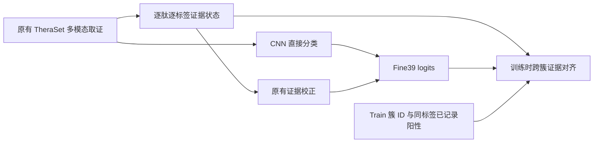

# XBridge-MFP

## 研究动机

2026-11-18 的 Fine39 科研审计中，TheraSet 的固定 0.50 Validation Jaccard 为 61.2704%，8,529 条里有 2,351 条零命中。距最近 Train 序列的全局编辑相似度低于 0.70 的 3,753 条样本贡献了约 55% 的总 Jaccard 缺口。审计中至少两轴和三轴的样本分别有 47.20% 和 27.64% 恢复了对应数量的已记录功能轴。XBridge 优先检验功能证据能否跨簇迁移，以及证据能否改善正确标签的排序。

## 实现与设计修订

1. **功能证据。** 保留冻结 ESM-650M 的残基信息，将其与 Peptide ESM-150M 及逐残基化学词嵌入融合。每个 Fine39 标签用自己的查询在有效残基上读出证据，输出 39 个独立 logit。缓存模式用于低成本对照。在线模式在 Peptide ESM 最后四层 Q/V 上启用 rank-8 LoRA，编码器其余参数固定。CLS、EOS 和 PAD 由同 revision 的 tokenizer 定义，读取证据时只使用有效残基。
2. **跨簇桥接。** 每个训练批可加入一个额外正例对，先选标签，再选两个不同簇，最后在簇内选行。全部原训练行仍遍历一次。损失在 batch 内同标签、不同簇的已记录正例对上计算 `max(0, 0.50 - cosine)²`，先对标签内正例对平均，再对参与标签平均。权重设为 0 时仍用同一配对采样，形成等曝光对照。独立分类监督、证据标准差和 margin 处于活跃区间的配对比例一起记录。正例桥接单项允许常量解，且同一功能可能有不同机制。
3. **逐轴覆盖。** 复用项目独立轴投影和泛抗微生物抑制规则，在每个已记录有效轴内对真实 Fine39 阳性 logits 做温度归一化的 log-mean-exp，再计算正例 softplus。逐样本均分各轴梯度。此项可能推动已经命中的功能分数继续增加，因此保留 `--xbridge-axis-weight 0.015` 供消融，默认权重为 0。基础监督复用项目 ASL，零位按未标注位处理。
4. **折外残差。** 单独训练和评估证据头后，可接入冻结 TheraSet。训练用三折簇折外 logits，推理用同一训练范围的全量参考，最终 `Z = U + R`。残差末层初值为零，参考固定为 eval 并以 FP32 前向。首步主损失更新残差末层，独立分类头为证据与 LoRA 提供梯度。推理使用已保存的参考权重和适配参数。折外与全量参考的置信分布仍可能不同。

模型在 `src/mfp_nova/models/xbridge.py`，采样在 `src/mfp_nova/xbridge_data.py`。训练和评估使用共有的 `mfp-nova` 入口。默认按固定 0.50 Jaccard 选模，附带 Macro-AP、样本 Precision/Coverage、独立轴 MFP-F1、零命中数、Top-1/Top-5 命中数和轴恢复数。残差运行还输出相同样本上的参考、辅助头及新增和丢失标签统计。

## 已完成的验证

- 在线模式使用真实 Peptide ESM checkpoint 和 Fine39 缓存，完成 24 条训练样本、24 条 Train 内留出样本的两轮 CPU FP32 探测，并从 `last.pt` 续训一轮。检查长度 2、10、22、74 的真实样本，LoRA 置零后对 FP16 缓存的有效残基平均绝对误差为 `2.07e-5`，最大为 `9.43e-4`。LoRA B 梯度非零，训练后保存的 B 权重也发生变化。检查点记录 LoRA 和证据头，冻结 ESM 从配置中的固定 revision 加载。
- 三个 Train 内嵌套簇折各跑一轮 TheraSet，导出折外 logits，再用独立的同范围参考跑完两轮 XBridge 残差。在线和残差检查点均已重载并验证无标签 NPZ 推理，重算分数与导出分数一致。单元测试覆盖残差初始等价、冻结参考、首步主／辅助梯度、padding、空配对和覆盖轴语义。短跑所用参考权重为诊断权重，历史 V100 参考归档提供了预测与元数据。
- Seed 42 的同预算消融各使用 768 条 Train 样本、768 条 Train 内簇留出样本（618 个簇）、6 轮和同一配对采样。各组第 5 轮的固定 0.50 指标如下。MFP-F1 指真实多轴样本上的独立轴功能预测 F1。

| 配置 | Jaccard | Precision | Coverage | MFP-F1 | 零命中 | 恢复 ≥2 轴 `/211` | 恢复 ≥3 轴 `/57` |
|---|---:|---:|---:|---:|---:|---:|---:|
| ASL，保留配对采样 | 24.51% | 25.95% | 67.57% | 54.27% | 202 | 107 | 11 |
| ASL + 桥接 | 24.81% | 26.29% | 67.27% | 53.46% | 202 | 103 | 9 |
| ASL + 逐轴覆盖 | 21.76% | 22.62% | 76.19% | 56.06% | 139 | 137 | 16 |
| ASL + 桥接 + 逐轴覆盖 | 21.86% | 22.73% | 76.44% | 56.03% | 139 | 140 | 16 |

桥接单项 Jaccard 差为 **+0.29 个百分点**，在这批样本上按簇配对重采样的描述区间为 −0.17 到 +0.76 个百分点。它未减少零命中，恢复两轴、三轴的条数略降。桥接与逐轴覆盖同时启用时，相对仅桥接增加了 119 个已记录命中位和 1,051 个未标注预测位。当前权重更适合保留为覆盖率消融。以上结果来自少量、按诊断规则抽样的内部样本，测量的是单次运行，正式 Fine39 指标和两台 GPU 的在线吞吐仍待测。

运行记录见 `runs/xbridge_asl_control_20261118_100737`、`runs/xbridge_axis_control_20261118_100403`、`runs/xbridge_cached_pair_ablation`、`runs/xbridge_cached_pair_probe`、`runs/xbridge_lora_smoke` 和 `runs/xbridge_oof_smoke_20261118_100538`。`best_validation.npz` 含原始 `row_id`、标签和簇 ID。内部划分的导出 `split` 为 `train_inner`。

## V100 全量 Fine39 结果 · Batch 256 · 2026-11-18

运行 `xbridge_fine39_online_b256_s42_20261118_111956/online` 使用提交 `2bcb589`、V100 16 GB、PyTorch 2.4.1+cu121、Transformers 4.44.2、seed 42、FP16，batch 256、累积 1。原 Train 39,455 条，Validation 8,529 条，跑满 60 轮，固定 0.50 Jaccard 选中第 51 轮。模型为独立在线 LoRA + 跨簇桥接，逐轴覆盖项权重为零。XBridge、TheraSet 和两种 V7 的导出均与本地 Fine39 的 Validation 行号、记录 ID、簇 ID、39 列顺序和标签逐项一致。以下比较都使用相同验证集和阈值。

| 模型 | Jaccard | Precision | Coverage | Macro-AP | Micro-AP | Micro-F1 | 完全集合匹配 |
|---|---:|---:|---:|---:|---:|---:|---:|
| XBridge 在线 b256，第 51 轮 | 43.58% | 46.38% | 65.35% | 38.72% | 54.21% | 51.85% | 22.20% |
| V7 structured | 47.48% | 50.33% | 61.33% | 42.25% | 52.93% | 53.16% | 30.67% |
| V7 flat | 49.80% | 53.04% | 63.74% | 46.03% | 59.60% | 55.88% | 32.72% |
| TheraSet V5 baseline，第 53 轮 EMA | 61.27% | 65.19% | 67.38% | 56.64% | 69.56% | 65.66% | 50.21% |

与 TheraSet 的 Jaccard 差为 −17.69 个百分点。按验证簇配对重采样 2,000 次，区间为 −19.41 到 −15.76 个百分点，条件为本次单 seed 训练和两个已选 checkpoint。与 V7 flat 相差 −6.22 个百分点。TheraSet 的 batch、精度、训练更新数、骨干、输入分支和训练配方均有区别，差距无法归因给任一单项。

### 训练过程

| 轮次 | Train Jaccard | Val Jaccard | Val Macro-AP | Val 分类损失 |
|---:|---:|---:|---:|---:|
| 1 | 24.08% | 26.44% | 22.17% | 0.02592 |
| 9 | — | — | — | **0.02129** |
| 14 | — | 37.30% | **40.78%** | — |
| 35 | 65.01% | 42.62% | 38.94% | 0.02894 |
| 51 | 71.20% | **43.58%** | 38.72% | 0.03271 |
| 60 | 72.18% | 42.82% | 38.70% | 0.03341 |

第 14 到 51 轮，固定阈值 Jaccard 增加 6.27 个百分点，样本 Precision 从 39.19% 升至 46.38%，Coverage 从 73.57% 降至 65.35%，Macro-AP 同期下降 2.05 个百分点。Micro-AP 在第 50 轮达到 54.33%。第 35–60 轮 Jaccard 均值 42.59%。曲线显示模型仍在学习更有选择性的输出集合，但各功能标签的平均排序早早达到平台。第 9 轮后验证分类损失走高，训练分类损失继续下降，第 60 轮 Train/Val Jaccard 差为 29.36 个百分点。Train 指标来自训练中逐批前向，包含额外桥接采样行。验证损失上升与训练拟合增强并存，继续同配置增加轮次缺少收益证据。

全程 6,684 秒（1.86 小时），9,360 次参数更新，无 AMP 跳步，峰值分配显存 3.90 GiB。每轮中位数 108.6 秒，训练段 83.8 秒，其中取数等待 42.6 秒，验证 21.2 秒。相对旧 b8 的单轮 499.5 秒，b256 的中位单轮约快 4.6 倍。b256 约 156 步/轮，旧 b8 × 8 约 822 步/轮，时间比较包含优化预算与正例采样频率的变化。第 51 轮小批次平均约有 8,000 个带标签的跨簇正例对，约 22% 仍低于 cosine margin。桥接加权损失约 `3.3e-5`，训练分类损失约 `6.44e-3`，证据标准差约 0.90。桥接确实参与了优化，损失量级和证据离散度无法衡量它对泛化的贡献，当前日志也没有各损失的梯度范数。

### 误差归因

- **多报是主要失分来源。** XBridge 命中 8,498 个记录位，过报 11,146 个未标注位，漏掉 4,637 个记录位。TheraSet 对应 8,705、4,677、4,430。每条平均预测 2.30 vs 1.57 个标签，记录均值为 1.54。净增 6,469 个未标注预测位中，Gram 阳性、Gram 阴性和泛抗微生物三个标签贡献 2,469 个。基于逐行 Jaccard 分两种顺序交换命中位和未标注预测位再取平均，未标注预测位差解释 −15.00 个百分点，命中位差解释 −2.70 个百分点。这是指标分解。数据库零位按未标注处理。
- **两者都已命中的样本也拉开了差距。** 5,235 条共同命中样本上，Jaccard 为 64.12% vs 85.76%，贡献约 −13.28 个百分点。5,638 条单记录细标签样本贡献 −13.82 个百分点，占整体差距约 78.1%。总体精确匹配从 4,282 条降至 1,893 条。
- **功能身份排序也偏弱。** Top-1 命中 4,894 vs 5,858 条，Top-5 命中 7,300 vs 7,566 条。39 个标签中 38 个 AP 下降。头部、中部、尾部 Macro-AP 为 48.62%、46.51%、28.12%，TheraSet 对应 63.70%、64.10%、48.23%。独立功能轴 Jaccard 为 49.89% vs 65.68%，把细标签折叠到功能轴后差距仍为 15.80 个百分点。新增未标注预测位中 5,386 个在观测功能家族之外，1,083 个在观测家族内。
- **低相似度未见簇尚无净增益。** 全长编辑相似度按最近 Train 序列取值。`<0.5`（957 条）、`[0.5, 0.7)`（2,796 条）、`[0.7, 0.8)`（2,165 条）、`[0.8, 0.9)`（2,611 条）的 Jaccard 分别为 29.39%、38.24%、42.50%、55.38%，TheraSet 为 39.20%、55.93%、61.70%、74.72%。最远组零命中少 17 条，Top-1 与 Top-5 仍低 8.67 和 6.69 个百分点。合并 `<0.7` 后，零命中多 36 条，Jaccard 低 15.68 个百分点。
- **多功能召回有局部改善，代价是判得更宽。** 相比 V7 flat，XBridge 多找回 27 条 ≥2 轴和 13 条 ≥3 轴样本；相比 TheraSet 分别少 40 和 21 条。≥2 轴恢复率为 45.30% vs 47.20%，≥3 轴为 22.92% vs 27.64%。独立多功能检测召回从 57.35% 升至 70.49%，精度却从 57.90% 降至 34.48%，检测 F1 降到 46.31%（TheraSet 57.63%）。有多轴记录样本上的功能预测 F1 为 59.73% vs 65.75%，与检测 F1 分开报告。

### 阈值与下一步决策

在同一 Validation 回看全局最佳阈值为 0.65，Jaccard 45.27%。按簇分五折拟阈值并交叉预测为 45.19%，零命中增加至 3,168 条。交叉拟合只约束本次阈值，模型已在完整 Validation 选中。用真实标签数取 Top-k 的诊断为 53.92%，用 TheraSet 的预测标签数为 49.35%。两项都说明预测数量有影响，但排序仍有缺口。

当前阈值下，XBridge 找回 782 条 TheraSet 的零命中，同时在 943 条基线命中样本上掉为零。392 条基线零命中样本的正确标签只进入 XBridge Top-5，显示候选有部分互补。固定阈值两输出取并集仅 47.95%，取交集 52.44%。互补候选是否能被折外验证的残差可靠选出仍是待检验假设。

保留第 51 轮权重与训练记录作为独立模型结果。若要决定是否保留桥接，优先在同一 Train 内簇留出、同 batch 和更新预算下比较在线桥接开关。若要提升主模型，优先保留 TheraSet 的表达能力，并针对同一批样本检查新增正确候选与新增未标注位，再决定是否投入三折残差训练。当前结果不足以支持继续加轮次或直接推进模型融合，也不能单独归咎于 LoRA、桥接或 batch 256。

分析脚本为 `scripts/analyze_xbridge_validation.py`。本地输出目录为 `runs/xbridge_b256_analysis_20261118_133219`，内有训练曲线、逐轮数据、39 类明细、相似度分层及配对统计。输入为 XBridge Validation 结果包、V5 baseline 归档、V7 归档及既有 Fine39 最近邻审计文件。

## 桥接开关对照

首轮在线对照使用原 Fine39 Train 的第 0 个内部簇折，31,564 条用于训练，7,891 条用于选模和诊断，拟合侧和留出侧簇交集为空。两组均用在线 LoRA、seed 42、batch 256、累积 1、FP16、固定阈值 0.50、20 轮共 2,500 个计划优化步。在运行目录生成配置，将 patience 设为 0。两组保留相同的跨簇额外正例抽样，桥接权重分别为 0 和 0.025，逐轴覆盖关闭。首轮以固定预算筛查，进入更多折或 seed 的依据是低相似度功能排序、Jaccard 和零命中的联合变化。

已完成一组本地缓存预检。Train 内部抽 1,536 条拟合、1,536 条簇留出，CPU FP32、batch 64、seed 42，各跑 10 轮、250 步。关／开桥接最佳 Jaccard 为 27.12%／26.82%，差 −0.30 个百分点，固定两权重的簇重采样描述区间为 −0.76 到 +0.20 个百分点。相同第 10 轮的差为 −0.33 个百分点。最优权重 Top-1 命中 656／672，零命中 370／375，未标注预测位 4,595／4,627。低相似度 `<0.7` 的 1,272 条里 Top-1 命中 540／555，Jaccard 26.37%／26.18%。小样本缓存预检支持检查排序与集合指标的分歧。运行结果见 `runs/xbridge_bridge_cpu_probe_20261118_133858/analysis/summary.json`。

### V100 在线对照结果

两组均使用提交 `2bcb589`、V100 16 GB、FP16、batch 256、seed 42。核对元数据后，配置只差桥接损失权重。拟合侧 31,564 条，Train 内留出侧 7,891 条、5,048 个簇。两组均跑满 20 轮、2,500 次实际更新，AMP 跳步为 0。逐行 ID、簇、39 列标签均与项目内部折匹配。以下为同一 0.50 阈值下按 Jaccard 选出的第 16 轮权重。

| 指标 | 关闭桥接 | 开启桥接 | 开启减关闭 |
|---|---:|---:|---:|
| 样本 Jaccard | 35.9937% | 35.9738% | −0.01996 pp |
| 样本 Precision | 37.8199% | 37.8253% | +0.0054 pp |
| Coverage | 74.5410% | 73.0870% | −1.4540 pp |
| Macro-AP | 38.0833% | 38.5882% | +0.5049 pp |
| Micro-AP | 51.6787% | 51.6334% | −0.0453 pp |
| Micro-F1 | 46.4043% | 46.3431% | −0.0612 pp |
| Top-1 命中 | 4,289 | 4,272 | −17 |
| Top-5 命中 | 6,797 | 6,808 | +11 |
| 零命中 | 1,577 | 1,695 | +118 |
| 完全集合匹配 | 708 | 743 | +35 |
| 已记录命中位 | 9,450 | 9,324 | −126 |
| 未标注预测位 | 18,600 | 18,236 | −364 |
| 至少恢复两轴（2,101 条） | 1,247 | 1,242 | −5 |
| 至少恢复三轴（520 条） | 183 | 178 | −5 |
| 已记录多轴样本上的功能预测 F1 | 62.67% | 62.75% | +0.09 pp |

同轮次看，开桥接在 20 轮中有 15 轮 Jaccard 略高，轮均差 +0.080 个百分点。第 20 轮为 35.87%／35.92%。第 16 轮选中权重的 Jaccard 配对簇重采样区间为 −0.566 到 +0.431 个百分点。开桥接的验证分类损失在第 10–20 轮始终更低，第 16 轮为 0.02411，关闭组为 0.02478。第 16 轮有 27 个标签 AP 上升、12 个下降。排名改进主要体现在逐标签指标，整体 Micro-AP 和按样本 Top-1 几乎持平。开桥接训练了 31.02 分钟，关闭组 29.35 分钟。两组峰值约 3.90 GiB，单对运行时差也包含机器负载与取数波动。

| 最近拟合侧序列的全长编辑相似度 | 样本数 | 关闭 Jaccard | 开启 Jaccard | 开启后 Top-1 净变化 | 开启后零命中净变化 |
|---|---:|---:|---:|---:|---:|
| <0.50 | 1,078 | 27.15% | 27.22% | −8 | +11 |
| [0.50, 0.70) | 2,422 | 33.09% | 33.42% | +9 | +4 |
| 合计 <0.70 | 3,500 | 31.26% | 31.51% | +1 | +15 |
| ≥0.70 | 4,391 | 39.77% | 39.53% | −18 | +103 |

零命中转移为救回 63 条、丢失 181 条，净增 118 条。546 条的簇 `572` 贡献其中 81 条，该簇有 526 条记录 `antimicrobial__unknown`，该标签在全留出集净少 82 个已记录命中位。去掉该簇做影响诊断，Jaccard 差由 −0.02 变为 +0.24 个百分点，零命中仍净增 37 条。保留原协议的主结果。低相似度合计 Jaccard 增益 +0.251 个百分点，配对簇区间 −0.069 到 +0.584 个百分点，Top-1 只多 1 条。结果不足以把对应变化归为可复现的跨簇迁移收益。

第 16 轮减少未标注预测位对 Jaccard 的贡献约 +0.415 个百分点，失去已记录命中位的贡献约 −0.435 个百分点，两者抵消。同一内部留出上对两组各做五折簇交叉阈值拟合，Jaccard 为 42.53%／41.94%，零命中为 2,880／2,938 条。阈值诊断复用了已经选中 checkpoint 的内部留出集，不能当作独立泛化成绩。

**研究决策。** 后续主线优先采用关闭桥接作为工作对照，保留原配置以便复现。V100 对照支持桥接在本折上有小幅 Macro-AP 收益，但 Jaccard、低相似度 Top-1、零命中和多轴恢复没有形成联合增益。暂缓扫桥接系数及完整 TheraSet 三折残差。若继续投入算力，优先保持相同 batch、物化输入与更新预算，在同一 Train 内折对照缓存／在线 LoRA，检验新增表征是否能改善功能身份识别。当前证据限于单折、单 seed、20 轮日程，不能外推到完整 60 轮或其他桥接实现。

结果位于 `runs/xbridge_bridge_analysis_20261118_145823/`，含 `summary.json`、`label_deltas.csv`、逐样本记录和 `bridge_training_curves.png`。本次未读取 Test。

**V100 · Ubuntu Bash**

```bash
(
  set -e
  cd "$HOME/wuzhencheng/projects/MFP-Nova"
  source "$(conda info --base)/etc/profile.d/conda.sh"
  conda activate MFP-Nova
  train_python="$CONDA_PREFIX/bin/python"
  gpu=4
  cpu_threads=4

  export CUDA_VISIBLE_DEVICES="$gpu" PYTHONPATH="$PWD/src"
  export OMP_NUM_THREADS="$cpu_threads" MKL_NUM_THREADS="$cpu_threads"
  "$train_python" -c 'import sys, torch; print(sys.executable, torch.__version__); sys.exit("CUDA unavailable") if not torch.cuda.is_available() else print(torch.cuda.get_device_name(0))'

  run="xbridge_bridge_inner0_b256_s42_$(date +%Y%m%d_%H%M%S)"
  mkdir -p "runs/$run"
  "$train_python" - "runs/$run/config.yaml" <<'PY'
import sys
from pathlib import Path

import yaml

config = yaml.safe_load(Path("configs/xbridge.yaml").read_text())
config["train"]["patience"] = 0
Path(sys.argv[1]).write_text(yaml.safe_dump(config))
PY

  nohup bash -c '
    set -euo pipefail
    train_python=$1
    run=$2
    for arm in bridge_off bridge_on; do
      weight=0
      if [ "$arm" = bridge_on ]; then weight=0.025; fi
      "$train_python" -u -m mfp_nova.cli train \
        --config "runs/$run/config.yaml" --model xbridge --task fine39 \
        --xbridge-online --xbridge-inner-fold 0 --seed 42 \
        --device cuda:0 --precision fp16 --batch-size 256 --accumulation-steps 1 \
        --num-workers 0 --epochs 20 --metric-suite jaccard \
        --xbridge-bridge-weight "$weight" --xbridge-axis-weight 0 \
        --name "$run/$arm" 2>&1 | tee "runs/$run/$arm.log"
    done
  ' bash "$train_python" "$run" >"runs/$run/queue.log" 2>&1 </dev/null &

  printf 'PID=%s\n输出目录=%s/runs/%s\n' "$!" "$PWD" "$run"
  tail -n 40 -F "runs/$run/queue.log"
)
```

**RTX 5070 · Windows PowerShell**

```powershell
Set-Location 'D:/Data/Code/MFP-Nova'
conda activate MFP-Nova
$env:OMP_NUM_THREADS = '4'
$env:MKL_NUM_THREADS = '4'
$env:PYTHONPATH = (Resolve-Path src).Path
$run = "xbridge_bridge_inner0_b256_s42_$(Get-Date -Format yyyyMMdd_HHmmss)"
New-Item -ItemType Directory -Path "runs/$run" | Out-Null
@'
import sys
from pathlib import Path
import yaml
config = yaml.safe_load(Path("configs/xbridge.yaml").read_text())
config["train"]["patience"] = 0
Path(sys.argv[1]).write_text(yaml.safe_dump(config))
'@ | python - "runs/$run/config.yaml"
if ($LASTEXITCODE -ne 0) { throw 'Failed to prepare XBridge config' }
foreach ($arm in 'bridge_off', 'bridge_on') {
  $weight = if ($arm -eq 'bridge_on') { '0.025' } else { '0' }
  python -u -m mfp_nova.cli train `
    --config "runs/$run/config.yaml" --model xbridge --task fine39 `
    --xbridge-online --xbridge-inner-fold 0 --seed 42 `
    --device cuda:0 --precision fp16 --batch-size 256 --accumulation-steps 1 `
    --num-workers 0 --epochs 20 --metric-suite jaccard `
    --xbridge-bridge-weight $weight --xbridge-axis-weight 0 `
    --name "$run/$arm" 2>&1 | Tee-Object -FilePath "runs/$run/$arm.log"
  if ($LASTEXITCODE -ne 0) { throw "XBridge training failed for $arm" }
}
```

两组结束后在项目目录打包。Bash 和 PowerShell 均可执行以下命令。

```bash
tar -czf "runs/$run/bridge_comparison.tar.gz" -C "runs/$run" bridge_off/results.json bridge_off/metadata.json bridge_off/history.jsonl bridge_off/best_validation.npz bridge_on/results.json bridge_on/metadata.json bridge_on/history.jsonl bridge_on/best_validation.npz
```

将结果包传回本地后，用 `python scripts/analyze_xbridge_validation.py --bridge-pair <结果包或运行根目录>` 复用同一比较。脚本只在分析端需要 RapidFuzz，用于按实际拟合序列计算每条内部留出肽的最近 Train 全长编辑相似度。汇总包含两模型的 Jaccard、零命中、Top-1、Top-5 和多轴恢复统计，并单独记录 AMP 跳步后的实际优化步数。配对簇区间受选模和单 seed 限制。

## TheraSet-Bridge 跨簇融合设计

### 融合位置

独立模型入口为 `--model theraset_bridge`，源码为 `src/mfp_nova/models/theraset_bridge.py`，默认配置为 `configs/theraset_bridge.yaml`。训练日志、结果和检查点均使用 `theraset_bridge` 模型标识。该模型复用相同 Fine39 原始 Validation 上达到 61.27% 的 TheraSet V5 baseline 骨干，保留 CNN 直接分类、双 ESM 缓存、结构与理化输入、残基对读取和原有证据校正。历史基线的 `prototype_readout` 和 `label_context` 均关闭。桥接只在训练时对逐标签 `evidence_state` 增加辅助项。默认使用双缓存、原主损失、R-Drop 和 EMA。原 TheraSet 仍通过 `--model theraset --v5-mode baseline` 运行。



XBridge 的在线等预算对照里，开桥接只带来 +0.50 个百分点 Macro-AP，Jaccard 持平，零命中净增 118 条，其中 81 条来自簇 572。该簇的现象说明报告需要同时看到按样本指标和大簇影响。它不足以判断拟合侧大簇采样是直接成因。

### 从跨簇配对到定向证据迁移

1. **按标签与簇对均衡。** 对原 Train 内参与拟合的小批次，仅在同一个已记录 Fine39 标签的正例行之间构造候选。要求两行的簇 ID 不同。先在每个有有效配对的标签内，按**无序簇对**聚合，再对有有效配对的簇对和标签等权平均。这样同一簇对在一个批次中有 20 对行或只有 1 对行，仍只贡献一个簇对的权重。保留相同采样可用于对照。若首轮沿用已有的每批额外抽样一对，两臂都启用，抽样只在拟合侧。可用簇对数量、每标签覆盖和有效配对比例在分析时分别报告。
2. **锚点和待补足样本承担不同角色。** 配对双方均有同一个 Fine39 记录阳性。锚点在两次 R-Drop 前向中最终 logit 都 ≥0，且证据 logit 都高于 Train 先验。接收端在两次前向中最终 logit 都 <0。R-Drop 未启用时使用同一次前向。分组分数与梯度图分离。这样先利用现有训练视图排除单次 dropout 导致的分数翻转。这个筛选只表示训练模型的置信状态，不能证明两条肽存在相同作用机制。
3. **对已确认记录的功能做有下限的单向对齐。** 用归一化的锚点证据作为停止梯度的目标。待补足端仅在余弦小于 0.50 时受损失约束。锚点仍通过原分类项训练。只在同一个精确记录位上对齐，同家族不同细标签及 `__unknown` 与细亚类之间不自动配对。共享参数仍可能间接影响锚点和其他样本，所以必须持续观察验证 Precision、零命中和大簇的误差。

令 `e[i,c]` 为 TheraSet 的标签证据，`z[i,c]` 为最终 logit，`v[i,c]` 为证据分支 logit，`b[c]` 为训练先验 logit。对于符合锚点条件的 `j` 和待补足的 `i`，

```text
s(i, j, c) = cosine(e[i, c], stop_gradient(e[j, c]))
pair_loss  = max(0, margin - s(i, j, c))²
bridge     = mean_label(mean_cluster_pair(mean_eligible_row_pair(pair_loss)))
total      = original_theraset_loss + lambda(epoch) * bridge
```

实现沿用同一小批次的两遍前向，无需额外执行教师模型。几何项只对第一遍的证据向量求梯度。实际加入了一项与分类器一致的方向检查。历史强基线使用单个有效原型，证据分数为 `b[c] + w[c]·e[i,c]`。记接收端单位向量为 `u`，锚点单位向量为 `v`。余弦向上对接收端证据的梯度正比于 `v - (u·v)u`。要求它与分类器方向 `w[c]` 内积为正，才允许对齐。这约束了单个配对在证据向量空间对本标签分数的一阶作用。最终输出还有 CNN 和校正门，实际参数更新会同时作用于多行多标签，验证仍需直接检查最终得分和错误。

首版以 `margin=0.50`、`lambda=0.025` 为与历史可比的起点，桥接从现有 5 轮学习率 warmup 结束后开始，再用 5 轮线性升至目标权重。有效簇对为空时本项为零。训练中的 `evidence_logits` 仍接受原有分类监督。配对用 FP32 计算，前向模型仍可采用原有精度。

余弦项不能保证正例 logit 上升。即使分类器简化为 `w=(1,0,0)`，正例向量 `(1,1,0)` 和 `(0.1,0.2,1)` 的 logit 都为正，纯对称余弦对齐的下降方向仍会降低第一个 logit。停止锚点梯度只是切断这条配对对锚点表示的直接作用。联合训练的结果以原分类指标检验。

### 配对规模与大簇

按 seed 42 的首次原配对采样，从内折 0 的 31,564 条拟合样本重放一轮。batch 64 的中位为 468 个行对／标签（对标签求和的总对数），每批覆盖中位 14 个标签；batch 256 对应 7,756 对、24 个标签。39 个标签在拟合侧均有至少 39 个已记录阳性簇。大规模行对无需形成新训练输入，但将所有行对直接平均仍会加重常见簇的参与。以 `antimicrobial__unknown` 为例，拟合侧 7,047 个记录阳性散在 4,191 个簇，最大阳性簇含 260 条。对完整拟合池的全部合格行对计数，该簇参与约 7.15%；均匀抽两个阳性簇时，参与约 0.05%。两个比例描述不同采样分布，实际小批次占比应从日志观察。定向筛选会进一步降低覆盖，需分别记录有不同簇的阳性候选数、通过锚点筛选的有效簇对数、以及低于 margin 且产生非零损失的有效簇对数。若一类标签很少获得锚点，先看筛选前后计数与置信分布。

### 首轮实验

用原 Train 产生第 0 个内部簇留出和相同的拟合数据。对照组和定向桥接组从同一个仅使用拟合侧的 TheraSet 初始化开始，可以统一从随机初始化训练。两组共用 batch 64、固定更新预算、同 seed、相同配对采样、R-Drop、EMA、优化器和固定阈值 0.50。20 轮可做首轮筛查，由同一协议选模并补充同轮次比较。已在全量 Train 上训练的 61.27% checkpoint 仅用于最终原始 Validation 的历史参照。它包含内部留出簇的训练信息，不能作为内折实验起点。

独立入口支持 `--theraset-bridge off|align|positive`，默认为 `align`。三组均使用相同的跨簇正例采样器。`positive` 使用相同的动态筛选、方向条件、margin 和簇对归一化，把对齐项替换为接收端证据 logit 的正例 `softplus(-logit)`，对辅助项的分类器权重停止梯度，使其与对齐项使用同一个梯度入口。每批先计算两项对证据状态的梯度范数，再把正例项乘以停止梯度的范数比。这样同一模型状态、同一批样本上的两种辅助作用具有相同的证据层梯度预算。不同训练轨迹可能改变随后的配对与梯度量级。

先看低相似度组的 Top-1、零命中救回数减新增数，以及相同 Precision 下的额外命中。辅以整体 Jaccard、二轴／三轴恢复、每标签 AP 和簇配对差。大簇影响报告为补充分析，完整留出始终参与主评分。若在其他折和 seed 上有一致收益，再按原 Fine39 Train/Validation 协议做正式比较，最后评价 Test。

### 文献对应关系

- **AMCL（2025）** 在多功能肽预测中按标签集合相似度筛选对比样本，并加入难正例和半难负例。Fine39 的 0 位是未标注，尤其在 `__unknown` 存在时，记录集合不同也可能有共享活性。本实现将对齐粒度设为已记录的单个 Fine39 标签，配对只提供正例监督。原分类目标继续使用项目的弱负项。 [AMCL](https://doi.org/10.1186/s12915-025-02273-0) · [Class-Aware Selective Loss](https://openaccess.thecvf.com/content/CVPR2022/html/Ben-Baruch_Multi-Label_Classification_With_Partial_Annotations_Using_Class-Aware_Selective_Loss_CVPR_2022_paper.html)
- **ProtDML（2026）** 用标签感知的距离度量调整蛋白表征，包括类内聚合和类间分离。Fine39 这里复用已有的逐标签证据空间，并以证据分类器方向筛选迁移对。是否提高未见簇功能识别由配对消融确定。 [ProtDML](https://doi.org/10.1093/bib/bbag293)
- **MatchDG** 把可匹配对象的跨域一致性与整个类别的表示对齐区分开。Fine39 只知道两条肽共享一个记录标签，因此本实现采用证据层、按模型置信状态定向、达到 margin 即停止的弱约束。模型置信筛选有自强化风险，后续可用冻结特征筛选做独立比较，首轮通过筛选计数和同规则正例对照检验。 [MatchDG](https://proceedings.mlr.press/v139/mahajan21b.html)
- **ProteinScore（2026）** 以结构子图保留功能相关证据，并单独检验低同源蛋白。这里据此保留 TheraSet 的局部取证和低相似度专项评估。论文的蛋白结构任务对短肽和不完整记录标签仅提供设计动机。DataSAIL 同样强调在簇隔离后评价泛化，项目现有划分继续作为评价基础。 [ProteinScore](https://pmc.ncbi.nlm.nih.gov/articles/PMC13200542/) · [DataSAIL](https://www.nature.com/articles/s41467-025-58606-8)
- **VICReg** 说明单靠表示相似会有坍塌风险。本实现复用 TheraSet 原有证据分类监督，记录每标签证据跨样本的平均标准差。其数值只作诊断。 [VICReg](https://arxiv.org/abs/2105.04906)

### 启动 TheraSet 跨簇对照

验证记录。27 项 TheraSet、XBridge 和 EMA 相关测试通过，随后重跑了证据层梯度匹配与簇对归一化的两个专项测试。真实双缓存的 120 条拟合／120 条留出短跑验证了 R-Drop、EMA、跨簇对齐、续训和同阈值导出。关闭与对齐两组都选中了桥接尚未开启的第 5 轮，不能据此推断正式性能。另从诊断权重对真实拟合侧的三个 64 条批次做梯度探针。每批先得到 292–458 个已记录候选对，筛出 38–93 个有利方向的跨簇对，约 25.8%–29.5% 低于 margin。在最后一层解码器 FF 权重上，标称 `0.025` 的原始对齐梯度约为主分类梯度的 3.8%–10.5%，未做尺度匹配的正例对照则达到 191%–508%。加入证据层梯度匹配后，复测真实 batch 64 的 88 个有效对，两种辅助目标对证据状态的梯度范数均为 0.003312。另用真实缓存跑通了正例对照三轮短训，其中有效对均已达到 margin，因此该短训的辅助项为零。这几个批次只用于验证目标与梯度的量级。

以下三组共用 `configs/theraset_bridge.yaml`，20 轮、batch 64、累积 1、FP32、seed 42、内折 0，使用冻结双 ESM 缓存。服务器先同步含该入口的代码。

独立入口已用 64 条拟合样本和 64 条内部留出样本跑通两轮 CPU 短训。结果、`best.pt` 和 `last.pt` 均标记为 `theraset_bridge`，两个检查点均可重载。上段的初版探针是在分离入口之前运行，保留其历史 `theraset` 标识。新入口的短训已执行配对筛选，所筛配对均达到 margin，辅助损失为零。

**V100 · Ubuntu**

```bash
(
  set -e
  cd "$HOME/wuzhencheng/projects/MFP-Nova"
  source "$(conda info --base)/etc/profile.d/conda.sh"
  conda activate MFP-Nova
  git pull --ff-only origin main
  py="$CONDA_PREFIX/bin/python"
  gpu=4
  threads=4
  run="theraset_bridge_inner0_b64_s42_$(date +%Y%m%d_%H%M%S)"
  mkdir -p "runs/$run"
  nohup env CUDA_VISIBLE_DEVICES="$gpu" OMP_NUM_THREADS="$threads" MKL_NUM_THREADS="$threads" PYTHONPATH="$PWD/src" \
    bash -c '
      set -euo pipefail
      py=$1
      run=$2
      for arm in off align positive; do
        "$py" -u -m mfp_nova.cli train --model theraset_bridge \
          --theraset-bridge "$arm" --xbridge-inner-fold 0 --task fine39 --seed 42 \
          --device cuda:0 --precision fp32 --batch-size 64 --accumulation-steps 1 \
          --epochs 20 --name "$run/bridge_$arm" 2>&1 | tee "runs/$run/bridge_$arm.log"
      done
    ' bash "$py" "$run" >"runs/$run/queue.log" 2>&1 </dev/null &
  printf 'PID=%s\n输出目录=%s/runs/%s\n' "$!" "$PWD" "$run"
  tail -n 40 -F "runs/$run/queue.log"
)
```

**RTX 5070 · PowerShell**

```powershell
Set-Location 'D:/Data/Code/MFP-Nova'
conda activate MFP-Nova
git pull --ff-only origin main
if ($LASTEXITCODE -ne 0) { throw 'Git sync failed' }
$py = Join-Path $env:CONDA_PREFIX 'python.exe'
$env:OMP_NUM_THREADS = '4'
$env:MKL_NUM_THREADS = '4'
$env:PYTHONPATH = (Resolve-Path src).Path
$run = "theraset_bridge_inner0_b64_s42_$(Get-Date -Format yyyyMMdd_HHmmss)"
New-Item -ItemType Directory -Path "runs/$run" | Out-Null
foreach ($arm in 'off', 'align', 'positive') {
  & $py -u -m mfp_nova.cli train --model theraset_bridge `
    --theraset-bridge $arm --xbridge-inner-fold 0 --task fine39 --seed 42 `
    --device cuda:0 --precision fp32 --batch-size 64 --accumulation-steps 1 `
    --epochs 20 --name "$run/bridge_$arm" 2>&1 | Tee-Object -FilePath "runs/$run/bridge_$arm.log"
  if ($LASTEXITCODE -ne 0) { throw "TheraSet training failed for $arm" }
}
```

回传三组的 `results.json`、`metadata.json`、`history.jsonl` 和 `best_validation.npz`，保留 `bridge_off`、`bridge_align`、`bridge_positive` 子目录。分析端可使用 `scripts/analyze_xbridge_validation.py --bridge-pair <运行目录或归档> --bridge-arm align`，用 `--bridge-arm positive` 复算正例控制。

## 单模型训练命令

先在 `--xbridge-inner-fold 0` 下固定 seed、样本、阈值和训练预算，比较缓存与在线 LoRA。每种表征同时跑默认桥接权重和 `--xbridge-bridge-weight 0`，用独立证据头的 Top-1/Top-5、零命中及 Jaccard 判断增量。以下命令在真实数据上跑两轮短训练，检查单卡资源和数值。正式内部对照移除 `--limit-samples 128 --max-steps 16 --epochs 2`，保持两组相同配置。缓存对照省略 `--xbridge-online`。

**RTX 5070 · PowerShell**

```powershell
$env:OMP_NUM_THREADS = '4'
$env:MKL_NUM_THREADS = '4'
$run = "xbridge_inner0_s42_$(Get-Date -Format yyyyMMdd_HHmmss)"
New-Item -ItemType Directory -Path "runs/$run" | Out-Null
mfp-nova train --model xbridge --xbridge-online --xbridge-inner-fold 0 --seed 42 `
  --device cuda:0 --precision fp16 --batch-size 8 --accumulation-steps 8 `
  --limit-samples 128 --max-steps 16 --epochs 2 --name "$run/online" 2>&1 |
  Tee-Object -FilePath "runs/$run/online.log"
```

**V100 · Ubuntu Bash**

```bash
run="xbridge_inner0_s42_$(date +%Y%m%d_%H%M%S)"
mkdir -p "runs/$run"
nohup env CUDA_VISIBLE_DEVICES=0 OMP_NUM_THREADS=4 MKL_NUM_THREADS=4 \
  mfp-nova train --model xbridge --xbridge-online --xbridge-inner-fold 0 --seed 42 \
  --device cuda:0 --precision fp16 --batch-size 8 --accumulation-steps 8 \
  --limit-samples 128 --max-steps 16 --epochs 2 --name "$run/online" \
  >"runs/$run/online.log" 2>&1 </dev/null &
echo "PID=$!  runs/$run/online.log"
```

证据头具备互补排序后，再用 `--model theraset --task fine39 --hh-oof-fold 0/1/2`（每折单独启动）生成三个 `oof_logits.npz`。全训练范围的参考使用同范围 TheraSet V5 baseline 的 `best.pt`。内部对照时，三折教师、参考和 XBridge 都带同一个 `--xbridge-inner-fold 0`。给 XBridge 同时传入 `--xbridge-reference <best.pt>` 和 `--xbridge-oof <fold0.npz> <fold1.npz> <fold2.npz>`。折内训练采用固定轮数，预测折只用于导出分数。对相同留出行比较参考、辅助头和残差总分，优先看低相似度、零命中净恢复和多轴恢复的变化。

转入原始 Fine39 协议时从所有训练命令去掉 `--xbridge-inner-fold`，使用原 Train 范围的折外参考文件。Validation 选模，Test 用于最终评价。`mfp-nova evaluate --checkpoint <best.pt> --split val --output <validation.json> --predictions <validation.npz>` 导出带逐行信息的验证结果。续训用 `--model xbridge --resume <last.pt>`，复用保存的训练范围和 OOF 输入。预测入口 `mfp-nova predict --checkpoint <best.pt>` 支持项目已有的序列或预处理 NPZ 输入。
